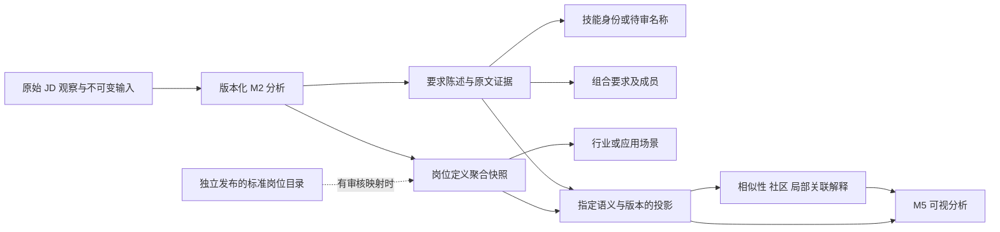

# M2 → M3 → M5 候选契约 v0.1

日期：2026-10-18；**研究草案，未批准为正式接口或存储模型，未实施迁移**。
依据：[产品决策](../../PRODUCT_DECISIONS.md) M2-25～40、M2-48～60 与第 7 节，现有 [B2 数据结构](../../../backend/app/job_analysis/semantics/models.py) 及 [旧图投影](../../../backend/app/integration/rebuild_m2_graph.py)。字段选择由本研究提出，不将它们写成产品已确认规则。

## 1. 实体、断言和计算层



| 实体/数据 | 候选身份和语义 | 关系约束 |
|---|---|---|
| JobDefinition | `job_definition:<M2稳定ID>`，结构化岗位聚合/定义；不是原始 JD、独立职位或标准岗位 | `SUPPORTED_BY` 指向输入/分析；映射标准岗位必须有独立依据，不能从标题直接生成 |
| StandardJob | `standard_job:<published_catalog_id>`，须存在于指定 release 的正式条目 | `CLASSIFIED_AS`/主辅角色关系另带审核和映射版本；当前正式 release=0，不产出此类型节点 |
| JobFamily / Direction / Level | 分别带值集/版本，互不代替；可 unknown/unresolved | 只有证据支持才关联；辅助分类不重复计入招聘总数；本轮未实现此投影 |
| Skill | `skill:<版本化词典稳定ID>`；可验证同义归一，不自动合并上下位/版本/相关技术 | 名称与显示语言不是身份；新词未正式准入可为 `candidate_skill:<id>`，不伪装 canonical |
| Industry | 经审核的行业分类值；旧 Industry 不自动等于它 | `IN_INDUSTRY` 需要有来源；不能用自由场景文本生成正式行业分类 |
| Scenario | 有证据的应用/业务场景；没有词表时保留 namespace + 原始文本身份 | `APPLIES_IN` 指向场景，原文名称和来源保留；不能靠相似布局推断上下位 |
| RequirementStatement | M2 单条 JD 的陈述、条件/对象/程度/组合与五态，不是岗位聚合边的布尔属性 | `ASSERTS_ABOUT` 指向技能，`MEMBER_OF` 指向组合；聚合不改变原陈述 |
| Evidence / Observation | 不可变输入、来源、时间、字段位置；分析状态与原始观察分开 | 精确定位 statement；无原文时标 unavailable，不能生成“已验证原文” |
| Similarity / Community / Layout | 输入投影、算法、参数、版本绑定的派生结果 | 独立 overlay；不是岗位事实、正式职业类别或真实用户确认 |

正式技能 ID 长期优先复用治理后的稳定 ID；百分号名称键只作 #21 的历史兼容身份方案。是否将 Skill/RequirementStatement/Evidence 均持久化为 Neo4j 节点，还是采用外部证据索引 + 轻量图节点，留到隔离性能/查询试验后决定；契约不要求本轮建表。

## 2. 版本头与来源清单

候选 envelope 使用独立 `schema_version=m3-research-contract-draft-0.1`；不能冒充现有 graph.json schema。建议字段：

| 字段 | 类型/要求 |
|---|---|
| `artifact_kind` | `fact_projection` / `derived_overlay` / `layout_overlay`，不得混用 |
| `snapshot_id` / `snapshot_sha256` | 业务命名及完整输入摘要，不使用生成时间作为唯一身份 |
| `source_manifests[]` | dataset_namespace、artifact_path、artifact_sha256、schema_version；路径须为允许公开/授权访问的相对引用，不输出本机密钥或私有绝对路径 |
| `analysis_versions` | M2 输入指纹、提取规则/模型依赖、技能治理、职责分类分别引用实际版本；未知写 null + 原因，不填推测版本 |
| `aggregation_version` | 聚合规则版本，独立于单条分析版本；只改聚合不声称重新观察或重调模型 |
| `identity_version` | 实体 ID/别名映射算法及词典/发布目录版本 |
| `projection_version` | 状态纳入、边聚合、方向、去重与缺失策略的完整规则摘要 |
| `generated_at` | 产物生成时间；不得代替 collected_at/observed_at/evidence_time |
| `coverage` | 输入总量、完成量、部分事实量、失败/未验证量、范围与限制；不能冒充市场分母 |
| `nodes` / `assertions` / `edges` | 明确事实来源和边语义；空数组允许，不能以默认数据补齐 |

旧快照可以填写其真实文件 SHA，analysis_version/原始来源 JD 不可恢复时必须 unavailable。历史快照和新 M2 事实不能仅用相同岗位名 join。

## 3. 五态、历史状态、冲突与组合

使用判别字段 `semantic_origin`，不同分支必须有不同的校验规则：

```text
semantic_origin = m2_statement_v2:
  state ∈ required | preferred | mentioned | not_required | uncertain
  statement_id、analysis_attempt_id、evidence_ref 必填
  semantic_validation、coverage、requirement_object、target、condition、degree 分开
  conflict: boolean；conflict_statement_ids: string[]
  group_ref: string|null；member_role: standalone|any_of_member|all_of_member

semantic_origin = legacy_snapshot:
  state = null（不声称新版五态）
  legacy_state ∈ legacy_required | legacy_bonus | legacy_conflict
  legacy_is_required: boolean|null
  legacy_weight: number|null（只保留旧值，不当新版要求强度）
  status_conflict、needs_review、source_occurrences[] 必填
  evidence_availability = snapshot_only | original_detail_available
```

历史 bool=true/false 只能进入 legacy 分支；false 不是 mentioned/not_required，也不能默认映射 preferred。旧快照未提及不产生否定边。新分析执行失败、不完整、未验证和陈述的 uncertain 分别表达；失败不生成伪 uncertain 陈述。

M2 原陈述和 effective 结果分别保存。只有 requirement_object、程度、条件、主体及作用对象可比时才做冲突解析；无明确修订依据的同一可比对象冲突可形成新五态 uncertain + conflict=true，但保留全部原陈述。历史 required/bonus 聚合冲突是另一类冲突，不借用该结论。

组合示例：**“Java 或 Python 至少掌握一种”**保存一个 required / any_of 组合，两个成员有 group membership，不能生成两个 standalone required。`all_of` 与 `any_of` 的组状态、各成员独立陈述、statement_ids/group_ids 分开；复杂嵌套未可靠解析时保留原文和问题原因，不强建树。程度与工作年限不互换。

不采用单个 required_rate 权重覆盖五态；若未来需要岗位聚合统计，应另附明确的统计范围、独立职位资格、分母、冲突/不确定数和聚合版本。当前岗位定义存在集合的 Jaccard 不提供这些统计条件。

## 4. 来源定位与索引

新事实 `evidence_ref` 建议直接兼容 M2 的 namespace / jd_id / fingerprint / field / start / end / quote，补齐 source_manifest、analysis_attempt_id / statement_id。start/end 为原字段字符串上的半开区间、单位明确为 Unicode code point；M5 若以 JavaScript UTF-16 截取必须适配，不能直接复用索引。quote 必须与输入摘要绑定的原字段相符；结构校验不等于人类语义确认。

历史投影 `source_occurrences[]` 建议为对象数组，替代平行数组错位风险：

```json
{
  "source_artifact_sha256": "<真实快照摘要>",
  "source_entity_id": "<原 job ID>",
  "field": "required_skills",
  "source_row_index": -1,
  "source_index": 2,
  "raw_name": "<原数组内容>",
  "legacy_state": "legacy_required"
}
```

以上是类型示意，占位内容不是有效证据。数组位置只定位原文件，不声称原始 JD 字符位置；同名、多次出现和不同来源都保留。需要 detail 时必须同时定位 skill_rows 的行及其 skills 下标，不能用过滤后的序号替代原下标。新模型可另附输入数组的 JSON Pointer，但必须说明根节点结构和 schema。

## 5. M3 → M5 只读候选接口

候选命名为 `/api/graph/v2/*`，保留 V1 并需另获实施授权；不是本轮已实现接口。

| 产物/操作 | 最低返回字段 |
|---|---|
| `manifest` | 版本头、输入摘要、可用事实/算法层、能力限制、正式目录版本、结果状态 |
| `nodes` / `neighborhood` | id、entity_kind、label、identity_status、source_ref；分页/过滤条件、visible_count、total_count、truncated、reason |
| `edges` | id、source、target、relation_kind、origin=fact_association/derived、assertion_refs、nullable 状态、证据引用、version_ref；JSON 数组明确解码 |
| `similarity` | 输入投影/算法版本、完整参数、score、shared_entity_ids、支持关联边引用、候选覆盖范围；非业务概率 |
| `communities` | run_id、method/objective/resolution/seed、partition_hash、成员/规模、连通性/孤点、未参与原因；semantic_label=null 允许 |
| `explain-connection` | source/target、max_hops、allowed_relations、node_ids、逐跳 edge_ref、traversed_reverse、found/not_found/truncated、解释限制；不得以 no_path 宣称任何范围内绝对无联系 |
| `resolve-legacy-id` | 输入 namespace/旧ID/上下文；resolved/ambiguous/unavailable 与候选列表；一对多时不得自动选第一个 |
| `layout` | graph/partition/layout version、坐标维度、可见层和 proxy_of；不包含装饰粒子到 nodes 的隐式合并 |

统一外层继续 `{code,message,data}`，code=0 仅表示请求成功；结果自身另有 `status=available/partial/unavailable/failed`，不得把服务成功冒充分析成功。数值 null 保留，不填 0；技能未知类型保留待复核，不猜技术类别。M5 不以 `!!is_required`、`weight || 1`、`jobs || 1` 改写证据语义。

有多语显示名时 label/name_en 与稳定 ID 分开。节点总数只算真实投影实体；proxy/装饰粒子单独计数。选中节点和返回视角绑定 graph_version + entity_id；切版本遇到身份歧义须明确提示，不用名称碰巧相同强继承。

## 6. 兼容、测试与回退门禁

1. 原 V1 graph.json、旧证据和本轮 SHA 保留；研究产物采用新目录，不原地“修复”旧快照。
2. 先实现 v2 纯文件 schema/adapter，用合成有来源样例和真实只读快照验证，不导入生产。旧导入器未知类型/顶层 audit 丢失必须显式拒绝或声明不支持。
3. 在隔离实例测试 null 省略、JSON 属性编码、字段白名单和查询传参；返回 v2 时完整保留来源和冲突。主张 one-to-many 迁移需端点级回查来源，不单纯改字典键。
4. 标准岗位准入测试只使用明确标注 synthetic 的模拟发布文件，不能写正式目录、创建真实用户确认或在真实图中发布候选。
5. 增加 any_of/程度/条件冲突、未提及/否定/失败分离、旧键多解、特殊字符与跨语言偏移、缺版本、丢证据、无路径/分页截断等用例。
6. 正式切换另获用户批准；保留 V1 读路径与旧 ID 状态恢复。计算或适配失败回到同快照的旧视图/诚实空态，不伪造社区、路径或缺失统计。

可先保留外部来源索引、文件 manifest 与轻量投影，再根据隔离查询/容量结果选择 Neo4j 持久化形式。未确认项包括正式 schema 名、字段生命周期、标准岗位发布衔接、证据权限、统计投影策略、API 名称及正式存储迁移。
