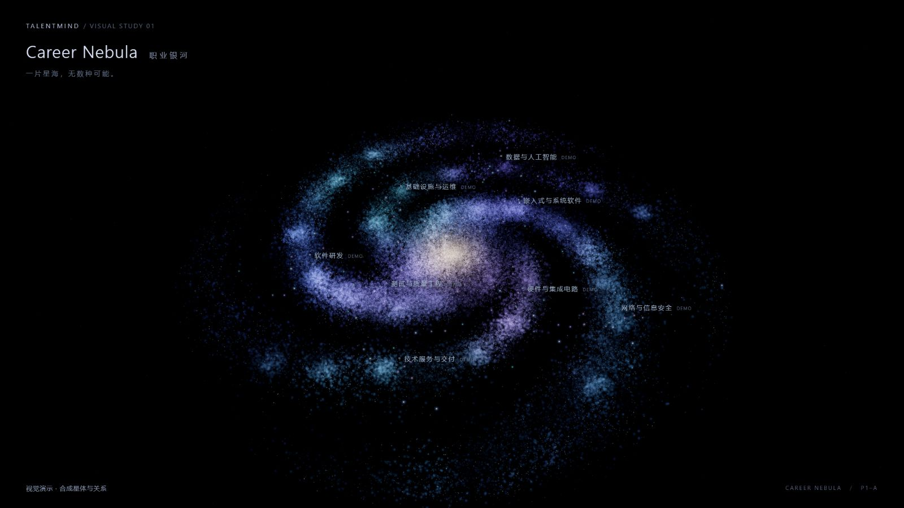

# Career Nebula P1-A · 真实浏览器视觉实验交付

日期：2026-10-18（Asia/Singapore）。**独立实验，等待用户实际视觉验收；不是正式图谱替换，也不宣布美术完成。**

## 范围与运行

- 基线：最新 `origin/master` `1e5f4da8d8739152718e03841257b67122eb5926`。本地旧 master 落后，未移动其引用或切换原工作树。
- 分支：`codex/issue-26-p1-visual-prototype`。
- 工作树：`C:\Users\Serena Lyric\.codex\worktrees\issue-26-p1-visual\TalentMind`。
- 入口：[本地原型](http://127.0.0.1:18126/)，监听 `127.0.0.1:18126`。仅本轮创建的 Node/Vite 服务保持运行；最终 PID/提交/PR 在本报告交付补录中记录。
- 安装、构建与依赖只在 `frontend/visual-lab/`：Three.js 0.180.0、Vite 7.3.7、独立 package-lock 与实际 node_modules 目录，没有 junction。正式 Vue 前端的 package/lock/node_modules 未改。启动命令见 [实验 README](../../frontend/visual-lab/README.md)。
- 原工作树 MySQL 端口修复、R0 未提交实验、全部既有工作树保留。原后端 18000 / PID 25160 保留；没有抢占端口或重启既有服务。仅为升级本实验依赖和加载录像保存配置，重启了本轮自己创建的 Vite 进程。
- PR #27（P0）与 #28（P0.5）仍 Open Draft，未修改、合并或清理；右侧滚动条补修未在本轮处理。

## 主要参考与独立实现

实际在 Edge 打开 [《诗云》在线原作](https://shiyun.cohenjikan.com/)，并通过 agent-reach 的 GitHub / gh 路线读取 [源仓库](https://github.com/Cohenjikan/shiyun)，固定研究版本 `2c7ff2fe5c41b1a833e29d47075e6030636d9a10`。阅读 Galaxy.tsx、PoetStars.tsx、GiftLines.tsx、positions.ts、galaxyParams.ts、App.tsx、DEVLOG.md；临时参考文件留在系统 TEMP，不作为本项目源码或证据提交。

| 原作可核验方法 | 本轮实现与差异 |
|---|---|
| Galaxy 的尘埃、较少亮星与密集 bulge 分层，BufferGeometry / Points | `particles.js` 五个 GPU Points 层：110000 尘埃、44000 薄雾、48000 星核、10000 较亮星点、2200 远景星点。总计 214200；不计入演示节点数。 |
| 旋臂与内圈角度打散、空间厚度、密度噪声 | 独立的截断 Gamma 圆盘半径、径向弯曲旋臂、内圈角度扩散、厚核/薄盘、高度扰动、平滑噪声拒绝采样和少量局部团簇。不以业务关系决定螺旋臂，也不把八职业映射成八条臂。 |
| 高斯式边缘、加法叠加、HDR Bloom | 自编粒子 shader 高斯衰减与 AdditiveBlending，ACES + 温和 UnrealBloomPass；没有中央大精灵、CSS/SVG 渐变、图片底盘或径向光斑充当银河结构。 |
| PoetStars 与背景分离、稳定坐标与选择反馈 | 116 个固定合成可交互星体；岗位/技术方向/技能/行业/应用场景以暂定色调、尺寸和细小轮廓区别。选中使用独立明亮核和固定屏幕范围的持续柔晕，不移动镜头；配色不是正式产品裁决。 |
| GiftLines 的真实端点、曲线、弱化背景关系 | 40 条端点连接到合成实体的二次 Bézier 曲线，默认极淡，选中直连增强，未选中关系进一步淡化；不用粗丝带或大规模硬直线。 |
| positions / galaxyParams 的可重复空间与共享参数 | 使用自己的确定性生成器与集中 config；真实知识坐标固定，只有装饰进行小幅有界漂移/呼吸，速度变化累积时钟，不整体旋转知识网络。 |

原作许可证为 PolyForm Noncommercial 1.0.0。本轮**没有复制其源代码、React 结构、纹理、图片、诗歌或视频**；学习方法并独立编写。Three.js 和 Vite 为 MIT，许可证随 npm 包保留；没有引入 React。

## 真实截图与视频

下列都是本机 Edge 实际运行此原型的浏览器原生截图，1600×900，约 DPR 1，装饰全量开启，没有 LOD 隐藏。所有业务层对象为合成演示，非 JD 或已审核知识关系；截图页不含诊断 HUD。连接器实际返回 JPEG 字节，文件扩展名已按真实格式命名；未重新采样、增强、AI 生成、绘制、修饰或用参考图替代。尺寸与 SHA-256 见 [证据清单](issue-26-p1-a/evidence-manifest.json)。

| 证据 | 文件 | 可复现入口 / 目的 |
|---|---|---|
| 银河全览 | [overview.jpg](issue-26-p1-a/overview.jpg) | `/`：完整银河、厚核、旋臂和八职业色场。 |
| 中景 | [mid.jpg](issue-26-p1-a/mid.jpg) | `?view=mid`：职业色场、亮区暗区与颗粒衔接。 |
| 近景 | [near.jpg](issue-26-p1-a/near.jpg) | `?view=near`：独立三维粒子与空间厚度，不是模糊背景图。 |
| 选中星体 | [selected.jpg](issue-26-p1-a/selected.jpg) | `?view=selected`：全览可辨识的明亮核、持续柔晕及真实样本端点曲线。 |

[真实运行录像](issue-26-p1-a/operation.webm)：约 20 秒、真实 canvas.captureStream(30)，演示慢速流动、屏幕平移、Q/E 缩放、未选中滚轮调速/暂停、选中与选中后滚轮缩放。**由页面测试脚本驱动 DOM 键盘/滚轮事件及诊断选择，不声称是人工逐键录屏**；捕获的是连续实时 GPU 输出，没有静态图模拟视频。只录 WebGL 画布，HTML 标签/标题/诊断面板不在视频中。

浏览器 Blob 下载交付不受连接器支持，原生下载事件也未能提供可用文件；最终使用独立 Vite 的仅开发本机保存入口，把真实录制字节保存到 TEMP，再归档至此。接收端固定 Host/Origin、64 MiB 上限、EBML 头、随机临时路径和独占创建，不接受文件路径输入，也不进入静态构建。

最终视频为 10144990 字节、1600×900，文件时间戳跨度 19.982 秒，448 个编码帧块且 448 个负载哈希不同，见 [文件核查](issue-26-p1-a/video-file-verification.json)。30 是采集请求帧率，本次文件实际约 22.4 帧/秒；不把它冒充稳定 30 FPS 或人工录屏。原生鼠标点选 TypeScript 的 [近景证据](issue-26-p1-a/selected-near-native.jpg)、[选中后滚轮](issue-26-p1-a/selected-near-wheel.jpg) 与 [拖动后的纵深](issue-26-p1-a/drag-depth.jpg) 另行保存。

## 验证与局限

环境：Windows 11 x64；AMD Ryzen AI 9 H 365 / Radeon 880M，驱动 `32.0.22032.6002`；Edge 155.0.0.0 UA；WebGL 2.0，ANGLE AMD D3D11 vs_5_0 ps_5_0。Node 24.15.0。全览前台实际采样 300 帧，平均 **16.67 ms / 60 FPS，P95 17.2 ms**，1600×900、DPR 约 1，见 [原始性能采样](issue-26-p1-a/performance-overview.json)。这只是本机该时段样本，不是全平台或所有近景状态性能承诺。

参数收口后 [1600×900 最终样本](issue-26-p1-a/performance-final.json) 为 60 FPS、P95 17.3 ms；关闭本轮自己创建的两个重复 WebGL 预览后，[默认窗口 1699×901 / DPR 1.5](issue-26-p1-a/performance-native.json) 300 帧同样为 60 FPS、P95 17.3 ms。多预览并存/录制期间曾采到约 22–30 FPS，最终录像也低于请求帧率；不能只引用单页稳定数字覆盖录制或多页开销。未关闭用户原先打开的其他项目/原作标签页。

| 检查 | 实际结果 / 证据边界 |
|---|---|
| 页面与 WebGL 初始化 | Edge 真机加载成功；首版未创建完 diagnostics 文件时曾有 Vite 导入错误，补齐后最终重新加载无该错误。 |
| 控制台 | [最终 error/warn 记录](issue-26-p1-a/console-final.json) 为 `[]`，不掩盖首次开发中的错误。 |
| 无选择滚轮 / 有选择滚轮 | 页面真实事件路径分别只改变流速 / 视距；可暂停，速度 0–2，相机距离 24–520，边界通过。 |
| WASD / Q/E | 通过连续 keydown→渲染帧→keyup 检查；与鼠标点击/拖动共同验证，不仅验证纯参数函数。 |
| 输入保护 | input、textarea、select、contenteditable、IME composing、Ctrl/Alt/Meta、窗口失焦清键均通过。 |
| 点选与动画稳定 | 选中前后相机/target 不变；知识坐标随动画不变；拖动往返起点不误判为点击（实际 createCamera + OrbitControls 回归）。 |
| 尺寸变化 | 浏览器视口 1600×900、窗口恢复与大小变化，以及 960×640 / 1600×900 场景容器重排检查；不是把一张图片缩放截图。 |
| 页面交互检查 | [24 项结果](issue-26-p1-a/browser-checks.json) 全通过；这些是应用内 DOM 事件脚本测试，需与原生鼠标实操证据区分。 |
| 本地自动测试 | `npm test`：5 passed，涵盖滚轮语义/输入保护、实际相机拖动、合成图唯一键/端点/确定性及装饰纵深。 |
| 独立构建 | `npm run build` 通过；约 529.82 kB JS / gzip 134.56 kB，保留 >500 kB 警告，不把它当失败或隐藏警告。 |
| 诊断剔除 | 最终产物不含本实验 GPU/UA 采集、帧历史、诊断面板、录像路径；Three.js 自身仍有浏览器兼容性 UA 判断。 |
| 依赖检查 | 初选 Vite 7.1.12 检出高危条目，改独立实验依赖为 7.3.7 后 npm audit 为 0；正式依赖不变。安装时旧实验 esbuild 文件锁导致 npm cleanup 警告，残留在本实验被忽略的 node_modules，不去清理既有缓存或 junction。 |
| 独立代码审查 | reviewer 找到生产诊断泄漏、往返拖动误点两项 P2，均修复并复核。接收端错误 Method/Host/Origin=403、坏头=415、超限=413 的只读模拟检查通过。 |

首次自动化创建的标签页位于后台/最小化窗口，rAF 被节流，页面检查曾有 Q/E、A/S、尺寸失败；该轮未作为通过证据。用户将原型切到前台后重跑 24/24 通过。帧采样记录 visibility，清空跨可见性历史，不从统计中静默删除慢帧；近景大量粒子/同时打开多个 WebGL 页或录像会影响性能。

收口轮还暴露诊断脚本固定等待 200ms 的 ResizeObserver 竞态，曾为 23/24；已改为等待实际画布尺寸和相机纵横比完成（最多 3 秒），并防止检查/录像并发。最终默认窗口重跑 24/24；尺寸检查保存 expected/actual，1440/1440 与 2400/2400。近景首版雾粒子放大过度，已给各层集中设置 3–10 CSS 像素上限后重拍全部截图和重录最终视频。

没有运行数据库集成测试或正式 Vue 全量构建：正式源码、依赖和业务入口未修改；本实验独立构建和浏览器验证覆盖本轮。无数据库写入、夹具或生产清理，因此不声称查询过生产夹具计数。

## 与原作逐项对照及仍不满意之处

| 项目 | 当前判断 |
|---|---|
| 整体轮廓与空间 | 已形成同一连续旋臂银河，高空倾斜可看见厚度；相较原作，旋臂仍更规则、较像程序生成的主干，外围细碎支流还不够丰富。不能宣称已达到原作的全部空间质感。 |
| 星核 | 由数万粒子自然积亮，暖白向蓝紫过渡，无巨型实心白球或硬 X；近景中心的颗粒粗细仍需人工审美反馈。 |
| 星尘/辉光/颜色 | 分层和噪声使连续雾光与独立细点共存，蓝紫青较克制；部分小团簇偏棉絮状，明暗的细腻度仍落后原作，不能靠继续增加 Bloom 解决。 |
| 职业荧光区 | 八个重叠空间色场融入四臂，没有八个圆岛；部分相邻类色偏接近，标签比荧光本身更容易辨认，仍需用户判断希望突出到什么程度。 |
| 知识星体 | 明显比尘埃清晰，选中核和柔晕保持屏幕辨识；五类型当前差别偏细微，远景不能只凭外观可靠认类型。本轮不锁定最终类型配色/大小。 |
| 关系线 | 曲线端点准确，默认低存在感，选中直连增强；全览中刻意较细，浅色星核背景附近仍可能难辨。暂未开发正式关系层级、语义编码或全部关联操作。 |

建议先由用户依据全览、近景及实际拖动体验反馈“亮度/色偏/旋臂自然度/团簇粗细/选中辨识”这几项，再按截图做定向参数调整。**本轮到 Draft PR 与证据交付即停止，不自动开始真实布局、M2/M3 数据接入、正式集成、合并或清理。**

## 交付补录

- 实现与全部真机证据提交：`76d19a7ab5f13a885f5d389029c8397eda44f719`，已推送独立分支；此后仅追加本节交付记录。当前最终 HEAD 可由 PR 的 headRefOid / 分支读取，避免报告自引用提交哈希。
- [Draft PR #29](https://github.com/Serena-Lyric/TalentMind/pull/29)：base=master，OPEN / isDraft=true / mergedAt=null / autoMergeRequest=null；未配置远端 CI 结果，不能声称远端 CI 通过。已附到本聊天，等待 ChatGPT 审查。
- 本地 URL `http://127.0.0.1:18126/` 保持运行；Node PID **22004**，命令 `node_modules/vite/bin/vite.js --host 127.0.0.1 --port 18126 --strictPort`，进程身份与监听端口已核对。原后端 18000 / PID 25160 保留。
- 全部 7 张浏览器截图实为 JPEG、均为 1600×900；8 项图片/视频的 SHA-256 与证据清单一致，报告/README 本地链接核查通过。浏览器留下无 HUD 的正常入口，临时视口覆盖已重置；只关闭本轮自己创建的重复实验/参考标签，没有关闭用户原标签。
- backend、exchange、frontend/src 与正式前端 package/lock 相对基线 diff 为空。正式 graph.json SHA-256 仍为 `6565d56dbc5a267eb90144f078c54f3d0c761c9a98ca29a18b4dc9c6cdde38e2`。
- PR #27 HEAD `41f9184f2e47a86df4fc86d60b93556e8a19e0db`、PR #28 HEAD `a2cbca41f849e06d2efa1629e55da98c5bbcf0ec` 均与开始核查一致，仍 Open Draft；没有合并、关闭或清理。P0.5 滚动条补修仍未完成。
- 到此停止开发，保留实验服务、分支、工作树和 docs/review 报告，等待用户对真实画面的验收；不自动开始 P2/P3。
