# Career Nebula：P1-A.2 + 真实 M3 集成候选

日期：2026-10-18（Asia/Singapore），面向 10 月 19 日审核。分支 `codex/career-nebula-p1-a2-m3`，基于 PR #29 `994edb6`。**交付状态：可回退的实验候选，未通过产品视觉验收；不建议直接定稿或合并。**

## 1. 交付与视觉判断

- 数据适配独立提交 `afd37d3`，P1-A.2 视觉提交 `2df4ff9`；后续修正与证据在同分支追加。视觉未通过时可保留/提取数据适配，不需要批准 P1-A.2。
- 主要比较基线为 P1-A `7edfea6`（实现 `76d19a7`）；P1-A.1 `994edb6` 仅为历史实验。PR #29 未改动；原两套证据目录 28 个 PNG/JPG/WebM 与 Git 原字节哈希一致。
- P1-A.2 恢复 P1-A 的颗粒大小、透明度、Shader、明暗纹理、星核分布。仅小幅改变臂宽/摆动、雾团锚点半径、局部密度及 10% 亮星位置分配。214200 装饰粒子、seed 261018、相机、Bloom、曝光保持原值；新版本不使用 P1-A.1 半分辨率 haze pass，没有背景填充/新增模糊。
- 工程目视：全景仍可分辨旋臂，近景独立星点与星核颗粒保留。间隙有少量离散星点，仍有明显空隙；星点粗细和数学规则感尚未解决。真实全图的高密度星体、长关系曲线也有拥挤，**不能以数量/测试通过替代用户认可**。
- 星点几何间隙比例为 P1-A 4.69%、P1-A.1 13.42%、P1-A.2 9.63%（只统计半径 25–90、距离最近理论臂角度 >0.45rad 的亮星；不是像素清晰度或美术得分）。详见 [核验 JSON](issue-26-p1-a2/evidence-verification.json)。

## 2. 五视图同条件证据

同一 Edge 155.0.4283.45 无头自动化测试、Radeon 880M / D3D11 / WebGL2，1600×900、DPR1、seed261018，截图时装饰时钟固定 0。各组三版本相机/target 已程序比较到 1e-5；没有图像后处理。历史 replay 只给 P1-A 补同样的 DEV 星核/固定时钟采集书签，不改美术代码。新候选的关系改为批处理，因此选中曲线可有适配差异；银河美术条件相同。UI 页脚真实显示候选状态。

| 视角 | P1-A 原基线 | P1-A.1 历史实验 | P1-A.2 待审核 |
|---|---|---|---|
| 银河全景 | 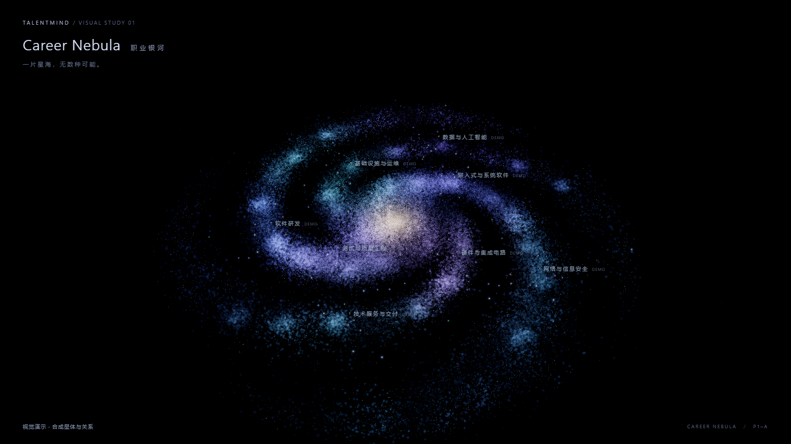 | 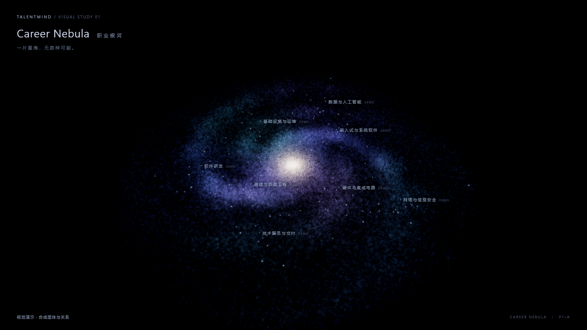 | 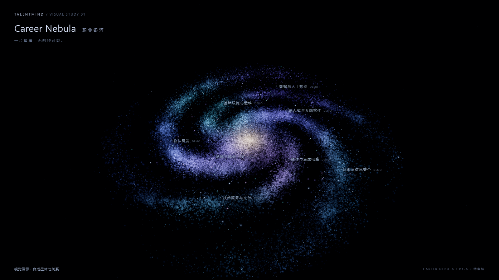 |
| 旋臂近景 | 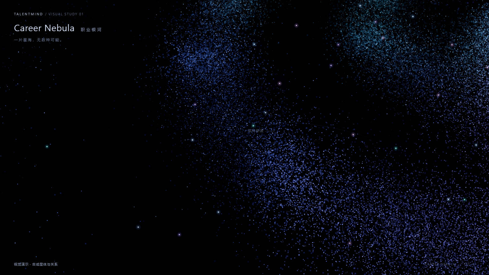 | 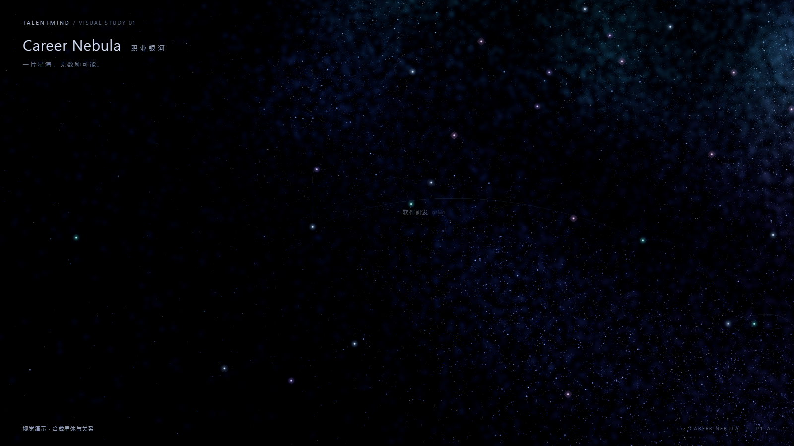 | 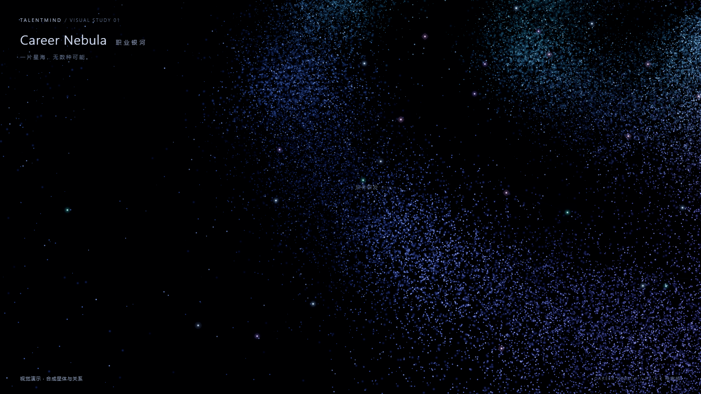 |
| 星核近景 | 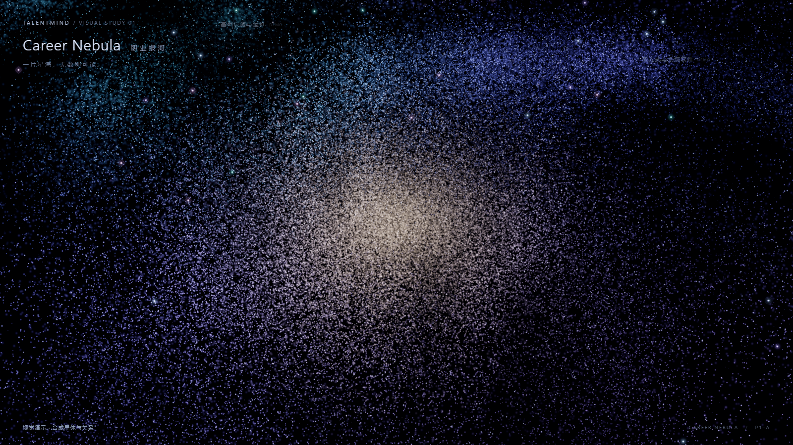 | 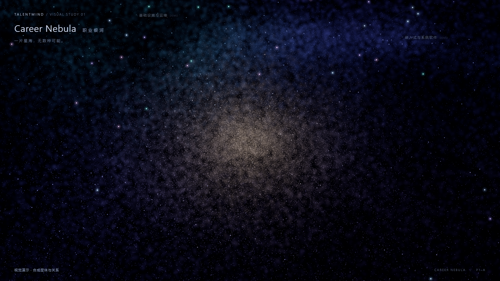 | 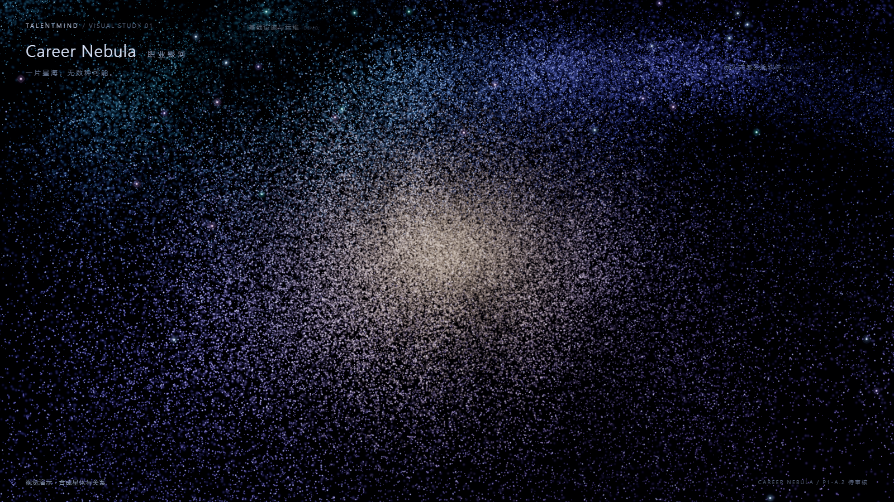 |
| 节点选中 | 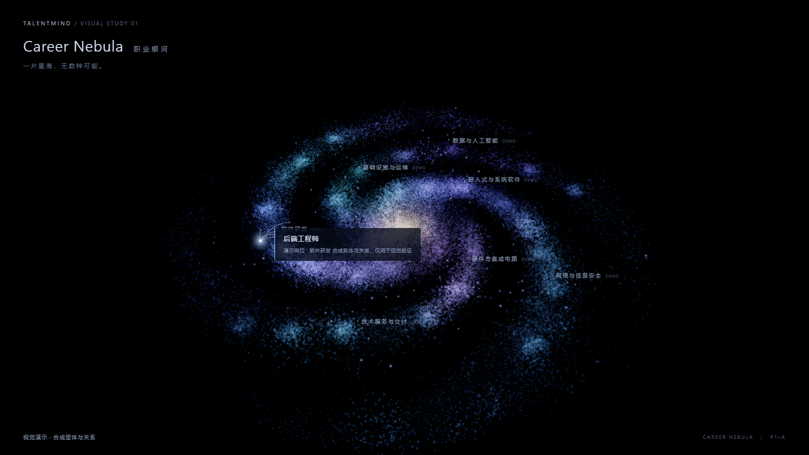 | 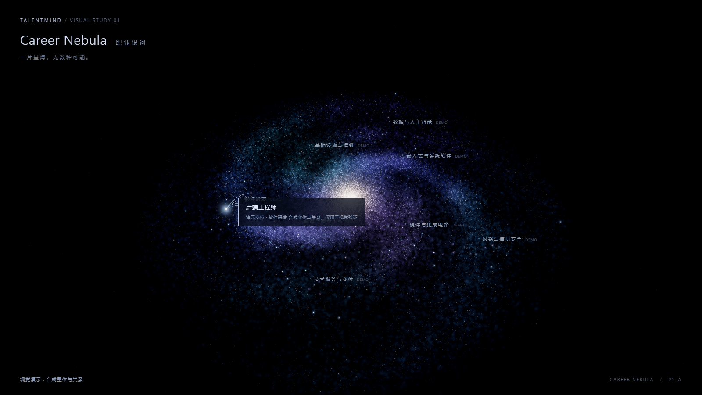 | 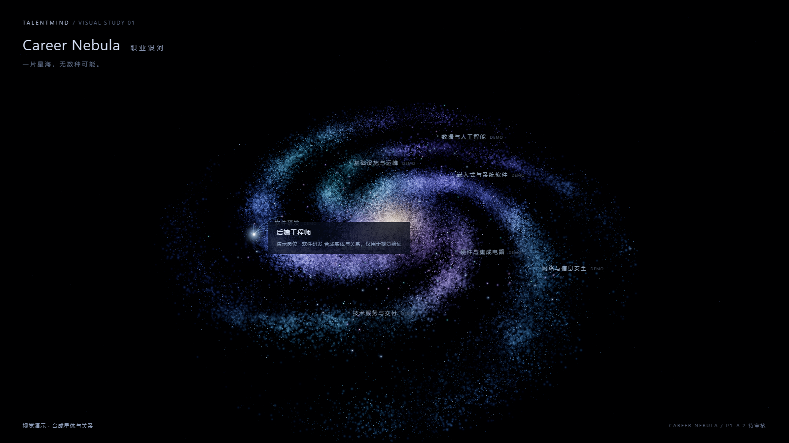 |
| 选中后滚轮缩放 | 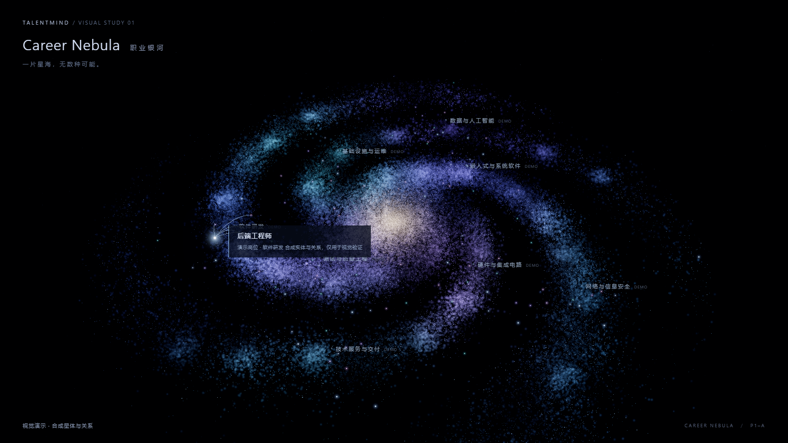 | 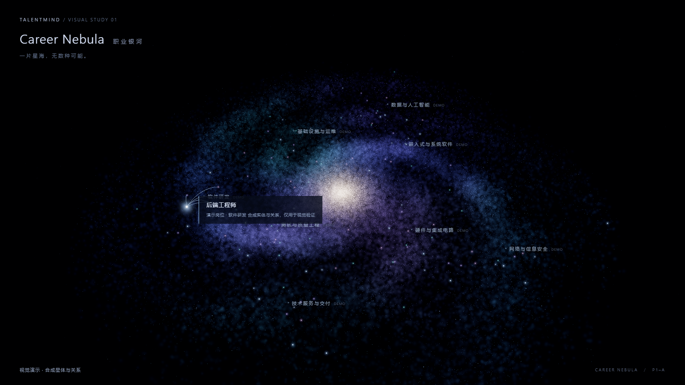 | 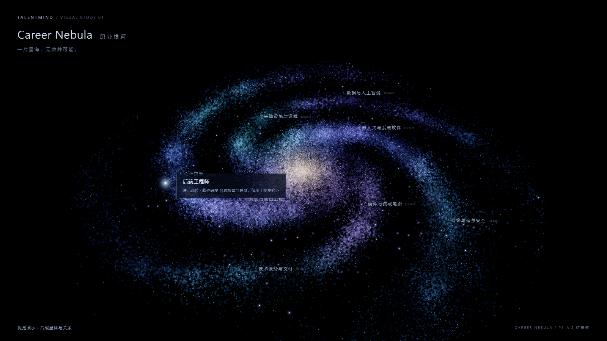 |

原始截图和逐图相机、GPU、帧统计见 [capture-manifest.json](issue-26-p1-a2/capture-manifest.json)。以上配对用同一 116/40 合成适配隔离美术差异；下节另提供**实际 M3**证据，未将合成图冒充真实接入。

## 3. 真实数据链与可追溯契约

`exchange/m3/graph.json` → Vite 只读 `/m3-graph.json`（构建打包同字节）→ 浏览器 fetch/计算 SHA-256 → `adaptM3` → `createKnowledge` → Points + 两个 LineSegments 批次。没有数据库连接、导入或重建调用。正式 Vue `frontend/src`、后端、交接文件均无改动。

源文件 **4523575 字节**，SHA-256 **`6565d56dbc5a267eb90144f078c54f3d0c761c9a98ca29a18b4dc9c6cdde38e2`**。浏览器响应字节、适配 provenance、构建 dist 文件三者一致。此为正式交接快照，**不是实时 Neo4j 查询，也不证明原数据全部语义正确**。

| 知识节点 | 数量 | 原始关系 | 数量 |
|---|---:|---|---:|
| Job | 717 | REQUIRES | 8866 |
| Skill | 4671 | APPLIES_TO | 2539 |
| Industry | 2457 | RELATED_TO | 7 |
| 合计 | **7845** | 合计 | **11412** |

214200 装饰粒子单独渲染，不能选择，不进入这些计数。岗位按原 ID 确定性哈希摆放，技能/行业参照实际相邻岗位坐标显示；这不是职业分类/社区算法，真实模式隐藏八个演示职业标签。行业类型仍沿用历史快照语义，不擅自把场景拆成新的知识类型。

- `nodes[0]`：`job:j-19a33f6480c854ba`，中文“智能体数据工程师（仿真环境方向）”，`source=["boss"]`，保留 duties、required/bonus、quality、evolution 等原字段。
- `nodes[1]`：`skill:python`，原 `job_count=225`；实际快照相连 **222 个岗位/222 条 REQUIRES**。原字段不改，展示计数来自实际数组。邻接诱导子图为 **223 节点/227 边**（额外 5 条为邻居岗位之间已有关系）。
- `edges[0]`：上述岗位 → `skill:python`，`type=REQUIRES`、`weight=1`、`is_required=true`。该布尔值仅是历史必备/加分，不升级为新版 M2 五态；nullable 值和平行边逐项保留。
- 所有节点/边保留 `raw` 与 `sourceIndex`；原 ID 原样使用，不百分号解码、不 slug/canonical 修复。详情显示原 JSON 路径与全部直接关系，文本采用 textContent。
- 类型/文本筛选产生诱导子图；关系筛选只限制其中的边，保留满足节点条件的节点。筛选清除隐藏选择，隐藏节点不能命中。搜索列表最多 100 条，UI 明示并可继续收窄；没有因此截断知识图。

证据：[真实全景](issue-26-p1-a2/m3-overview.png)、[选中与原始详情](issue-26-p1-a2/m3-selected.png)、[邻接子图](issue-26-p1-a2/m3-neighbors.png)、[真实缩放](issue-26-p1-a2/m3-zoom.png)、[岗位筛选](issue-26-p1-a2/m3-jobs.png)、[浏览器检查](issue-26-p1-a2/m3-browser-checks.json)。

## 4. 三种 M3 产物不能混同

| 产物 | 身份/关系口径 | 本轮处置 |
|---|---|---|
| 旧 `graph/builder.py` | Job/Skill，旧 job_name/canonical 裸键；REQUIRES、Job–Job Jaccard >=0.25；无 Industry/APPLIES_TO | 只读源码，不运行默认输出 |
| 正式 `exchange/m3/graph.json` | 带前缀历史 ID；7845/11412，RELATED_TO=7 | 原字节消费，禁止改写 |
| Issue #20 离线修复投影 | exact canonical/原名 + UTF-8 百分号编码，完整候选 Jaccard >=0.35，冲突 nullable、审计；不是生产迁移 | 仅运行只读 diagnose_snapshot，未用于本候选 |

只读诊断：正式旧身份下完整候选应有 41 条 RELATED_TO，快照保留 7 条，缺 34 条；修复投影为 **7864 节点/11455 边**（REQUIRES8880、APPLIES_TO2539、RELATED_TO36），16 个旧 ID 碰撞、11 项要求冲突。三者差异是既有数据/算法问题，本前端不补边、不重算正式统计。[完整诊断摘要](issue-26-p1-a2/m3-offline-diagnostic-summary.json)同时保留限制：只靠快照无法恢复被覆盖的名称、原始技能明细或 JD 原证据，不能将投影当作最终修复真值。

## 5. 性能与验证

三版本五视图各采集至少 300 个前台帧，结果见 [perf-manifest.json](issue-26-p1-a2/perf-manifest.json)。本轮三版在上述 DPR1 配置均约 **60 fps / mean16.67ms，p95约16.8–17.2ms**，触及刷新率上限；**不能据此宣称 P1-A.2 更快**，不能外推高DPR、录屏、多页或别的GPU。截图阶段短窗口帧数不作为这组性能结论。

真实 M3 另采 300 帧（交互测试后相机距离约192.72，具体向量在 JSON），约60fps / mean16.67ms / p95见 [m3-performance.json](issue-26-p1-a2/m3-performance.json)。知识渲染只有3个批次，完整后处理帧约22次draw call；高连接节点的全部曲线保留，仅按连接数降低线条透明度以限制汇聚过亮。

- Node：**13 passed**，含真实快照完整保留、非法契约、诱导筛选、隐藏命中、批处理与高连接度；新增适配与审阅修复均有 RED→GREEN。
- 浏览器：**15 项检查通过**，另含原 **24 项相机/输入/resize** 检查全部通过；正常会话 error/warn=0。503与畸形快照是刻意注入的失败用例，expectedErrors 单列，未当作正常错误隐藏。
- 独立实验 `npm run build`、正式 Vue `npm run build`（含 vue-tsc）均通过；两者保留 >500kB 警告。实验依赖 audit=0；正式依赖未升级，pnpm冻结锁文件安装完成且通过供应链检查。首次 offline 安装因缓存缺元数据失败，后续正常安装解决。
- 构建后18128预览另验证真实快照消费、python原始字段选择、显式demo回退，以及即使传diagnostics参数也没有DEV面板；见[生产构建检查](issue-26-p1-a2/production-checks.json)。该临时预览验证后关闭，保留18127开发候选供审阅。
- 后端非集成回归：**1173 passed / 2 skipped / 23 deselected / 2 failed**。失败为 `test_repository_draft_covers_eight_families_and_empty_release` 与 `test_shipped_source_hash_matches_a_fresh_LF_checkout`，均报 source hash or quote mismatch。当前/基线 PRODUCT_DECISIONS.md 字节SHA均 `ed54adf9368d3ebfeb0943def04840459d4f1f496483cb8584ebf95f978f6f43`，M2 candidates 固定引用旧 `20988bf8...`；本轮没有改这两个文件或后端，不声称全仓绿。首次无配置收集报错后，用127.0.0.1:1占位连接跑离线测试，不借用生产 `.env`。
- 无写库集成测试、数据库迁移、生产重建或采集；没有数据库夹具需清理。SQLite/文件夹具沿用原测试 teardown，未改测试清理逻辑。

## 6. 可操作回退与复现

1. 候选入口：本分支 `frontend/visual-lab` 执行 `npm ci --ignore-scripts`、`npm run dev`，访问 `http://127.0.0.1:18127/`。端口占用即失败，不停止既有18126。
2. **旧数据适配**：打开 `http://127.0.0.1:18127/?data=demo`，恢复116合成实体/40关系；页面明确“合成”，不会假装真实数据。此切换已浏览器实测。P1-A.2 美术仍在。
3. **旧视觉**：在同一目录运行 `node ../../docs/review/issue-26-p1-a2/prepare-replays.mjs`，访问 `http://127.0.0.1:18127/.p1a-baseline/index.html`；P1-A.1 历史入口 `/.p1a1-baseline/index.html`。仅DEV生成的忽略目录，不进入生产包。原PR #29及18126服务独立保留。
4. **关闭新候选、恢复正式旧页**：结束本轮Vite终端；在本分支 `frontend` 运行 `pnpm run dev`，打开 `http://127.0.0.1:18080/graph`。正式Vue源码从未切换；后端按原环境运行，仅供旧页读取。本轮开始时18080未监听，因此旧页链接需要先启动，不能宣称点击即已有运行服务。
5. 如果只接受数据适配，独立提交 `afd37d3` 可供后续提取；它基于P1-A.1实验历史，不能当作已批准的视觉分支。正式集成时仍需审查和用户授权。
6. 截图/性能复现：设置 `NEBULA_PLAYWRIGHT` 为已有Playwright的 `index.mjs`，依次运行 `node docs/review/issue-26-p1-a2/prepare-replays.mjs`、`capture.mjs`、`capture.mjs perf`、`check-m3.mjs`、`verify-evidence.mjs`（后四条从仓库根使用完整相对路径）。需要本候选18127在运行。脚本用自动化鼠标/DOM输入，非人工录屏。

回退无需数据库修改、重导或数据修复。正式图谱和其他PR均不合并。

## 7. 独立审阅与保留判断

独立只读审阅 `994edb6..2df4ff9`：Critical0 / Important1 / Minor0。Important为数组节点类型被隐式强转放行，已加字符串类型检查和数组/对象/null/数字反例，RED→GREEN；不再追加审阅轮次，修复由测试验证。陷阱：[类型强转与高连接度光线](../superpowers/traps/2026-10-18-m3-adapter-type-and-link-light.md)。

审阅留给本轮的判断均记录如下：视觉优劣由用户裁决；A1保留在历史和replay；哈希布局只作展示；平行边允许重合但逐条详情/次数保留；搜索上限100明示；关系筛选保留无相应边的节点；空图允许显示0；不追加未获确认的端点本体组合规则；旧页冷启动与截图/性能证据在本文补齐；浏览器检查先保存后追加最后检查的顺序已修正。若这些工程选择不符合期望，影响分别是后续视觉/布局调整、交互细节或更严格契约校验，均无需改写正式图。

**待用户审核：** 颗粒粗糙度、旋臂规则感、空隙量、真实节点密度和长曲线的可读性；此候选及整个PR均未获产品通过，也没有任何合并授权。
