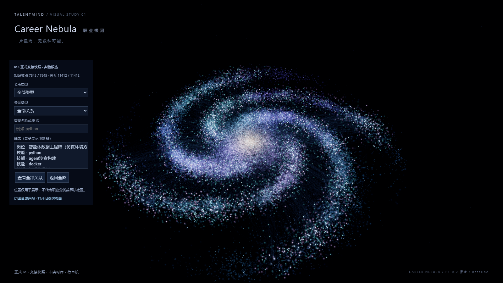
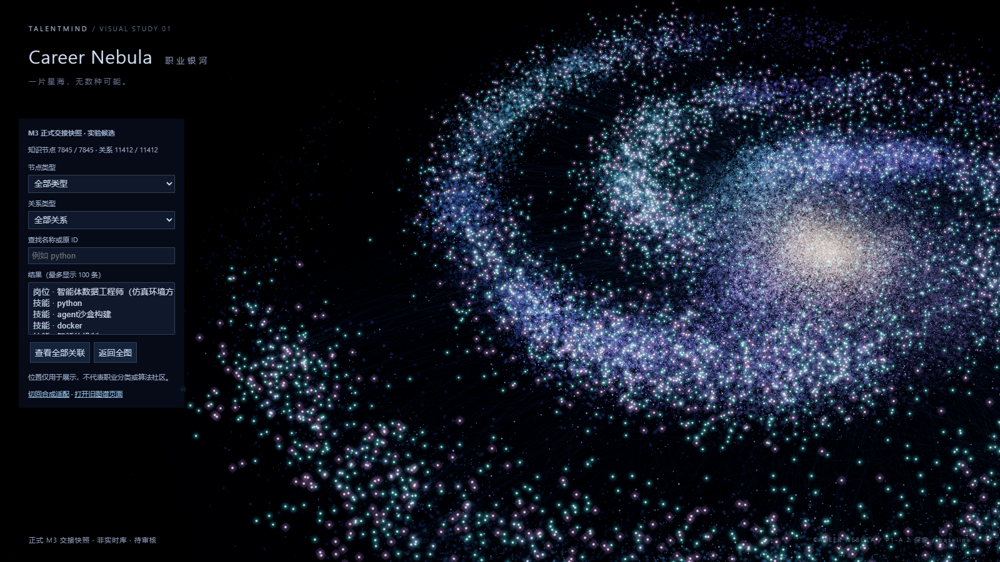
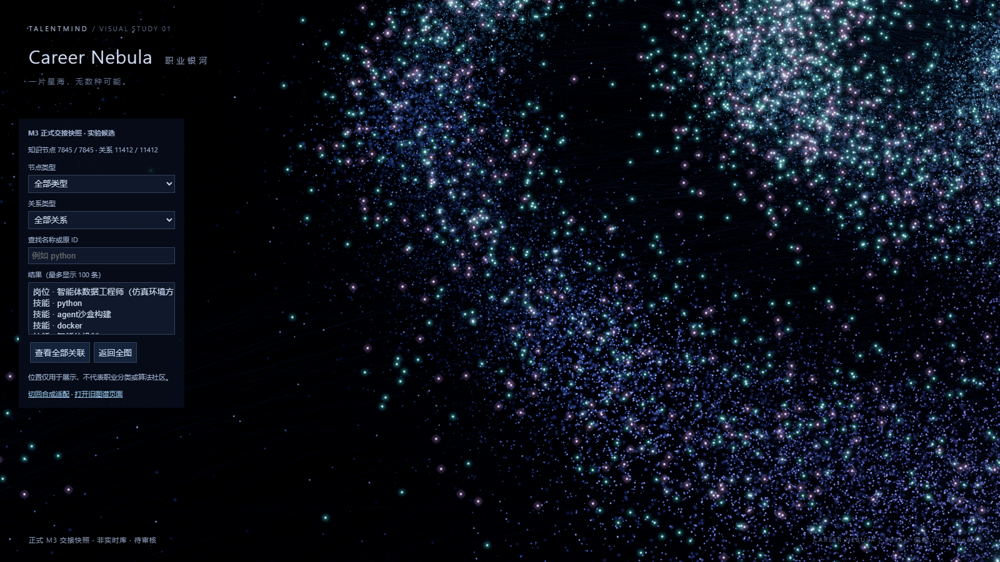
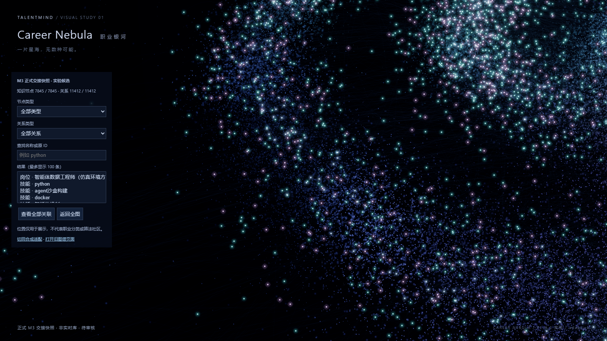
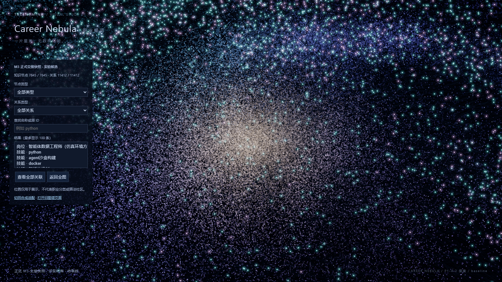
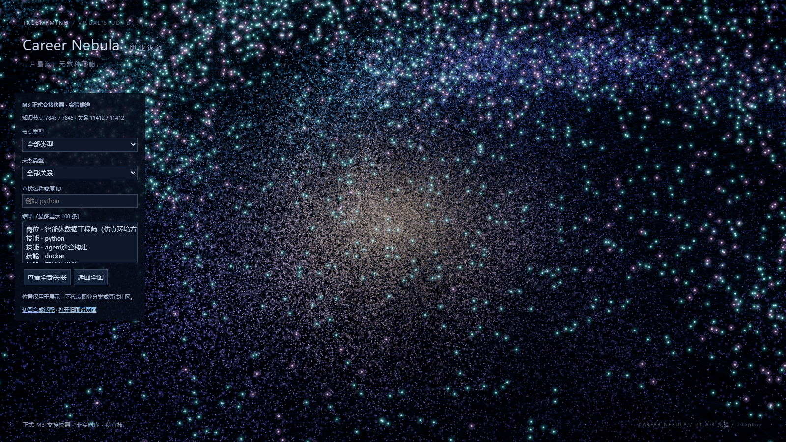
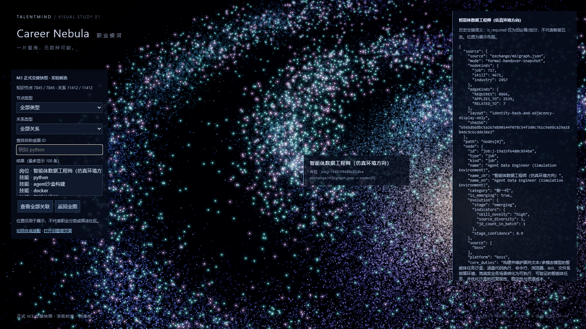
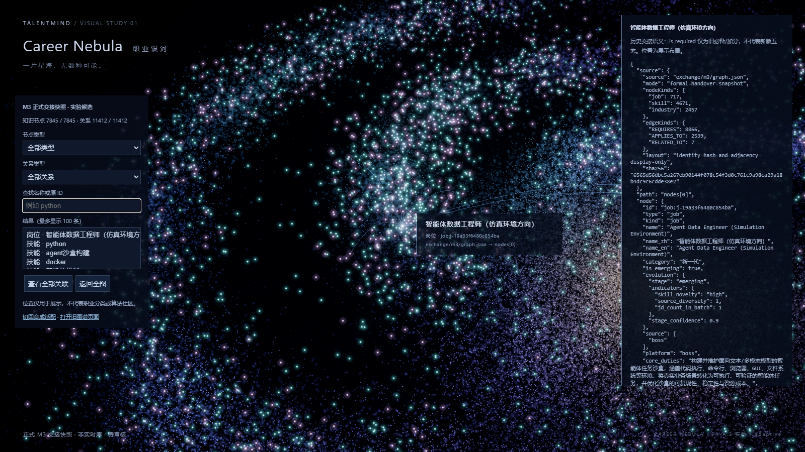
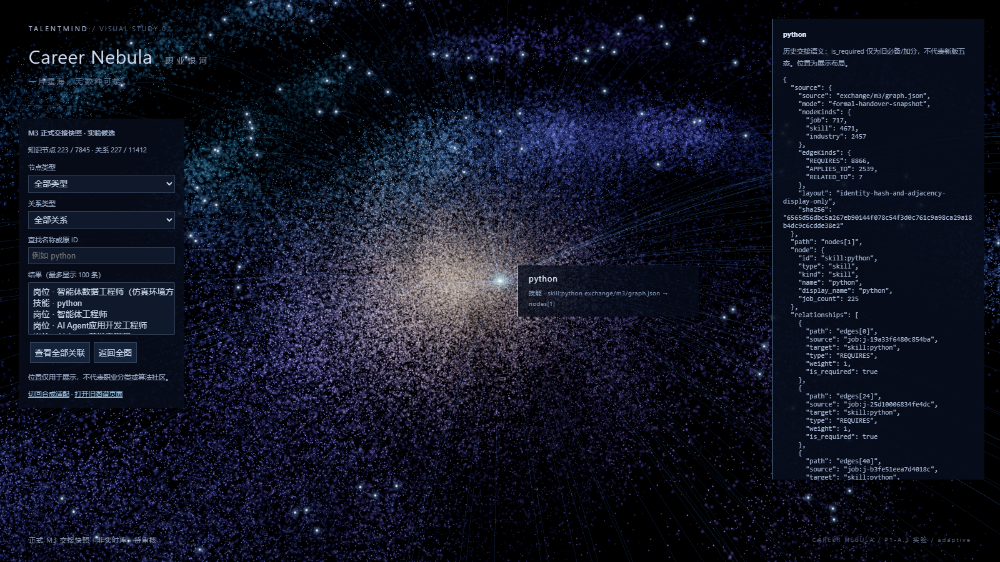

# Career Nebula P1-A.3：近景视觉分层实验

日期：2026-10-18（Asia/Singapore）。基线为 Draft #30 `e7771d070abd54532efd9c813e9434d5af87459c`，独立分支 `codex/career-nebula-p1-a3`；仅供单独审核，不合并 #29/#30/本轮 PR，不关闭 Issue #26。

**结果建议：实验未优于基线，保留 P1-A.2。** 全景完全保留，背景细星与星核有所减弱，但真实 M3 近景仍由密集知识节点及关系重叠主导，尚不能确认知识辨识度有足够改善。此次停止视觉优化；保留 opt-in 实验供复核，不因已投入实现而采用。P1-A.2 只是可接受的阶段保底，整个 #30 未获最终产品验收。

## 实现与边界

实现提交 `0017aae`。`config.js` 增加实验参数；`particles.js` 每帧只更新原有 opacity/maxPixels uniform；`main.js` 传入实际相机至 orbit target 的距离和 FOV。默认/未知参数均为 `baseline`，只有 `?visual=adaptive` 启用实验。无需复制一份知识图或重建粒子。

按 `distance × tan(FOV/2) / tan(43°/2)` 换算视野尺度，在 185→45 内用 cubic smoothstep 连续过渡；>=185 全景与原参数一致。各层近景 opacity/最大点径倍率：

| 装饰层 | opacity | 最大点径 | 目的 |
|---|---:|---:|---|
| stars 独立亮星 | 0.16 | 0.44 | 优先减少亮星干扰 |
| field 远景星点 | 0.30 | 0.55 | 限制远景背景亮点 |
| dust 细尘 | 0.80 | 0.85 | 轻调，保留旋臂纹理 |
| core 星核 | 0.72 | 0.80 | 轻调中心颗粒叠加 |
| mist 弥散雾 | 1 | 1 | 保留原弥散结构 |

这些是本轮实验取值，不是新的正式产品规则。214200 装饰粒子、seed261018、生成分布、原 Shader、Bloom、曝光、相机控制规则不变；没有全局变暗、模糊或新增渲染 pass。

已检查 `knowledge.js`：知识节点独立 Points 和屏幕拾取，选中高亮独立，真实关系由 base/highlight 两个批次保留。该文件本轮**字节不变**，没有提高知识节点亮度、调整点径/点击范围、隐藏/补算关系。未尝试进一步压低非关注关系，以隔离背景变量。开发诊断新增的 scene 访问只存在 DEV 动态模块，生产构建实测没有该模块/面板。

## 同条件对照

全部六组静态和两条视频使用**真实 M3 交接快照**，不是合成演示或实时 Neo4j。Edge 155.0.4283.45 无头自动化、Radeon 880M / ANGLE D3D11 / WebGL2，同机1600×900、DPR1、seed261018、装饰 clock=0。逐组相机/target/选择及过滤状态一致。另行验证的 116/40 合成回退明确标为 synthetic-demo，未混入这些图。

| 视角 | baseline：P1-A.2 | adaptive：本轮实验 |
|---|---|---|
| 银河全景，距离245 |  |  |
| 旋臂中景，距离110 |  |  |
| 旋臂近景，距离43 |  |  |
| 星核近景，距离43 |  |  |
| 真实岗位选中，距离65 |  |  |
| Python全部邻接，距离65 |  |  |

工程目视：全景完全一致；旋臂中的知识节点仍密集重叠，装饰减弱对主体辨识的帮助有限；星核变暗可观察，但不能等价为关系解释或节点识别改善。高连接节点的222条曲线仍形成放射汇聚。未做人工盲测或用户辨识任务计时，不把 uniform 降低或像素差异当作美术验收。

每图同时保留 `*-canvas.png`，仅在截图时隐藏 HTML 覆盖层，便于比较画布；未做图像后处理。六组 baseline canvas 与原 `e7771d0` 源码 DEV 重放逐字节一致；两版全景 canvas 也逐字节一致。UI 仍标明当前模式，所以完整页面 PNG 不要求字节相同。

连续缩放往返：[baseline 真实 WebGL 视频](issue-26-p1-a3/baseline-zoom-roundtrip.webm)、[adaptive 真实 WebGL 视频](issue-26-p1-a3/adaptive-zoom-roundtrip.webm)。两版按相同601帧相机重放，245→24→245，逐帧 camera/target 到1e-8一致；实际 canvas.captureStream/MediaRecorder VP9，不是静态图片拼接，也不是人工操作录像。键盘/滚轮的真实DOM输入另由交互检查验证，避免操作调度差异破坏配对。视频本身为30fps编码，性能统计来自浏览器rAF，二者不混用。

adaptive 的连续重放相邻帧最大 opacity 差0.00940、点径上限差0.03914 CSS像素，无粒子/几何切换；两版601帧全部复用同一批几何和position数组。两条视频均已在浏览器解码并跳转检查，完整轨迹及媒体SHA见[manifest](issue-26-p1-a3/manifest.json)。数值连续和编码检查不能代替用户观看视频的主观画质判断。

## 数据与交互

源文件4523575字节，SHA-256 **`6565d56dbc5a267eb90144f078c54f3d0c761c9a98ca29a18b4dc9c6cdde38e2`**。正式文件、浏览器响应、生产构建资产一致。Job717 / Skill4671 / Industry2457 = **7845**；REQUIRES8866 / APPLIES_TO2539 / RELATED_TO7 = **11412**。逐项 raw 与sourceIndex保留；正式交接、backend、frontend/src 和旧 builder 均无差异。

- Node全套 **16/16通过**；新增adaptive行为曾在原实现以近景opacity断言失败，再实现GREEN。覆盖默认/未知模式、全景恢复、分层差异、阈值连续、FOV等效视野、DPR2与几何引用复用；原数据适配测试检查全部raw节点/边与原索引。
- 开发浏览器 **79次顶层断言通过**（含重放追加复核，非79个互异场景）；其中两模式各含原24项相机/输入/resize检查。搜索、类型/关系筛选、实际鼠标拾取、邻接、空结果、隐藏选择清除、滚轮、实际鼠标拖动与实际窗口resize通过。
- 实际鼠标拾取在两模式的全景/旋臂中近景/星核共8个真实岗位中心验证；选择保持原ID，不移动相机。Skill的Python选择与全部邻接同时验证，Industry类型和所有raw字段由适配全量测试覆盖。未改拾取算法，不宣称所有遮挡重叠节点都可逐个用鼠标点击。
- Python原字段 `job_count=225` 保持；实际快照222条直接关系、邻接诱导223节点/227边，未把历史字段改成实际计数。
- 独立构建通过，保留>500kB警告（JS538.91kB，gzip138.18kB）；生产预览 **17/17通过**，含默认/显式/错误参数、真实数据选择、合成回退、DEV剔除、媒体解码。开发/生产正常会话error/warn均0。
- 证据核验通过：六组原版重放一致、视频逐帧配对、媒体SHA、数据hash、118份旧证据文件Git blob不变。见[verification.json](issue-26-p1-a3/verification.json)、[production.json](issue-26-p1-a3/production.json)。

本轮未运行数据库集成测试、正式Vue或后端全量回归：改动限独立visual-lab与证据，正式前后端源码未改；不把原PR的历史回归结果当本轮全仓绿。没有写库或数据库夹具，无需数据库清理；浏览器临时上下文在finally关闭，证据为有意保留的交付文件。

## 性能记录

每静态视角每模式300个前台rAF间隔，交错采样顺序；固定clock条件与截图相同。单位ms，draw call完整后处理帧均为22。只作同机有限样本对照，不宣称显著提升或跨设备结论。

| 视角 | baseline平均 / p95 | adaptive平均 / p95 |
|---|---:|---:|
| 全景 | 16.669 / 17.10 | 16.668 / 17.10 |
| 旋臂中景 | 16.668 / 17.10 | 16.668 / 17.10 |
| 旋臂近景 | 16.669 / 17.10 | 16.667 / 17.10 |
| 星核近景 | 22.778 / 33.40 | 21.168 / 33.40 |
| 真实节点选中 | 19.223 / 33.40 | 18.778 / 33.40 |
| 高连接邻接 | 16.667 / 17.20 | 16.667 / 17.10 |

有录像编码开销的相同缩放路径：baseline平均22.445/p95 33.50，adaptive平均22.028/p95 33.50，draw call仍22。约16.67ms的视角受刷新率上限约束，不能因此声称更快；星核/选中视角存在约33ms帧，不宣称稳定60FPS。未观察到本轮不可接受的性能退步，也没有解决原近景GPU负载问题。

## 采用条件与停止结论

| 条件 | 本轮判断 |
|---|---|
| 全景不明显劣于P1-A.2 | 满足：画布像素完全一致 |
| 近景知识节点辨识确实改善 | **未满足**：背景减弱可见，密集真实节点和关系的主体可读性仍不足 |
| 交互与数据语义无回归 | 本轮覆盖范围内通过；未修改真实语义/拾取 |
| 性能无不可接受退步 | 同机已采样范围内通过；非显著性/跨机结论 |

**实验未优于基线，保留 P1-A.2。** adaptive只保留为独立Draft的可审核实验，不切换默认值，不再追加本轮视觉优化。

## 回退与复现

在本工作树 `frontend/visual-lab`：`npm ci --ignore-scripts`，`npm run dev -- --port 18129`。

1. 保底入口：[baseline](http://127.0.0.1:18129/?visual=baseline)；[adaptive实验](http://127.0.0.1:18129/?visual=adaptive)。任意时刻把URL改为`?visual=baseline`后刷新，或移除visual参数，即恢复P1-A.2；不需要重建、重导或数据库修改。
2. 数据回退另用`?visual=baseline&data=demo`，页面会明确合成演示，不冒充M3。保持真实数据只需省略data参数。
3. 原 #30 分支/提交及工作树不变；DEV原版重放为`/.p1a2-baseline/index.html`，由本轮capture脚本只从e7771d0生成忽略目录，拒绝覆盖不同内容，不进生产包。
4. 正式Vue页面仍为18080/graph，需要按原README另行启动；本轮没有替换它，也没有因本实验停止其他服务。18129开发候选保留供审核，18130临时生产预览测试后关闭。
5. 设置`NEBULA_PLAYWRIGHT`为已有Playwright的index.mjs绝对路径；在仓库根依次运行`node docs/review/issue-26-p1-a3/capture.mjs`、`node docs/review/issue-26-p1-a3/verify.mjs`。生产验证需先build并在18130启动preview，再运行`check-production.mjs`。脚本使用真实Edge硬件WebGL，数据只读。该端口下原DEV面板旧“录制”按钮仍只支持18127的原保存路由；本轮录像用capture脚本浏览器下载，不绕过原路由的Origin限制。

采集器修正说明：最初canvas locator截图包含了footer，导致原版比较失败，现仅对canvas比较隐藏覆盖层；最初要求25px隔离点在真实密集全景不可得，改为3px中心分离并点击精确投影位置，未改12px实际拾取半径。最初按定时键盘录制端点不同，已替换为上述逐帧同路径录像，未把它称为人工输入视频。最终产物与核验均采用修正后的条件。见[采集陷阱](../superpowers/traps/2026-10-18-nebula-paired-capture.md)。

## 独立审核与下一阶段

独立只读审核待本轮提交后执行；内部独立审核不替代ChatGPT集中产品验收与用户合并授权。

本轮结束后工作重心转向M3图谱算法与创新性设计研究。10月21日前成员交接材料应区分已实现的只读适配/离线修复与待研究的实体语义、社区/路径/关系解释及评测；保留 #20 的旧ID碰撞、nullable冲突、正式快照与修复投影差异作为研究输入，不将显示哈希布局包装成职业社区算法。本轮只留下研究入口，不擅自选择算法、重建正式图或新建另一轮视觉任务。
