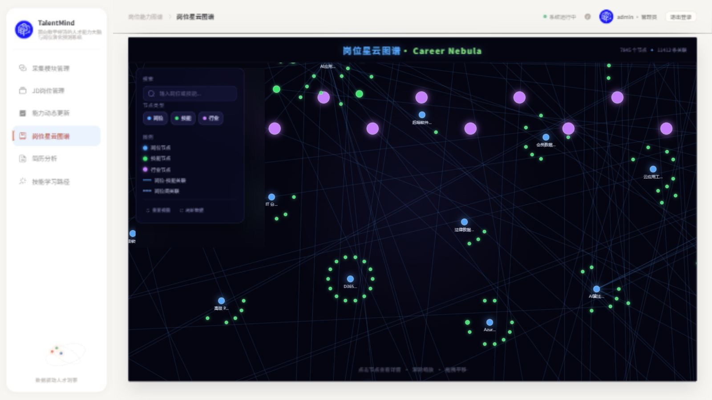
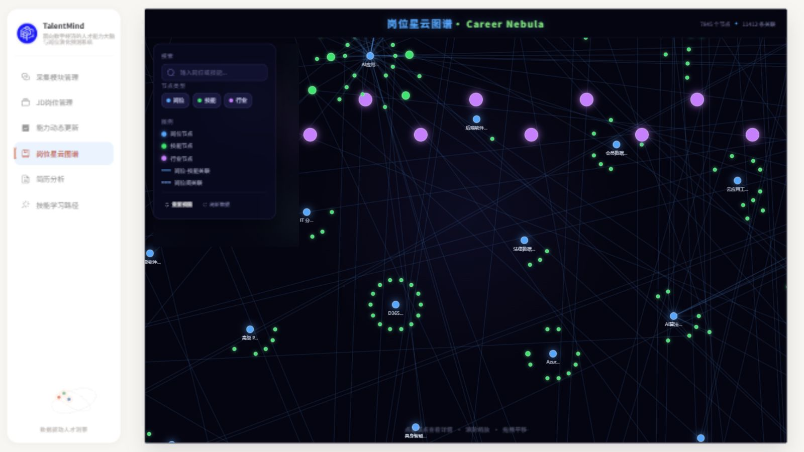
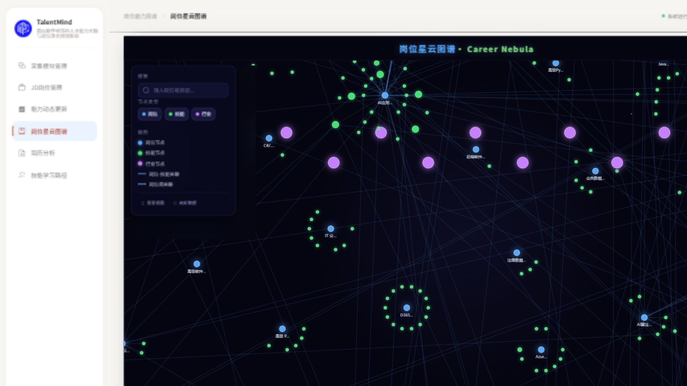
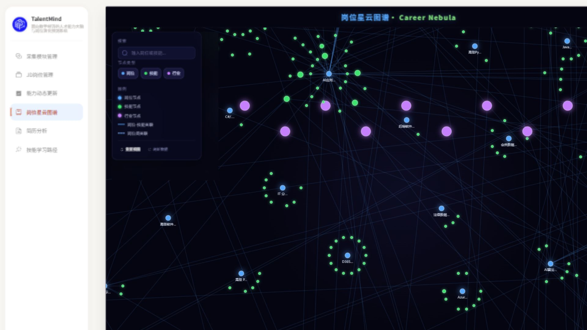

# Issue #26 · P0 图谱外壳交付

日期：2026-10-17（Asia/Singapore）。状态：**实现、自检和独立代码审查完成，等待 ChatGPT 复审与用户截图验收；P1 未开始。**

## 基线与范围

- 用户指定并经 fetch 核实的 master：`1e5f4da8d8739152718e03841257b67122eb5926`，包含已合入 PR #25 的产品、视觉与实施文档。
- 新独立工作树：`C:\Users\Serena Lyric\.codex\worktrees\issue-26-p0\TalentMind`；分支 `codex/issue-26-p0`。原目录仍为 `codex/m1-stage-02@e8235c8`，原有 10 项未提交文件未纳入本分支。
- 业务代码独立提交：`bdf257c8b058ea7528fafdaa8057cb1ce3587123`；仅 `App.vue`、`styles.css`、`views/Graph.vue`。可单独 revert 此提交回退页面布局。
- 原 PR #23 实查 OPEN，HEAD `abb73eb9c2b35819ba0ac870ed4cbd8dd5d91e7f`；旧工作树、归档和其他分支未清理。
- 按 [既有任务书](../superpowers/plans/2026-10-17-career-nebula-first-phase.md) 执行 P0，不另创产品方案。只在 Graph 命名路由隐藏共享顶栏，保留其余页面、登录/注销/守卫及图谱内标题、数据计数、左右菜单。

## 实现与核查

`App.vue` 用 `route.name === 'Graph'` 控制顶栏和图谱专属 class。共享 CSS 仅对此 class 将上下 padding 设为 18px。Graph 页面用视口高度减 36px，通过 scoped 深度选择器让既有主窗口填满；保留原 620px / 窄屏 560px 最小高度，短屏允许必要滚动以保证控件可达。未改 `GraphPanorama.vue` 的绘制、布局算法、交互或数据请求。

修改前先实际打开 master 基线页面并保存截图；没有用 CSS 临时覆盖或概念图模拟前后结果。基线与结果使用同一浏览器、同一开发端口 `18086`、相同视口、默认图谱视角。页面经既有 `/api` 代理只读访问现有 `18000` 后端；标题显示 7845 节点 / 11412 关系，是本轮实际页面返回值，不代表新版 M2 或新算法，也未单独查询 Neo4j 实时总数。保留原 Canvas/背景，无新增装饰粒子或 LOD。

### 桌面真实前后对照

| 视口 | 左导航卡片 top/bottom | 修改前主窗口 top/bottom | 修改后主窗口 top/bottom | 结果 |
|---|---|---|---|---|
| 1600×900 | 18 / 882 | 84 / 858 | 18 / 882 | 顶栏隐藏、上下对齐、无横纵溢出 |
| 1920×1080 | 18 / 1062 | 84 / 1038 | 18 / 1062 | 顶栏隐藏、上下对齐、无横纵溢出 |

最终代码的 8 项桌面断言均通过，见 [实际 DOM 检查记录](assets/issue-26-p0/layout-checks.json)。检查在路由过渡结束后运行；过渡中的 transform 短暂偏移不当成稳定布局数据。

1600×900，修改前：



1600×900，修改后：



1920×1080，修改前：



1920×1080，修改后：



### 操作与响应式回归

- 搜索 `python`，实际匹配 87 个节点，Enter 显示既有 `python 与 matlab` 详情；关闭详情、重置操作可用。[详情证据](assets/issue-26-p0/detail-1600x900.jpg)。
- 切至 [JD 页](assets/issue-26-p0/jobs-1600x900.jpg) 和 [采集页](assets/issue-26-p0/collection-1600x900.jpg)，均保留面包屑、运行状态、管理员和退出按钮；JD 页 `.page-main` 恢复原 `10px 34px 42px` padding，无图谱 class。未点击采集启动、导入、删除或导出。
- 退出后进入登录页，直接访问 `/graph` 被守卫转至 `/login?redirect=/graph`；使用页面提供的演示账户重新登录后返回图谱。[守卫证据](assets/issue-26-p0/login-guard-1600x900.jpg)。这是现有前端演示登录回归，不声称后端真实鉴权。
- [390×844 窄屏](assets/issue-26-p0/narrow-390x844.jpg)：页面宽 390、高 844，图谱主窗 x=108..374、y=18..826；搜索、筛选、图例可见，无横纵溢出。窄屏选中详情后关闭按钮 x≈316.7..346.7、y≈103.3..154.1，可点击关闭，不被视口裁切；保留原有浮层覆盖方式。
- 1280×600 短屏：主窗 bottom=638、文档高度=656，无横向溢出，保留最小高度产生必要滚动。左右对齐验收针对任务指定的两种桌面尺寸，不声称短屏也固定首屏对齐。

## 构建与审查

```powershell
cd 'C:\Users\Serena Lyric\.codex\worktrees\issue-26-p0\TalentMind\frontend'
$env:pnpm_config_verify_deps_before_run='false'
pnpm run build
```

最终代码构建退出码 0：`vue-tsc --noEmit && vite build`，2619 modules transformed，Vite 构建 8.37s。保留既有 chunk >500kB 警告，未为本任务调整打包。首次普通 `pnpm run build` 因 pnpm 11 自动安装预检要求清空 modules 且无 TTY 而中止；没有同意 purge。当前树 `frontend/node_modules` 为指向原工作区现有依赖的 junction，仅本进程关闭运行前自动安装检查；没有增加依赖或改 lockfile。开发 Vite 可能更新共享依赖的构建缓存，业务源文件与原工作区未提交内容未改。

独立只读 reviewer 检查了三个前端文件及 P0 规范：标准路由未发现 Critical/Important，指出尾斜杠与大小写 URL 识别遗漏一项 Minor。主 agent 实际访问 `/graph/` 复现顶栏仍存在、文档高度 990px（视口 900px），随后以命名路由修复；`/graph/` 与 `/GRAPH` 再验证均隐藏顶栏且文档高度 900px，对齐检查通过。此项是同一图谱路由隔离的边界修正；未改变路由规则。见 [陷阱记录](../superpowers/traps/2026-10-17-graph-shell-route-layout.md)。无需新增测试框架，验证以真实页面 DOM 断言、实际交互及构建完成。

`git diff --check` 通过。正式 `exchange/m3/graph.json` SHA-256 保持 `6565d56dbc5a267eb90144f078c54f3d0c761c9a98ca29a18b4dc9c6cdde38e2`。无后端、DDL、API、依赖、正式交接变更；未执行集成测试、数据库写入、迁移、导入、采集或真实数据清理，没有数据库测试夹具需要删除。

## 复现与验收暂停点

上述工作树的开发服务：`http://127.0.0.1:18086/#/graph`。重启时在该树 frontend 执行 `node node_modules/vite/bin/vite.js --host 127.0.0.1 --port 18086 --strictPort`，只读 API 继续使用默认 `18000`。没有取代现有 18080 服务。

截图均为本地实际浏览器截图，非用户视觉验收。等待 ChatGPT 对代码与证据复审、用户确认 P0 效果后才开始 P1；本分支不合并、不启用自动合并、不关闭 Issue #26、不清理任何旧工作树。未模拟网络失败/空图，不声称这两种状态已单独验收；未做全站业务或后端测试。依照任务书，README 产品说明不重复修改。
