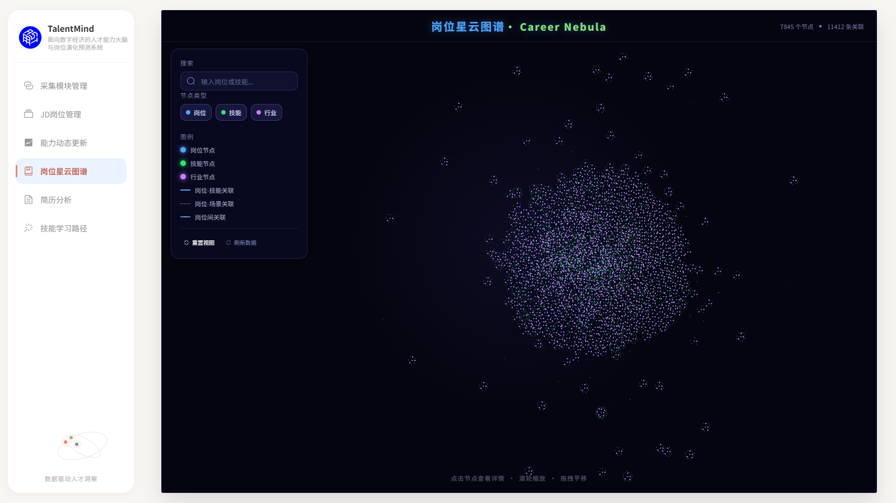
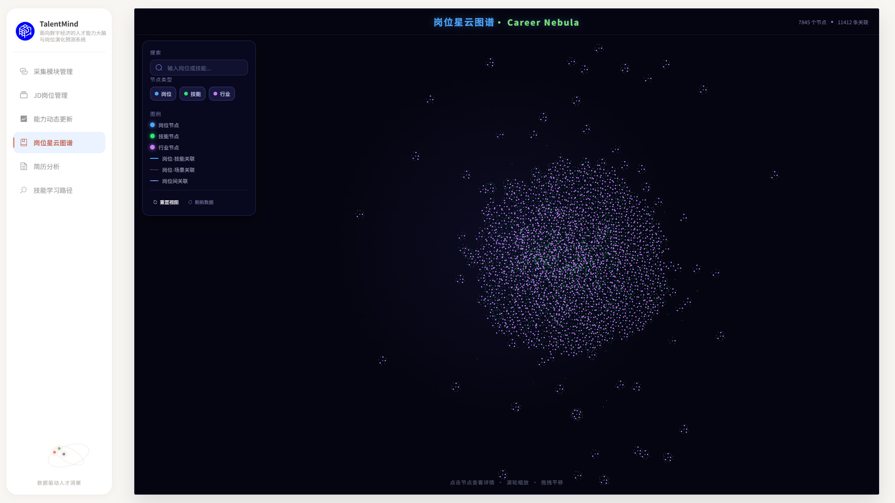

# Issue #26 · P0.5 交互补全交付（2026-10-17）

状态：用户已基本验收 P0.5；最后滚动条补修已开发、本机验证，等待 ChatGPT 复审。未合并 PR #27 或本轮 PR，P1《诗云》未启动。

## 最后界面补修：右侧详情隐藏滚动条（2026-10-17 开始，10-18 交付，最新）

用户已基本验收 P0.5，本轮仅修复右侧详情可见滚动条。开工 HEAD=`150b91a`，分支仍为 `codex/issue-26-p05`；已跟踪文件干净，上轮 11 张未跟踪截图保留原地，未夹带提交。18087（PID 11168 / 父 30052）的 Vite `__file` 确认为本检出；18000（25160）、18086（32572）保持既有服务，未重启/新增服务或改动共享依赖。

**10-18 提交前复核**：18000 仍由 PID 25160 监听，18086/18087 已无监听；本会话未执行停止或重启命令，未擅自恢复服务。以下前后截图和专项验证均已在此前正常运行的 18087 上取得，不能将验证时服务状态误写为提交时仍在运行。

生产差异仅两处 CSS：右侧 `.nebula-detail` 的 `scrollbar-width: thin` 改为 `none`，新增 `.nebula-detail::-webkit-scrollbar { display: none; }`。前者覆盖 Firefox 与现代 Chromium，后者提供 Chromium 兼容。`overflow-y: auto` 保留，模板/脚本、尺寸、位置、文字、左侧工具菜单和图谱交互均未修改。

### 真实前后证据与滚动验证

复用 18087 和既有 GET API，真实 Edge **155.0.4283.45**，使用同一岗位 `job:j-a38f7b74cc5f5920 / 后端工程师` 的原始长详情。没有注入测试长文或替换 API。截图明确排除 headless 默认 `--hide-scrollbars`；初轮默认 headless 截图不足以证明滚动条可见，因此最终前后证据均按排除该参数后的相同条件重新取得。

| 验证 | 1600×900 | 390×844 |
|---|---|---|
| 前后详情外框（x/y/宽/高） | 均为 1189 / 87 / 360 / 770 | 均为 119 / 462 / 244 / 351 |
| 样式 | thin → none；WebKit inline → none；overflow-y 始终 auto | 同左 |
| 滚动行为 | wheel 到180，连续5次8px到220；End 到394，等于1162−768；Home 回0 | wheel 到180，小增量到220；End 到1120，等于1469−349；Home 回0 |
| 不变项 | 面板文字 SHA-256、左侧矩形/滚动属性及相机逐项与补修前相等 | 同左；左侧原滚动条仍保留 |
| 末尾内容 | 最后“使用提示”完整在面板内可见 | 同左 |

隐藏原有10px滚动条后可用内容宽度自然增加，文字折行/scrollHeight 随之变化；没有修改面板外框尺寸、文字或字号。补修前滚动操作通过、隐藏断言 **RED（thin != none）**；补修后全部断言通过。pageerror=[]、API writes=[]，测试独立浏览器在 finally 关闭。连续小增量 wheel 验证触摸板滚动所用事件通路，不声称测试过物理触摸板硬件；本机无 Firefox，Firefox 使用标准 CSS 规则但未做实机验证。

| 场景 | 补修前 | 补修后 |
|---|---|---|
| 桌面顶部（可见滚动条对照） | [截图](assets/issue-26-p05-scrollbar/before-1600x900-top.png) | [截图](assets/issue-26-p05-scrollbar/after-1600x900-top.png) |
| 桌面内容末尾 | [截图](assets/issue-26-p05-scrollbar/before-1600x900-end.png) | [截图](assets/issue-26-p05-scrollbar/after-1600x900-end.png) |
| 窄屏顶部 | [截图](assets/issue-26-p05-scrollbar/before-390x844-top.png) | [截图](assets/issue-26-p05-scrollbar/after-390x844-top.png) |
| 窄屏内容末尾 | [截图](assets/issue-26-p05-scrollbar/before-390x844-end.png) | [截图](assets/issue-26-p05-scrollbar/after-390x844-end.png) |

原始数值与断言：[before.json](assets/issue-26-p05-scrollbar/before.json) / [after.json](assets/issue-26-p05-scrollbar/after.json)。本轮 `pnpm test` **49 passed / 0 failed**；`pnpm run build` 类型检查与 Vite 成功，保留既有 chunk >500kB 警告。专项脚本会比较同目录 before.json；重新取得 RED 证据须使用补修前代码，不能将当前已修复样式误记为补修前。

```powershell
# frontend 目录；复用既有18087和已装依赖
$env:PLAYWRIGHT_MODULE='C:/Users/Serena Lyric/.cache/codex-runtimes/codex-primary-runtime/dependencies/node/node_modules/playwright/index.mjs'
node scripts/test-nebula-detail-scrollbar.mjs --before # 原150b91a样式，预期隐藏断言失败
node scripts/test-nebula-detail-scrollbar.mjs          # 补修后，与before.json比较
$env:pnpm_config_verify_deps_before_run='false'
pnpm test
pnpm run build
```

已将后续《诗云》选中真实节点须明显、持续、易定位且区别于悬停/相邻节点的需求写入 PRODUCT_DECISIONS §7.3 第6项、视觉规范 §3 和 D109，标记为**已确认、待开发**；本轮没有开发高亮或启动 P1。新增 [详情滚动条陷阱](../superpowers/traps/2026-10-17-nebula-detail-scrollbar.md)并同步资产状态。

PR #28 继续叠加 PR #27（base=`codex/issue-26-p0`），完成后停止等待复审；不合并、不操作数据库、不清理工作树。下方相机补修及原轮交付为历史记录。

## PR #28 相机快照定向补修（2026-10-17，上一轮）

依据：[ChatGPT 最新复审](https://github.com/Serena-Lyric/TalentMind/pull/28#pullrequestreview-5558355111)、[Issue #26 最新接力](https://github.com/Serena-Lyric/TalentMind/issues/26#issuecomment-6235411265)。开工 HEAD=`c465f7ae24ee43e6c015e806190718bf6c5b66ba`，分支 `codex/issue-26-p05`，独立检出干净。远端核对 master=`1e5f4da`、P0=`41f9184`、P0.5=`c465f7a`；PR #28 继续以 `codex/issue-26-p0` 为 base，叠加 PR #27，两个 PR 均保持未合并。

### 运行环境审计（先审计，再验证）

| 监听端口 | 监听 PID（父 PID） | 命令行与归属证据 |
|---|---|---|
| 18000 | 25160（29676） | 原仓 `backend/.venv/Scripts/python.exe -m uvicorn app.main:app --host 127.0.0.1 --port 18000`，保留既有后端。 |
| 18086 | 32572（33568） | `node.exe node_modules/vite/bin/vite.js --host 127.0.0.1 --port 18086 --strictPort`；HTTP 返回的 Vue `__file` 为 `C:/Users/Serena Lyric/.codex/worktrees/issue-26-p0/TalentMind/frontend/src/components/GraphPanorama.vue`。 |
| 18087 | 11168（30052） | 同一 Vite 命令、端口 18087；Vue `__file` 为 `D:/Application/ClaudeCode/repository/TalentMind-p05/frontend/src/components/GraphPanorama.vue`。本轮直接复用。 |
| 23306、6379、7474、7687 | 17356、17660 | Docker backend / WSL relay 现有监听，未操作容器或数据库。 |
| 18080、18081、18082、18088 | 无监听 | 本轮没有新增服务。其他系统/项目监听保持原状。 |

审计使用 `Get-NetTCPConnection`、`Get-CimInstance Win32_Process`、父进程及已服务源码路径交叉核对。`TalentMind-p05` 为独立 Git 检出（`.git` 与 common dir 均为 `.git`），所以不出现在原仓 `git worktree list` 中。其 `frontend/node_modules` junction 实际指向 `C:/Users/Serena Lyric/.codex/worktrees/m3-m5-issue-22/TalentMind/frontend/node_modules`；未删除、重装或改写 junction。验证后 18000/18086/18087 的 PID 均保持原值，没有结束个人浏览器或其他原进程；只关闭本次脚本自行启动的隔离测试 Edge。

### 最小修复与回归

选中 A 并展开后改选 B，旧 savedView 原本不会失效。生产代码仅在 `GraphPanorama.vue` 增加选中 ID 的同步 watcher：身份变化（含清空）立即清除旧快照；相同 ID 不清除，仍由首次展开保存 transform、fittedScale、overview，返回逻辑原样复用。同步时机避免同一更新周期改选后展开的竞态。没有修改关系坐标、全图适配、页面外壳或 Y/H 实现。

| 本轮验证 | 结果 |
|---|---|
| 新增真实 SFC setup 回归 | 7 项：搜索/画布改选 B，空白/关闭/类型过滤清除，同 ID 画布重选及搜索循环，同更新周期改选并展开。旧代码定向 **9 passed / 6 failed**，失败为残留 A 快照或实际返回 A 相机；修复后 **15 passed / 0 failed**。同节点重复展开的既有测试保留。 |
| `pnpm test` | **49 passed / 0 failed**；新增测试复用现有 helper，实际执行 SFC、Vue watcher 与相机操作，仅隔离挂载/网络/Canvas 端口。 |
| `pnpm run build` | vue-tsc 与 Vite 成功；现有 >500kB chunk 警告保留。 |
| 18087 真实 Edge 155 回归 | **13 组通过**；新增真实键盘/按钮流程 A→展开→搜索 B→展开/重复/YH→返回 B，相机精确相等。保留原有 1600×900、1920×1080 全览/外壳、真实关系、搜索、滚轮/拖拽、390×844、输入保护及路由冒烟。pageerror=[]，API writes=[]。 |
| 独立只读代码检查 | 本轮两文件生产/SFC diff 未发现 Critical/Important/Minor；独立复跑定向 15/15、全套 49/49。浏览器脚本与文档由本会话另行检查，不能把内部自检当作 ChatGPT 复审。 |

真实浏览器结果：[本轮 browser-results.json](assets/issue-26-p05-snapshot/browser-results.json)。新增场景的 B 展开前相机为 `{scale:0.1807879385181108,x:-145.78549242182243,y:-10.139097741823434}`，返回逐字段精确一致，区别于 A 的 `{scale:0.08437419016874956,x:1574.9924840398633,y:-56.975756701247064}`。本轮重复生成的 11 张截图保留本地 `docs/review/assets/issue-26-p05-snapshot/`，只提交 JSON 结果，原轮已提交截图不覆盖。

本轮命令（`frontend/`，复用既有服务与已装依赖）：

```powershell
$env:pnpm_config_verify_deps_before_run='false'
node --experimental-strip-types --test tests/nebulaInteraction.test.ts
pnpm test
pnpm run build
$env:PLAYWRIGHT_MODULE='C:/Users/Serena Lyric/.cache/codex-runtimes/codex-primary-runtime/dependencies/node/node_modules/playwright/index.mjs'
$env:NEBULA_OUTPUT='../docs/review/assets/issue-26-p05-snapshot'
node --experimental-strip-types scripts/test-nebula-browser.mjs
```

新增 [快照陷阱记录](../superpowers/traps/2026-10-17-nebula-selection-camera-snapshot.md)并同步资产状态和 AGENTS 陷阱入口；没有新增产品裁决。正式 graph.json SHA-256 仍为 `6565D56DBC5A267EB90144F078C54F3D0C761C9A98CA29A18B4DC9C6CDDE38E2`。未运行后端/数据库集成测试，无数据库夹具或清理操作，无 M1/M2/DDL/正式图谱修改，不清理任何既有工作树或分支。仅推送现有 P0.5 分支，再次等待 ChatGPT 复审和用户验收；不合并 PR #27/#28，不开始 P1。

以下为原轮交付记录，42 项测试及原截图属于原轮证据，不替代本轮结果。

## 基线、分支与运行

- 基线：PR #27 `codex/issue-26-p0@41f9184f2e47a86df4fc86d60b93556e8a19e0db`。用户已验收 P0 外壳；本分支仅叠加 P0.5，PR base 为 `codex/issue-26-p0`，不是把 P0 当作已发布 master。
- 代码及正式决策提交：`9f9b478f6afd0f7ea68496bc08ea1ce5ab3b2528`。报告/真实截图另作独立提交。回退该代码提交即可回到 P0 行为；截图文档提交不承载业务逻辑。
- 独立检出：`D:/Application/ClaudeCode/repository/TalentMind-p05`；分支 `codex/issue-26-p05`。原目录仍为 `codex/m1-stage-02@e8235c8`，既有未提交运维文件保持原状；原 17 个 worktree 保留。
- 验收地址：[P0.5 图谱](http://127.0.0.1:18087/#/graph)。只读诊断：[含诊断入口](http://127.0.0.1:18087/?nebulaDebug=1#/graph)，不需要 experimental 参数。未登录时使用页面已有的演示账号登录。
- 保留原后端 `18000` 与 P0 对照 `18086`；本轮前端 `18087`。PR #23 对照仅在本轮目录内导出 `abb73eb` 的 frontend，临时 `18088` 截图后已关闭；全部测试浏览器在 finally 中关闭。

## 实际源码变化

| 文件 | 本轮变化 |
|---|---|
| `frontend/src/components/GraphPanorama.vue` | 启用完整 fit/动态缩放/重置、原位选择、全部真实可见直连、显式全部关联/返回、搜索导航、悬停与三类标签；H 用 v-show 保留面板状态；模式 resize 保留相机，全览窗口 resize 重新 fit；窄屏面板错开滚动。 |
| `frontend/src/graph/nebulaLayout.ts` | 经用户确认，只提取 PR #23 的确定性关系坐标；无新语义布局或旧 R0。 |
| `nebulaViewport.ts`、`nebulaEdges.ts`、`nebulaPresentation.ts` | 选择性复用 PR #23 的真实面板可用矩形、坐标转换、命中、搜索/边筛选与标签避让；屏幕半径上限为岗位/行业/技能 12/10/8 CSS px。 |
| `frontend/src/graph/graphShortcut.ts`、`frontend/src/views/Graph.vue` | Y/H 单键保护、IME 生命周期、路由限定、事件注册/释放；两种模式状态由 Graph 路由持有。 |
| `frontend/src/App.vue`、`frontend/src/styles.css` | 仅图谱路由沉浸类隐藏应用导航/外壳间距，图谱铺满网页内容区域；无 Fullscreen API、无 F11；保留 P0 默认外壳与其他页顶栏。 |
| `frontend/package.json`、`pnpm-lock.yaml` | 恢复 PR #23 已用 d3-force 3.0.0（ISC）及对应类型，增加 Node 测试命令；复用已装依赖，未安装或重装共享依赖。 |
| `frontend/tests/`、`frontend/scripts/test-nebula-browser.mjs` | 42 项算法/真实 SFC 回归及可重跑的真实浏览器 UI 流程。浏览器脚本通过 PLAYWRIGHT_MODULE 使用本机既有运行时，未将 Playwright 增为产品依赖。 |

已同步 PRODUCT_DECISIONS §7.3.1、决策索引 D105–D108、视觉规范、第一批任务书、P0.5 计划和资产状态。H 及关系坐标均由本会话用户明确确认。P0 已验收与 P0.5 已开发/待验收分开记录；后续视觉参数、引擎、语义社区/路径、设置页及旧 PR/工作树处置仍未定，不在本轮实施。

## 布局与 PR #23 的关系

PR #27 旧版黄金角岗位和行业横排导致约 27 万坐标宽度，本轮不是继续保留该坐标后偷偷裁掉外围节点。用户明确允许仅复用 PR #23 关系坐标：岗位/共享节点形成确定性骨干，叶子围绕真实父节点，孤立节点有有限位置。与旧 P0 位置不同，与 PR #23 experimental 的全部 **7,845 个坐标逐项相等**，逆序输入仍相等；关系数据仍是 11,412 条，未增删节点/边。

坐标一致不代表相机比例相同：P0 主窗高度与 PR #23 原外壳不同，完整 fit 会根据实际矩形调整比例和平移。普通边有 LOD 预算；选中时保留该节点的全部类型可见真实直连，不混入邻居之间的关系。选择态只显示当前邻域，清除选择恢复完整筛选图；缩放不会改变真实数据数量。

对照证据：[坐标比对记录](assets/issue-26-p05/comparison-results.json)、[PR #23 1600×900](assets/issue-26-p05/pr23-experimental-1600x900.png)、[PR #23 1920×1080](assets/issue-26-p05/pr23-experimental-1920x1080.png)。这些是真实对照浏览器画面，不是新的视觉目标或《诗云》样品。

## 实际验证

环境：Windows、本机 Node **v24.15.0**、真实 Microsoft Edge **155.0.4283.45**，以 headless Chromium/Edge 的实际网页视口渲染截图，deviceScaleFactor=1。使用既有后端 GET API，未替换正式图谱响应为 Mock。浏览器中真实键盘、鼠标、滚轮与路由操作；evaluate 仅读诊断/尺寸、设置路由及模拟 IME/重复键边界，不调用组件事件函数。

| 检查 | 实测结果 |
|---|---|
| `pnpm test` | **42 passed / 0 failed**，覆盖真实 SFC、布局/视口/边/标签及热键保护。 |
| `pnpm run build` | vue-tsc + Vite 成功；保留现有 >500kB chunk 警告。 |
| 两种桌面尺寸 | 1600×900 图谱/导航均为 y=18..882；1920×1080 均为 y=18..1062，首屏无额外纵向溢出。完整 7845 节点 fit，outside=0。 |
| Y/H | 默认/沉浸交叉隐藏恢复，图谱矩形分别精确为 1600×900、1920×1080；fullscreenElement=null；相机 scale/x/y 精确往返。选择、搜索游标、非默认筛选、高亮保留；长按只切一次。 |
| 搜索及关系 | Python **87 项**，Enter/Shift+Enter/前后按钮循环；222 条原始直连全部提交，显式全关联 fit **223 节点**且 outside=0，重复查看不覆盖原相机，返回精确恢复。隐藏岗位后原始222、可绘制0，无虚构边。 |
| 鼠标及窗口 | 实际节点/空白点击和关闭详情均不改相机；真实滚轮、拖拽；探索 resize 保留相机，全览 resize 重新适配。 |
| 筛选/刷新/窄屏 | 三类开关、全关闭、刷新成功；1280×600、390×844；窄屏选中、全部关联、返回均可点击，两面板不重叠并各自滚动；窄屏沉浸视口高度844。 |
| 输入保护 | 搜索输入、textarea、select、contenteditable、Ctrl/Alt/Meta/Shift 组合、repeat、IME isComposing/compositionstart 与 keyCode229 均不误触发。 |
| 其他页面与登录 | Dashboard/Jobs/Analytics/Evolution/Resume/Learning/ResumeDemo/Collection 八页顶栏和热键隔离冒烟通过；错误密码、登录守卫、注销、重新登录及重入后无重复监听通过。不是八页全部业务功能验收。 |
| 浏览器错误与写入 | pageerror=[]；API 非 GET/HEAD 写请求=[]；临时输入元素 finally 删除，浏览器 finally 关闭。未启动采集/导入/迁移或数据库集成测试。 |

完整结果：[browser-results.json](assets/issue-26-p05/browser-results.json)。复跑（frontend 目录，前端18087和既有只读 API 可用）：

```powershell
$env:pnpm_config_verify_deps_before_run='false'
pnpm test
pnpm run build
$env:PLAYWRIGHT_MODULE='C:/Users/Serena Lyric/.cache/codex-runtimes/codex-primary-runtime/dependencies/node/node_modules/playwright/index.mjs'
node --experimental-strip-types scripts/test-nebula-browser.mjs
```

共享 node_modules 为指向已装 PR #23 依赖的 junction；不应对它执行删除或重装。pnpm 进程关闭自动依赖重装检查；没有重新生成依赖树。独立检出使用本地对象共享以避免下载整仓，与原工作树的文件及分支状态隔离，后续仓库清理仍需单独审计。

## 独立审查与修复证据

独立只读审查无 Critical，发现窄屏详情遮挡（Important）和搜索标签避让读取旧面板高度（Minor），均已修复：

- 窄屏真实浏览器先复现面板相交 RED，再增加错位限高滚动；最终实际点击关联/返回通过。
- 搜索面板高度变化新增 SFC 回归先得到 drawn=1 的 RED，等待 nextTick 后绘制得到0；42项全绿。
- 初次网页沉浸测试发现高度864而非900，修正 scoped CSS 优先级后两分辨率通过；图谱外壳动画禁用，避免连续 resize 破坏相机。

长期陷阱记录：[全览基线与网页沉浸高度](../superpowers/traps/2026-10-17-nebula-fit-and-immersive.md)。独立作者审查和本机测试不能替代 ChatGPT 复审或用户视觉验收。

## 真机截图

以下全部是本轮真实页面渲染，数据为当前既有 API 的 7845节点/11412关系；无装饰节点注入、无 AI 合成画面。

| 场景 | 1600×900 | 1920×1080 |
|---|---|---|
| P0 默认外壳 + P0.5 全览 | [查看](assets/issue-26-p05/overview-1600x900.png) | [查看](assets/issue-26-p05/overview-1920x1080.png) |
| Y 网页沉浸 | [查看](assets/issue-26-p05/immersive-1600x900.png) | [查看](assets/issue-26-p05/immersive-1920x1080.png) |
| Y + H 隐藏内部面板 | [查看](assets/issue-26-p05/immersive-hidden-1600x900.png) | [查看](assets/issue-26-p05/immersive-hidden-1920x1080.png) |

[Python 搜索](assets/issue-26-p05/search-python-1600x900.png) · [全部关联](assets/issue-26-p05/connections-python-1600x900.png) · [真实滚轮近景](assets/issue-26-p05/zoom-1600x900.png) · [窄屏选中及面板](assets/issue-26-p05/narrow-selected-390x844.png) · [窄屏 Y/H](assets/issue-26-p05/narrow-immersive-hidden-390x844.png)





## 保护边界与限制

`backend/`、`exchange/` 相对基线无 diff；正式 graph.json 的 Git blob 仍为 `1416538fedc56d928815b8d6322d0d40c51dac1f`，新检出/原目录 SHA-256 同为 `6565D56DBC5A267EB90144F078C54F3D0C761C9A98CA29A18B4DC9C6CDDE38E2`。未直接连接或查询数据库，故不宣称本轮查询过库表计数/清理夹具；没有写库测试。原工作区的未提交文件清单与开工时一致。

现有 API 的关联岗位数元数据（如 Python 显示225）可能与真实直接边数222不同，未擅改后端或伪造前端数字；关联绘制及诊断以真实边为准。普通 LOD、近景绘制耗时不构成持续帧率保证；未做生产部署、网络失败/空图端到端模拟、付费模型或数据库集成测试，也没有远端 CI 成功声明。离开图谱会初始化下一次图谱会话，不承诺跨路由/刷新持久保存。

到此停下，等待 ChatGPT 复审和用户验收；不自动合并、不启动 P1、不清理旧分支或工作树。
