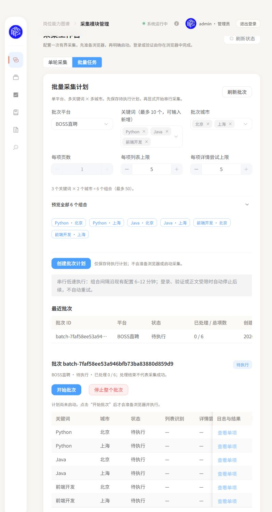

# M1 多关键词×多城市批量任务

基线 `7a68396`，沿用工作树 `m1-m2-quality-replay/TalentMind` 和 `codex/product-integration-20261020`，完成后普通推送原分支/PR44，不新建工作树/分支/PR、不合并master。负责人本轮授权开发和测试，未要求执行真实批量采集。

## 交付范围

单平台多关键词、多城市生成笛卡尔组合，预览后创建未启动计划，再显式开始批次；组合串行，独立状态、run_id、原因、计数和日志/原文/结果复用原接口，统一停止。默认沿原低速切换间隔，可中断等待。单项仍1页、最多5列表/详情；持续模式不启用，遇登录/安全验证/游客限制终止后续组合，不自动重试或启动。

后端批次JSON属于忽略的本地运行态，不新增招聘业务数据库或修改DDL。创建不调用浏览器、采集器或数据库；运行复用原单项control与Windows进程树停止机制。批次和单项共享占用，重启只归档中断，不自动恢复。

## 验证与交接

实施/接口见[计划](../superpowers/plans/2026-10-21-collection-batches.md)。本轮仅离线模拟执行与产品页面创建未启动计划，不以模拟通过证明真实批量采集或完整JD入库成功。

`stop-local.ps1` 补批次等待阶段归档先行：5项隔离PowerShell测试覆盖活动批次、未启动计划保留，以及停止失败不杀服务；均先观察旧行为失败，再验证修复。边界全部为合成服务响应和假进程，未操作真实进程或服务；临时目录在finally自动删除。

### API与输入范围

- `POST/GET /api/collection/batches` 创建草稿/列出本地批次。
- `GET /api/collection/batches/{batch_id}` 查看批次及逐项状态；`POST .../start` 和 `POST .../stop` 显式统一控制。
- `GET .../items/{item_id}/task` 精确获取该单项日志与真实run_id，不依赖仅100条的滚动历史。日志沿用本地原文开关/回环/Host/Origin门禁，过滤TM_EVENT全文并限制受控日志路径；缺文件返回missing，不伪造任务。结果/数据库正文继续使用原results/raw接口。
- 每批一个平台，关键词可新增、去重后1–10个，城市使用该平台已有目录多选，最多50组合（当前目录每平台3城）。每项仍1页、1–5列表及详情，默认低速间隔6–12分钟。没有开放任意城市码、并行爬取、持续循环或自动重试。
- 创建、刷新、切换页面及服务重启均不自动开始；重启中的活动批次归档为interrupted。批次与单项/准备共享互斥；批次执行后旧单项准备资格失效。

### 最终检查

| 检查 | 实际结果 |
|---|---|
| 批次后端定向及相关回归 | 187 passed，其中新增50项批次测试；覆盖串行、互斥、网站门禁、准备/运行/等待阶段停止、重启、持续保存失败释放、长期日志和原文门禁 |
| 后端完整非集成阻网回归 | 1423 passed / 2 failed / 2 skipped / 23 deselected；93个Python进程、网络尝试0、临时目录删除true |
| 保留失败 | 仍为既有 `test_repository_draft_covers_eight_families_and_empty_release`、`test_shipped_source_hash_matches_a_fresh_LF_checkout` 的B3 source hash/quote mismatch；不重签或跳过修绿 |
| 前端 | 139/139通过，含11项批次SFC行为测试；vue-tsc及Vite构建通过，保留已有图谱导入/大chunk警告 |
| 停止入口 | 5/5隔离PowerShell回归；真实源脚本通过语法与UTF-8 BOM检查 |
| 独立复审 | 两项P2（持久化失败占用残留、旧日志滚出历史）先复现再修复；复查无新增阻塞，另定向8后端/11前端通过 |

### 真实页面：只创建计划，未运行

控制台顶部“批量任务”选Python、Java、前端开发与北京、上海，页面正确显示3×2=6并预览全部组合；点击“创建批次计划”后，批次 `batch-7faf58ee53a946bfb73ba83880d859d9` 为queued，started_at=null，6个条目全部queued、run_id=null、各业务计数null。**未点击“开始批次”，未发prepare/start请求、无采集worker进程。**

验收专属草稿已从运行目录精确移入忽略的私有证据目录，运行列表复查该夹具计数0，避免留可误启动的测试任务；截图和原始JSON证据保留。未清理真实业务数据。

创建前后实查八张MySQL表全内容摘要、Neo4j全内容摘要、正式graph.json和主仓10项修改摘要均相同；jd_pool仍2988，分析层717/717/275，Neo4j7845/11412。未运行生产集成测试或实际批量采集，测试临时文件自动删除。

### 使用与后续

继续用本工作树 `start_system.bat` 或 `pwsh -File scripts/start-local.ps1`，访问18080采集模块并切换“批量任务”；先建计划，之后由负责人自行显式开始。统一停止脚本也会先停止活动批次，保留数据库与Edge。BOSS人工验证和智联DOM身份绑定的已有真实限制未因批次功能消失，见[统一集成报告](Product-integration-2026-10-21.md)；本轮没有声称Gate1或真实批量入库已通过。

批次运行态、日志、数据库原像与个人配置均在忽略的data/local，不入Git。回退只涉及本轮代码提交；本轮无业务数据回滚。仍推送原集成分支与PR44，供集中审查，不合并master。
