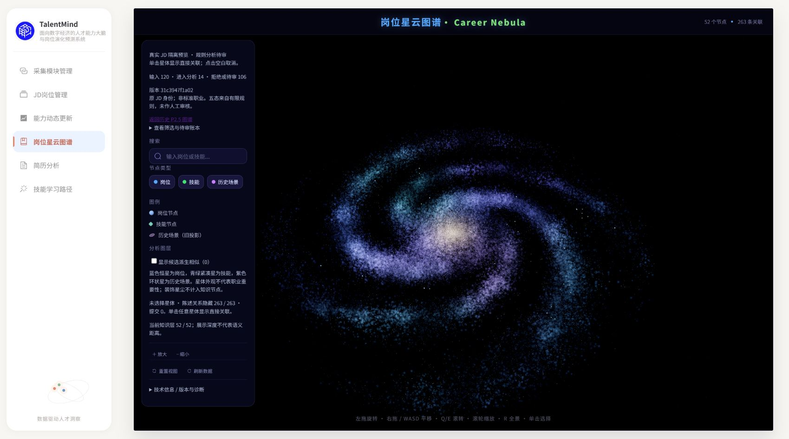

# M1/M2 真实 JD 质量修复与第二轮贯通

2026-10-20（Asia/Singapore）。交付状态：独立候选，等待外部复审；不合并、不切换生产。

实现提交 `2c51aa58b2738291186c5d06e6bf4a88678b31ef` 已推送，叠加 [Draft PR #40](https://github.com/Serena-Lyric/TalentMind/pull/40) 已创建并附当前聊天；实查 OPEN、isDraft=true、mergedAt=null、autoMergeRequest=null，暂无远端CI。后续交付登记只修改文档，不改变上述实际实验版本。

## 基线与实现

从 #39 文档 HEAD `e20e6ffb9dd524aefbf1aa568ec27ee89cda0c31` 建立独立工作树 `m1-m2-quality-replay/TalentMind`、功能分支 `codex/m1-m2-quality-replay`。#38 核验仍为 `e2e07ecd3361ea33b4a9add2d17b453399162943`。PR base 为 `docs/post-e2e-implementation-20261020`；这里只审查相对 #39 的增量，不将上游堆叠功能计为本次实现。

- B1 `conservative-activity-v3`：元数据不是工作活动；限制跨标点、开发经验/流程等名词的误命中；支持有限的对象在前职责。同行明确职责标题终止元数据遮蔽，反向职责必须完整匹配动作边界，不能截断“开发进度管理”。
- B2 `bounded-skill-clauses-v3`：按原字符串偏移识别同行标准章节、括号/数字条款；支持有限能力词及语言/数据库后缀。逗号仅在所有片段均完整命中正向语法时拆分；共享否定、整体选择/加分尾注及未知组合保守待判断。旧 B2 结构及历史报告原样保留。
- SQL 导出增加非负 `--offset`，固定三平台按 ID 排序的独立窗口；不执行 SQL、不连接数据库。M1 现有 BOSS 详情字段合并已存在，没有再次重写适配器或从其他行补正文。
- 新增 `app.graph.real_quality`：同输入/身份/指纹对照、分平台字段与原因审计、五态及未解析计数、32 项受控本地待标注摘录。摘录保留具体技能目标、原文位置、章节/条件上下文及争议入口；人工标签为 null。已有 `governance.evaluation` 继续负责合法来源和人类签审后的正式评测。
- 复用 `real_pipeline`、正式 Vue、来源索引和私有预览。没有修改前端源码、相机、星尘或其他工作线文件；没有接入 M4 生产匹配。未确认陈述不授予匹配/正式统计资格。

## 真实原因与有限修复

原始备份 SHA-256 `9df1424cedadd96dbd6ce5b5b5196679b757988199cf46b346dc5770e0012be2`。120 条固定输入 SHA-256 `b6c37b28932ea43820eafaf7c43903b5747514f64ba86a8e5790aa71d5536dff`，与 #38 **字节相同**。原包保留原工作树，未写入、移动或清理。

| 问题 | 证实的原因 | 本轮处理 |
| --- | --- | --- |
| BOSS 0/40 | 全部为历史列表卡片，正文仅标题/薪资/地点等；duties、requirements、experience 均空。没有可核验工作活动，工资含私用区字体字符 | 全部仍 needs_review；不凭标题/工具入分析、不猜字体、不造详情。现有备份无法证明当时为何未抓到详情，不能断言是当前适配器丢字段 |
| 91 needs_review | 80 insufficient_evidence、11 ambiguous_activity；后者涉及产品/公司背景、否定、示例或归属等规则无法裁决的语境 | 对照账本保留所有身份、原文及原因；不将未入分析伪装成范围外 |
| 7 input_failed | 均为猎聘 raw_text 空字符串，在严格输入边界失败；与规则判断无效、B2 uncertain 不同 | 原样保留，不用 duties 或别的 JD 补造正文 |
| B1 误命中 | 标签间的“开发…软件”、开发流程/经验跨到后面的代码或程序词，被当成工作活动 | 排除标签并收紧动作和对象边界；增加可说明的反向职责正例 |
| 22 条 B2 全 partial | 每篇均包含语法未覆盖的文字/未知技能/元信息；识别出技能并不代表整篇分析完成 | 保留 partial；不清空 issues 来制造 completed |
| 416 条 uncertain 边 | 按实际图边 reason 分账：368 unsupported_context、30 multiple_degrees_unparsed、18 unsupported_clause。同行章节/编号没分开，元数据和公司背景影响上下文，多个程度混在长句；部分条件跨整篇保守生效 | 修复结构；不能解释的尾句/范围仍 uncertain。上述数字不是 B2 原陈述数量（B2 含被 B22 排除的领域等词），不能混用分母 |

三平台输入都没有独立 requirements 列；这不是 JSON 导出漏掉已有字段。duties 常包含整个职位描述和其中的任职标题，因此 B2 即使从 duties 读取也必须识别内部章节。raw_text/duties 可能重复同一内容，保留字段证据，不能按陈述数量推算独立需求。

## 最终第二轮结果

最终固定样本版本 `31c3947f1a02e305fa35e7a87e4e44d0b602fba223efc9cd500fa6b4a20b587f`，私有目录 `data/local/quality-round2-v3/`。v1/v2 是诊断中间版本，保留但不作为交付。尤其 v2 曾产生两条规则 required，独立审查发现拆句的范围漏洞后已撤回，**不将这两条作为改进成果**。

| 阶段 | #38 首轮 | 最终第二轮 | 独立留出 |
| --- | ---: | ---: | ---: |
| 输入 | 120 | 120（同字节） | 60 |
| B1 in_scope | 22：智联19/猎聘3/BOSS0 | 14：智联12/猎聘2/BOSS0 | 1：智联1 |
| needs_review / input_failed | 91 / 7 | 99 / 7 | 51 / 8 |
| B2 completed / partial / failed | 0 / 22 / 0 | 0 / 14 / 0 | 0 / 1 / 0 |
| B22 候选 / unresolved fragments | 0 / 530 | 8 / 338 | 2 / 22 |
| M3 节点 / 陈述边 | 71 / 417 | 52 / 263 | 6 / 20 |
| required / preferred / not_required | 0 / 0 / 0 | 0 / 0 / 0 | 0 / 0 / 0 |
| uncertain / mentioned | 416 / 1 | 262 / 1 | 20 / 0 |
| 冲突 / 相似边 / 非平凡社区 | 0 / 0 / 0 | 0 / 0 / 0 | 0 / 0 / 0 |

B1 有9条从 in_scope 返回待审，1条从待审进入分析。**不能称9条都是原误判**：其中确有标签、经验和流程误命中，也有仿真/软件设计、编码实现等实际技术内容因有限语序覆盖不足被降级；这些是真实召回损失，逐条保留在私有 comparison 账本。新规则不等于真实范围分类更准确。明确职责而当前匹配不到时保留待审，不删除输入。

前后共有250个相同“JD/字段/技能原文位置”锚点：249仍 uncertain、1仍 mentioned；167锚点移出投影、13新增。uncertain 总数减少主要来自筛选集合与结构变化，**没有证据证明确认需求增长或语义准确率提升**。B22 的8个候选全部未准入；unresolved 数量也受样本量和切分口径影响，不能当作错误减少量。

留出在规则开发阶段锁定为相同备份各平台 ID 升序第41–60条，三平台各20，输入 SHA-256 `2fbd810d580ee93d166c162226114ee3b3cae8894215555c0a69a894ee32c474`；实际核验与120条身份无交集。未读留出正文来设计规则；最终复现只因独立合成审查发现作用域漏洞而更新，未按留出结果调参。它是独立留出回放，**不是随机代表样本或人工金标准**。20条BOSS仍无职责正文（9条仅有experience元数据）；猎聘另有8条空正文，暴露输入覆盖仍弱。

## 重放、标注与运行

[公开对照计数](real-jd-quality-round2/comparison-counts.json)、[主样本清单](real-jd-quality-round2/run-manifest.json)、[留出清单](real-jd-quality-round2/holdout-manifest.json)仅含聚合、版本和摘要；没有私有原文、SQLite或原始来源索引。两套样本分别再次完整运行；facts/derived/layout 三文件字节相同，摘要列于对照计数。

私有 `data/local/quality-comparison-final/` 包含逐条 B1 变化及 `review-pending.json`：32项（BOSS7/猎聘12/智联13），含明确与歧义的筛选/技能证据，字段和章节上下文可回源。算法预测与空人工标签分开；指标状态 `not_evaluated_no_human_signoff`，precision/recall=null。这是**最小化、初步筛除敏感片段的受控本地草稿**，不是已经认证的匿名公开数据；完整脱敏及真实人类签审尚未完成，分享前必须人工检查。不存在把这些未签审条目当作金标准的功能。

使用已安装项目依赖及 `backend/app/graph/requirements-offline.txt`。本机复用只读研究解释器，cwd 指向本工作树 backend，不读任何真实 .env。示例目标必须不存在：

```powershell
Set-Location backend
python -X utf8 -m app.integration.real_jd_export --sql D:/backup/TalentMind-2026-10-14/snapshots/mysql-current-20261014.sql --offset 40 --per-platform 20 --output ../data/local/holdout-new
python -X utf8 -m app.graph.real_pipeline run --input ../data/local/quality-round2-v3/input.json --dataset m1-preserved-20261014-first40 --provenance ../data/local/quality-round2-v3/source-provenance.json --output ../data/local/replay-new
python -X utf8 -m app.graph.real_pipeline verify --output ../data/local/replay-new
python -X utf8 -m app.graph.real_quality --before <本机原始v2包路径> --after ../data/local/replay-new --output ../data/local/comparison-new
```

正式 Vue 私有模式：在 frontend 设置 `M3_REAL_PREVIEW_DIR` 为本工作树 `data/local/quality-round2-v3` 绝对路径，运行既有 Vite，打开 `http://127.0.0.1:18094/?graphDataset=real&nebulaDebug=1#/graph`。本次验证复用已装依赖，额外把优化缓存显式放在本工作树忽略目录；没有安装/清理其他工作树依赖。

## 验证与独立审查

已实际执行的阶段证据：新增结构/导出用例先7 failed；B1误命中先3 failed；反向职责先2 failed；审查范围/元数据/动作边界先9 failed；标注上下文与目标先2 failed；experience诊断归类先1 failed，均修复后通过。定向范围、语义、治理和贯通组合292 passed，新增质量用例最终34 passed。前端95 passed，vue-tsc与Vite构建通过（保留既有大chunk提示）。完整阻网非集成最终结果另见本报告收尾记录。

独立只读审查 Critical0/Important5/Minor2。Important 的逗号共享范围、编号尾注、同行元数据边界、反向职责截断及标注上下文/多目标身份，均加入失败用例后统一修复；没有以作者自检替代交付后的外部复审。两个 Minor 保留：开发“工具软件”等明确活动仍可能被保守规则误降级；初步敏感筛查不覆盖全部联系方式（如固定电话），草稿不得直接公开。

实际浏览器：最终版本显示52/263、120→14/106；搜索Java后从 uncertain 关系回到 JD248941 的平台、原始来源、观察时间、指纹和全文。不是职位数/确认要求统计。全部263条前端 sourceIndex 连续对应原边并通过真实文件校验。历史回退显示7845/11412；专属破坏副本的错误 facts 摘要、缺失 sources 均显示0/0及错误，不回落成历史数据。缺失文件会另触发 Vite 开发错误覆盖层，失败关闭成立，错误展示仍较粗糙。原文截图仅本机保存；公开仅保留不含JD正文的最终概览。

未运行服务集成、真实采集或生产库查询/写入；不存在需对生产库执行的测试夹具清理，也不声称查询过生产数据。临时测试SQLite/文件在临时目录自动清理并核对目录消失；交付分析包属于私有审计资产，按要求保留。没有修改B3候选/审核/发布或正式M3快照。

## 回退与遗留

1. 移除 `graphDataset=real` 回到历史P2.5；该路径实际验证7845/11412。
2. 需要首轮稳定保底时，把隔离预览的显式路径改回原 #38 的 `real-e2e-20261020-v2` 并重启Vite；固定输入及原13项文件摘要保留。不要用新版源码覆盖旧包，也不要更改正式M3文件。
3. 整个功能分支保持Draft即可撤销采用；无需数据库回滚、迁移或真实数据恢复。私有包均新目录，不清理其他工作树。

本轮实现完成的是**可执行有限规则修复、对照/留出/回源及第二轮隔离展示**。真实完整语义、独立人类评测、BOSS历史详情恢复、复杂条件/组合、B1召回损失和完整脱敏仍未解决；保留 #38 保底，不把候选当生产验收。零确认需求增长是实际结果，不通过放松 uncertain 或重签B3来美化。

## 最终验证收尾

- 完整阻网非集成：**1215 passed、2 failed、2 skipped、23 deselected、190 warnings**，168.32秒（并发开发环境，不作性能结论）；最后补充的experience诊断用例单独RED→GREEN，新质量文件最终34 passed。两项失败为 `test_canonical_catalog.py::test_repository_draft_covers_eight_families_and_empty_release`、`::test_shipped_source_hash_matches_a_fresh_LF_checkout`，均为上游B3 `source hash or quote mismatch`，#38已有同样失败；未重新签署候选或改产品文档来修绿。
- 阻网审计88个Python进程，外部/服务连接与DNS尝试0；另拦截1次urllib3导入时 `_has_ipv6` 本地bind探测，允许12次标准库内部socketpair事件；专属临时目录退出后确认不存在。阻网器、完整原日志及独立审查ledger保留在本机 `data/local/quality-execution/`。
- 前端95 passed，`vue-tsc --noEmit` 和Vite build通过，仍有既有chunk提示；构建只带原历史图/布局，不带私有来源或SQLite。真实三份文件进入前端验证器后，52节点/263边及全部sourceIndex匹配。
- 原 #38 包13项文件逐项SHA不变；正式 `exchange/m3`、B3目录/审核/发布、产品决策与前端源码相对 `e20e6ff` 无diff。没有生产数据库操作、工作树清理或自动合并。


