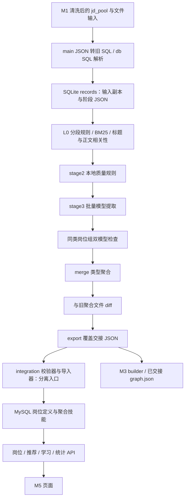

# M2 岗位分析架构差距评估（第一轮）

日期：2026-10-15（Asia/Singapore）。范围：只读代码评估、已确认产品决策归档与改造建议；**没有实施 M2 改造**。

评估基线：远端 `master` 的 `402bdfe413cd634624d3912b180624eca6c5944a`，文档分支 `codex/m2-architecture-gap-assessment`。原工作区仍在 `codex/m1-stage-02`，其 `资产与状态.md` 有用户未提交修改；本轮使用独立工作树，不切换、覆盖、暂存或提交原工作区内容。

阅读依据：[产品决策](../PRODUCT_DECISIONS.md)、[决策索引](../superpowers/决策跟踪.md)、[资产状态](../superpowers/资产与状态.md)、[AGENTS](../../AGENTS.md)、[起始入口](../../AGENT_START_HERE.md)及实际源码。已追加 M2-15～24 与 D63，M2-01～14 和 D1～D62 保留。本文所有技术方案均为**推荐，待裁决及开发验收**；不构成算法、阈值、模型、版本字段或新契约定稿。

证据标记：**F**＝源码可直接确认；**V**＝本轮合成输入离线验证；**I**＝基于控制流的静态推断；**R**＝仍需专用运行环境或标注样本验证。定位均对应上述基线；源码链接后的 `L` 为一基行号。未查询真实数据库，不以 717 岗位或历史测试数证明新能力。

## 1. 执行摘要与总体可行性

**可在现有 M2 上渐进改造，无须重写采集、词典、SQLite 或文件交接体系；但当前管道不能直接作为可信统计基础。** 优先问题是输入不完整/漏更新、续跑输出不完整、校验失败冒充成功，以及单条证据被合并压缩。先解决这些问题，才有条件验证五态技能和统计规则。

当前真实主线是“旧格式 SQL → SQLite 状态 → 规则/标题/相关性筛选 → 本地规则质量评分 → 模型提取 → 按岗位类型聚合的双模型检查 → 类型合并 → 快照 diff → 文件覆盖导出”。README 中的“三模型、质量模型、断点续跑”不是对全部实际路径的充分描述。

最小建议：复用 `StateDB` 与单条提取模型外壳，在独立分析中间层保存完整输入引用、分析身份、证据及成功/失败状态；用完整输入指纹和分析版本控制复用；从固定成功事实集合重建聚合，再由独立适配器产生旧交接格式。默认不触碰正式 MySQL/Neo4j，也不覆盖现有 `exchange/m2`。

**调整候选阶段的依赖**：A 应包含最小身份、证据、失败与失效闭环；B 完善语义和分类；独立职位分母要求的最小关联裁决（D 的一部分）必须先于 C 的正式要求率。不能把高级去重后置后，先把 JD 条数称作独立职位数。完整跨来源识别、不确定范围和时间可比性仍可分阶段建设。

## 2. 当前真实架构与数据流

该图为调用结构，不表示完整 CLI 已运行。当前 `main --help` 提前返回；实际执行路径的裸模块导入阻塞包入口。M2 不由 FastAPI 自动完成上述分析；M3 builder 与既有含行业图谱文件也不是可互换的同一产物。

### 2.1 证据目录

| 编号 | 文件 / 位置 | 已确认的执行行为与边界 |
|---|---|---|
| E01 | [main.py](../../backend/app/job_analysis/main.py#L46) L46–132；[config.py](../../backend/app/job_analysis/config.py#L7) L7–29、L106–124 | F：帮助在导入管道前返回；完整路径混用相对导入与 `from pipeline/db_state import`；JSON 转临时旧十列 SQL，未清理临时文件。配置只读环境变量；LLM 与 DS 端点分开，词典可被本地数据包快照替换。帮助中模型环境变量说明与固定槽位池不一致。 |
| E02 | [db.py](../../backend/app/job_analysis/db.py#L6) L6–7、L116–165；[DDL](../../backend/app/contracts/ddl.sql#L3) L3–11 | F/V：解析器固定旧十列，忽略 INSERT 列名，逐行解析并静默跳过转换失败。当前表含 `source_detail/cross_source`；按当前 DDL 列序的十二列合成 INSERT 解析为 0 条。不能承诺支持任意 mysqldump、多行或批量 tuple；JSON 绕转也丢上述新增字段。 |
| E03 | [db_state.py](../../backend/app/job_analysis/db_state.py#L22) L22–36、L54–170 | F/V：`content_hash` 是 `raw_text[:2000]` 的 64 位 SimHash；唯一索引只比较相等，没有 Hamming 距离近似匹配。`dup_group` 选质量/密度代表，其他存 `dup_skip`；hash 碰撞则直接跳过不留来源映射。`g:` 前缀不含组 ID。 |
| E04 | [db_state.py](../../backend/app/job_analysis/db_state.py#L111) L111–139、L191–224 | F/V：同 ID 内容变化才更新，但不刷新 duties/experience/crawled_at/cross_source；force 仅清阶段结果，不刷新任何输入字段。单行阶段 JSON 覆盖，没有运行/输入/规则版本账本。阶段 pending 查询可复用。 |
| E05 | [pipeline.py](../../backend/app/job_analysis/pipeline.py#L69) L69–116、L128、L162、L416–420、L463–487 | F/I：仅从 `s1_pass` 组本轮 candidates，未按 `s2_pass/s3_pass` 恢复或从历史 `s3_json` 取成功事实参与最终 merge；续跑可能只输出新增部分乃至空集合。输入缺项直接标下架，不要求完整快照；先生成的下架日志又被 diff 返回值覆盖。 |
| E06 | [rules.py](../../backend/app/job_analysis/rules.py#L150) L150–211；[pipeline.py](../../backend/app/job_analysis/pipeline.py#L26) L26–33、L107–110、L310–315；[batch_prompts.py](../../backend/app/job_analysis/batch_prompts.py#L63) L63–69 | F：长文分段删减/重排并限额，seg_text 替代 raw_text，提取批量 prompt 再取前 4000 字，仅传标题/正文。旧单条 prompt 含职责并不能证明实际批量调用使用职责/任职条件。L5 使用清洗后的原全文，与 L4 清洗后的分段输入不完全一致，没有原文位置映射。 |
| E07 | [models.py](../../backend/app/job_analysis/models.py#L84) L84–124、L137–185；[stage3_extract.py](../../backend/app/job_analysis/stage3_extract.py#L107) L107–184 | F：技能只有 `is_required` 二分；缺失标记默认 True。unknown 为字符串名列表；词典外项被剥去原证据、置信度、要求标记。`_validate_extraction` 没被解析路径调用，且自身仅检查空值等，不验证引文属于指定 JD 原文。 |
| E08 | [pipeline.py](../../backend/app/job_analysis/pipeline.py#L250) L250–368；[verify.py](../../backend/app/job_analysis/verify.py#L175) L175–219 | F：先把原始响应写 s3_json，再用类型化结果覆盖。L5 按岗位规范名分组、同技能选最高置信证据，在组内任意 JD 搜索引文前 50 字；找不到只是回退文本窗口，非确定性失败。Judge 失败/null 后却把组内技能标 verified。未发现编排调用 verify 阶段的 mark_done。 |
| E09 | [stage3_extract.py](../../backend/app/job_analysis/stage3_extract.py#L323) L323–338；[pipeline.py](../../backend/app/job_analysis/pipeline.py#L319) L319、L369–414；[stage2_quality.py](../../backend/app/job_analysis/stage2_quality.py#L168) L168–181；[stage1_relevance.py](../../backend/app/job_analysis/stage1_relevance.py#L15) L15–25 | F/I：提取 API 错误兜底为 pass/正常模型名，另给 manual_results；编排未使用 manual_s3，零技能分支又可能记成“成功但零技能”业务拒绝。1–2 技能被拒，0 技能另分支处理。stage2 实际规则评分且全部 pass；相关性按新一代信息技术范围筛选，manual 按 reject 收口（pipeline L213–219）。这些是旧过滤行为，不能自动作为新统计总体或分析完成定义。 |
| E10 | [merge.py](../../backend/app/job_analysis/merge.py#L54) L54–110、L130–246 | F/V：标题清理并删 seniority；同类型并组，不是独立职位识别。技能必备取 OR、最高 confidence 对应单条 evidence、出现次数累加；weight 为最高 confidence 在所有技能中的归一份额。代表名按技能最多选，再据其生成 ID；来源/场景为 set，并非稳定有序输出。 |
| E11 | [differ.py](../../backend/app/job_analysis/differ.py#L45) L45–169；[export.py](../../backend/app/job_analysis/export.py#L11) L11–41、L57–88 | F：diff 按岗位名称比较聚合快照，技能缺项写“JD不再要求”；比较 confidence 却称权重变化，非逐职位版本研究。source_jd_time 构造时未填。导出固定 schema/contract 头与时间，直接写相同文件名；无单条分析导出/运行清单、历史保留或整批原子发布。报告 total 混合聚合定义数与拒绝/复核记录数，不能作覆盖率分母。 |
| E12 | [normalizer.py](../../backend/app/skills/normalizer.py#L1) L1–14；[stage3_extract.py](../../backend/app/job_analysis/stage3_extract.py#L96) L96–104；[词典](../../backend/app/skills/skill_dict_seed.json) | F：285 项 canonical/别名、10 类，含软技能；共享精确归一函数可复用。stage3 自建别名表且不保存分类。既有分类不是新产品四类技能/条件/场景的完整类型体系，别名冲突需检查。 |
| E13 | [schema.py](../../backend/app/collect/schema.py#L5) L5–13；[cleaner.py](../../backend/app/collect/cleaner.py#L174) L174–186；[repository.py](../../backend/app/collect/repository.py#L40) L40–77；[dedup.py](../../backend/app/collect/dedup.py) | F：M1 原始层存的是经过清洗的文本，采集时赋 crawled_at；RawJD.job_id 临时 join 后不落库。source_detail 可承载职位链接/平台身份，增量入库可匹配并补详情，但更新不保存前版本或最后观察序列。正文相似/dup_group 是线索，不是已经裁决的独立职位关系。 |
| E14 | [fetch_hn_jobs.py](../../backend/app/collect/fetch_hn_jobs.py#L16) L16–46；[hn_hiring.py](../../backend/app/collect/fetchers/hn_hiring.py#L65) L65–107；[cross_validate.py](../../backend/app/collect/cross_validate.py#L56) L56–115 | F：HN 按父帖来源删除后提交再导入；评论 ID/时间未完整保留，父帖 URL 不等于单职位身份。交叉验证标题相似并抬 quality，不等于确认同一职位；只上调/置位，未清旧命中。signal 是技术热度，不能当招聘观察序列。R：真实现存历史是否可恢复须另查有授权的快照。 |
| E15 | [m2_package.py](../../backend/app/integration/m2_package.py#L13)；[import_exchange.py](../../backend/app/integration/import_exchange.py#L88) L88–108、L193–198、L343–347；[validate_exchange.py](../../backend/app/integration/validate_exchange.py) | F：默认包路径可指向私有旧回包；加载兼容数组/包装与稳定 job_id、名称回退。技能按岗位 ID/canonical 留最高 confidence，不能保留逐 JD 冲突。job_skill.jd_id 实写内部岗位定义 ID，不能视为原始 JD 外键。import_all 自动确保结构并全量清空重导；不自动先调用独立校验器。 |
| E16 | [builder.py](../../backend/app/graph/builder.py#L69) L69–86、L125–146、L292–329；[import_graph.py](../../backend/app/integration/import_graph.py#L24)；[mvp.py](../../backend/app/routers/mvp.py#L294) L294–321、L363–366；[learning.py](../../backend/app/routers/learning.py#L83) L83–103 | F：M3 旧 builder 消费 required/bonus 数组、词典过滤、固定边权 1.0/0.6，不读五态事实；图谱导入先全库删除。推荐/匹配 API 读聚合数组，学习接口按 m2_job_id 取单份聚合 evidence。完整中间事实不能原样替换旧接口。 |
| E17 | [dashboard.py](../../backend/app/routers/dashboard.py#L85) L85–110；[Analytics.vue](../../frontend/src/views/Analytics.vue#L11)；[evolution.py](../../backend/app/routers/evolution.py#L38) L38–70；[JobEvolution.vue](../../frontend/src/views/JobEvolution.vue#L6) | F：技能频次按聚合 job_skill 计，percentage 为 count/maxCount；Analytics 将其展示为热门技能需求。演化接口对日志无真实/演示过滤，展示 version 来自日志数量；不能视为真实 JD 版本。M5 需新统计响应与降级元数据。 |
| E18 | [matcher.py](../../backend/app/matching/matcher.py#L286) L286–328；[mvp.py](../../backend/app/routers/mvp.py#L308) L308–319；[learning.py](../../backend/app/routers/learning.py) | F/I：匹配对未命中技能统一产生 unmatched，API 标 missing/建议学习；若聚合输入含软技能，也会进入此路径，不能据简历未提及断言求职者缺乏。R：实际软技能回包占比及文案效果需后续离线分类样例验证。 |
| E19 | [rebuild_m2_graph.py](../../backend/app/integration/rebuild_m2_graph.py#L68) L68–163；[mvp 图谱读取](../../backend/app/routers/mvp.py#L165) L165–199、[聚合编辑](../../backend/app/routers/mvp.py#L432) L432–437；[Jobs.vue](../../frontend/src/views/Jobs.vue#L76) | F：另一条图谱重建链从 MySQL 定义/技能读入，以 m2_job_id 建岗位键、scenarios 建行业，写 graph.json 并全库重导；仍是 required/bonus 二分。M5 图谱 API 实读 Neo4j，新 M2 文件不会自动更新页面。岗位页手工新增技能默认加入 required 并写旧 JobPayload，不维护新事实。 |

### 2.2 已保存但会丢失/压缩的信息

1. `s3_json` 可保存 unknown 名称和单条提取结果；不能说 unknown 完全没有保存。但原始响应与最终结果共用槽位，未知项证据在类型化时已丢，最终 merge/export 不含候选池或单条事实。
2. 合并仅保留最高置信度那份 evidence，丢其他 JD 的要求状态和证据；`evidence_jd_count` 是技能项次数，未按 JD ID 去重，不能直接作不同 JD 支持数。
3. 标题中的级别在 normalize 时删除，没有单独维度保存。`source_jd_count` 仅是成功输入记录组大小，没有可审核的成员清单/独立职位清单。
4. `verify_json`、done 和分阶段 pending API 虽定义，实际编排没有构成完整恢复链；原始下架日志还会被后续赋值覆盖。字段存在不等于能力闭环。
5. 交接版本头只有固定 schema/contract 与生成时间，单条 model 名即使被阶段 JSON 保存，也不包含规则、提示词、词典、聚合版本；最终定义又不保留单条 model 等来源清单。

## 3. 已确认目标与架构差距矩阵

“部分实现”只表示已有局部基础，不能据此上线相应产品能力。代码证据 E 编号对应 §2.1 的文件、行号和执行行为。

| 目标能力 | 现状 | 代码证据 | 差距 | 可复用部分 | 风险 | 建议阶段 |
|---|---|---|---|---|---|---|
| M2-01 单条事实后聚合 | 部分实现 | E07–11：ExtractionResult→s3_json→merge | 单条事实不是稳定长期账本，续跑未读历史成功事实 | 类型模型、SQLite、批回调 | 聚合漏数据/无法复核 | 第一阶段 A |
| M2-02 五种要求状态 | 未实现 | E07：bool、required/bonus | 不承载仅提及/否定/待判断；缺失默认必备 | 技能原文与解析入口 | 需求强化 | 第一阶段 A 留结构；后续 B 完善 |
| M2-03 未提及与不确定/否定分开 | 未实现 | E07、E09、E11：manual 收拒绝、缺项称不再要求 | 无相应分析完成边界，集合缺失不能推否定 | verdict、错误外壳 | 错分母/假否定 | 第一阶段 A；后续 B 完善 |
| M2-04 已知归一、未知证据候选与严格准入 | 部分实现 | E07、E12：别名、unknown 名称 | 未知项证据丢失，无候选审计/准入闭环 | 词典、归一函数、unknown 容器 | 幻觉/候选丢失 | 第一阶段 A 保留；后续 B 治理；准入待产品裁决 |
| M2-05 四类技能、条件与场景分开 | 部分实现 | E07、E12：词典类别、scenarios | 分类未进事实；专业领域可能混成技能 | seed category、场景字段 | 指标混类 | 后续阶段 B；类别边界待产品裁决 |
| M2-06 软技能统计/简历解释边界 | 部分实现 | E12、E18：有软技能类，missing 统一生成 | 缺“未见证据”与“缺乏能力”解释区分 | 软技能词典、匹配结果装配 | 对用户错误能力判断 | 后续阶段 B 及下游适配 |
| M2-07 职业大类/标准岗位/方向/级别 | 未实现 | E07、E10：仅 job_name 及删级别 | 无四层身份与分类证据 | 标题清理、单条职责 | 类型与职位混淆 | 后续阶段 B；目录待产品裁决 |
| M2-08 多方向、级别分层、允许未明确 | 未实现 | E10：级别剥离 | 无集合方向、未知级别和分层样本 | 保留输入标题 | 级别混样 | 后续阶段 B+C |
| M2-09 主辅岗位且不重复计数 | 未实现 | E10：标题同类分组 | 无主辅关联、计数归属 | 输入 jd_id | 重复分母 | 后续阶段 B 与 D 最小关联协同 |
| M2-10 成熟复合职业/材料多职位区别 | 部分实现 | E10、pipeline L423–447：特殊标题处理/过滤 | 保留或剔除 multiple 不等于拆分/主辅识别 | full-stack 标题处理 | 多职位漏计/误并 | 后续阶段 B+D；拆分规则待产品裁决 |
| M2-11 标题职责联合、冲突可不确定 | 部分实现 | E06、E09：标题快筛，正文截断 | 无分类冲突证据和不确定态闭环 | 标题规则、职责文本 | 标题误导/正文遗漏 | 第一阶段 A 保输入；后续 B 分类 |
| M2-12 规则优先、模型按需 | 部分实现 | E01、E06、E09：本地规则后仍批量 LLM | 槽位/端点和按需策略未与新原则一致 | title/tech_signal、客户端、重试 | 成本/端点漂移/质量 | 后续阶段 B；模型待产品裁决 |
| M2-13 原始证据与程序校验 | 部分实现 | E07–08：逐字提示，按组模型校验 | 缺原文绑定、确定性校验；失败标 verified | quote/jd_id、原文本、校验入口 | 错证据成为事实 | 第一阶段 A 阻塞项 |
| M2-14 聚合不改变单条事实含义 | 部分实现 | E10：输出 OR，不直接改 merge 入参 | 输出缺单条支持关系；不能把 union 当共性必备 | merge 输入/输出分层 | 对所有岗位过度概括 | 第一阶段 A 保事实；后续 C 替换统计语义 |
| M2-15 多维需求，分数仅派生 | 未实现 | E10、E17：confidence weight 与 maxCount 百分比 | 非招聘比例，没有状态/级别/来源计数 | 可复用分组及列表装配 | 主观权重冒充需求 | 后续阶段 C；指标待产品裁决 |
| M2-16 分级去重且不动 M1 | 部分实现 | E03、E13–14：跳过/代表关系 | 无四种关系、裁决证据；碰撞可无记录 | dup_group/来源身份作为候选线索 | 误并/漏计；不能回删原始层 | 第一阶段 A 最小引用；后续 D 分级关联 |
| M2-17 首次/窗口/同职位变化 | 部分实现 | E10–11、E13–14：本批极值/快照 diff | 无完整观测/职位历史；旧 diff 不是真实版本 | crawled_at、first_seen、日志载体 | 假下架/假历史 | 第一阶段 A 真实时间来源；后续 E |
| M2-18 原始变化与可比性并存 | 未实现 | E11、E17：快照比较/日志展示 | 不记录抽样结构变化，无可比标识 | 来源字段、快照文件 | 样本变动误称市场增长 | 后续阶段 E；方法待产品裁决 |
| M2-19 按样本/覆盖/去重/来源降级 | 未实现 | E11、E17：total 混粒度、无降级元数据 | 缺相应分析状态分母与结构质量量化 | 阶段状态、来源可统计 | 不可信精确展示 | 第一阶段 A 保状态；后续 C；阈值待产品裁决 |
| M2-20 单条证据/跨来源职位冲突 | 未实现 | E08、E10、E15：按类型组选/OR/导入去重 | 无独立职位边界；强状态覆盖冲突 | 每条原文、候选关联 | 错强化要求/证据串用 | 第一阶段 A 保留；后续 D 冲突；C 不抢先定率 |
| M2-21 全部合格且完成分析职位分母 | 未实现 | E03、E05、E09–11：跳过/漏恢复/拒绝/组数 | 无完整成员与身份，不确定/冲突未独立计数 | 输入集与成功状态基础 | 选择偏差、误称真实需求率 | 后续阶段 D 最小关联后 C；范围证据待产品裁决 |
| M2-22 长期单条与聚合保存 | 部分实现 | E04、E08、E11：单槽/同名覆盖 | 无不可覆盖分析身份、聚合快照清单 | SQLite JSON、文件交接 | 历史不可追溯 | 第一阶段 A；完整历史后续 |
| M2-23 增量单条、聚合可重建 | 部分实现 | E03–05、E10–11 | 输入失效不可靠、历史事实未读、输出不确定排序 | ingest、merge 分层、加载器 | 增量结果不等价全量 | 第一阶段 A 阻塞项；后续 C 重建 |
| M2-24 指纹/版本分阶段失效 | 部分实现 | E03–04、E11：模糊前缀指纹/格式版本 | 无分析版本边界，force 可复用旧输入 | 状态管理、版本包装 | 过期事实被当新分析 | 第一阶段 A；具体算法/字段待裁决 |

R：真实数据库中是否另存过完整原文、单条回包或来源历史，本轮无法确认；不能把私有未核验资产当作上述缺口已解决。就本基线正式执行路径，矩阵中的缺失可以确认。

## 4. 正确性问题：按阻塞程度排序

### P0：第一阶段验收前必须解决

1. **输入适配与失效**（E02–04）：十二列误解析可静默零输入；标题/正文尾部/职责/条件变化漏分析；force 与普通更新仍可能用旧字段。不能以“新增数量=0”解释为没有新需求。
2. **恢复与事实集合完整性**（E05）：落库不等于恢复。必须按阶段恢复，并从明示输入范围的成功事实集重建；无变化续跑不能抹空产出，部分批次不能推下架。
3. **失败、未验证与业务结论严格分开**（E07–09）：禁止校验失败标 verified，禁止 API 失败伪装“没有技能”；拒绝、待判断、可重试错误、完成且未提及不能混作一个状态。
4. **证据绑定与不覆盖保存**（E06–08）：保留每条 JD 的证据、未知项、转换链与输入定位；按类型组的证据不能证明每条 JD 判断。L5 会改变单条技能删除/置信度，须保留前后及校验依据。
5. **入口和隔离边界**（E01）：先离线确认包入口、输入解析、输出路径、状态库路径和配置生效，再考虑模型；完整 CLI 不应作为当前验收捷径。禁止以 reset、import_all 或默认输出修复环境。

### P1：可信聚合及跨模块发布前必须解决

- 聚合 OR、最高置信证据和 weight 不能当要求率；技能项次数不能当独立职位数（E10）。1–2 技能拒绝等旧条件会改变覆盖范围，不能不披露地进入分母。
- 归一后的分组名与代表名生成的 ID 不同层；代表记录变更可能使 ID 漂移（I）。来源身份、材料、拆分职位、标准岗位和聚合维度应分开。
- 导入器会折叠状态/证据且全量重建，部分“jd_id”实指聚合定义（E15）；新事实不能直接灌进当前表或 API。
- 自动降级必须依据可审核的输入、完成、排除、关联质量与来源结构；阈值未决时先给可解释计数，不能用旧 total 代替覆盖率。

### P2：趋势与长期研究前必须解决

- M1 缺最后观察/版本序列，一次导出缺项不证明下架；采集时间、来源发布时间、分析时间、展示版本必须分清（E13–14）。
- diff 是分析快照变化，可能源于输入、模型、词典、规则变化；不能把缺项写成“真实不再要求”（E11）。
- 既有日志混有演示记录；展示序号不是真实职位版本，可比性分析也未实现（E17）。

## 5. 可复用资产与不建议重复开发的部分

| 资产 | 复用方式 | 必须收窄的承诺 |
|---|---|---|
| SQLite/WAL、参数化更新、阶段 JSON/回调 | 沿现有 StateDB 组织独立中间层、阶段提交、离线重放 | 现有 records 不是不可变历史账本；先修恢复/版本/失败语义 |
| JdRecord / ExtractionResult / Pydantic | 复用单条输入/输出边界，逐步扩展语义与证据 | bool 和 unknown 字符串不能直接满足新产品；不能以默认值制造确定事实 |
| seed、normalizer、title_rules、tech_signal、分段工具 | 复用 canonical/别名精确归一及规则特征；保留原文和变换映射 | 词典类别/标题归一不是完整分类体系；技术热度不是招聘事实 |
| LLMClient、批次 ID 对齐、重试、端点注入 | 在离线替身通过后，按批准配置处理歧义 | 旧模型名、成功调用计数不是新选型/事实质量证明；联网查词不等于准入 |
| merge 输入/输出分离、diff 载体 | 保留聚合接口位置，从固定事实重写统计规则；diff 区分分析变化与观测变化 | 旧 OR/权重/diff 原因文字不可直接复用为需求结论 |
| export 包装/加载、m2_package、validate_exchange | 复用交接编码、加载兼容、稳定键识别和校验框架 | schema/contract 版本不等于分析/聚合版本；导出不是历史存档；导入不是安全发布 |
| 既有小样例/测试设施 | 复用临时目录、合成输入及断言基础，新增实际恢复/错误样例 | 顶层 import/checkpoint 测试没有覆盖完整执行；不引用历史通过数作为本方案验收 |

不建议先建第二套采集/词典体系，或引入复杂调度、精确依赖图、通用缓存、大型统计框架。现有相似指纹可以保留作候选特征，不能继续作为唯一精确复用判据。

## 6. 推荐分阶段路线与最小验收

阶段是依赖门禁，不是承诺一次完成所有算法。下列输入/产出均为建议结构，不是新 DDL。

| 阶段 | 输入与产出 | 依赖 / 复用 | 最小验收标准 | 对 M1/M3/M4/M5 的影响 | 开发前需裁决 |
|---|---|---|---|---|---|
| A 分析基础与事实保留 | 输入：固定、可核对 M1 快照或增量文件；产出：独立分析事实、输入/分析身份、错误及证据记录、可重放清单、隔离输出 | StateDB、类型模型、回调、加载器；先解决 E01–09 | 全字段变更失效；force 真读新输入；相同输入不重复分析；各阶段中断可恢复；错误不记成功；历史成功事实不丢；部分输入不判下架；无生产写入 | M1 只读输入并披露缺失字段；M3–M5 继续用原交接；新输出默认隔离 | 中间层边界/身份命名空间、最小版本与保留规则、成功与未验证的定义、证据规则、离线样例验收范围 |
| B 技能语义与岗位分类 | A 事实/原文、冻结词典/目录；产出：五态技能、未知候选证据、类型区分、四层分类/主辅与未明确结果 | A 完整事实；复用归一/规则与模型适配口 | 五态/否定/仅提及/未知/冲突标题/级别/多职位样例可核对；词典外候选不丢证据；证据不足不强赋值；模型失败保留错误 | M1 无需被改写；M3/M4/M5 需讨论兼容投影和软技能解释，尚不直接发布 | 类别/目录、主辅/拆分原则、候选准入条件、模型/回退与成本；可先保留未决，不开放自动准入 |
| D 的最小前置：独立职位关联边界 | A/B 的材料与事实；产出：可审计职位成员、已确认关联/不同及疑似/未判定状态 | A 保来源身份；可先用明确证据/人工小样本，不要求成熟自动算法 | 原始记录一条不删；同文不同职位不得因 hash 合并；主辅不重计；未裁决关系可查，不能伪称全已去重 | M1 提供可用 source_detail 并说明局限；下游仍隔离 | 独立职位定义、同平台 ID 复用/跨来源/多职位边界、疑似和未判定对统计输出的处理 |
| C 可信聚合 | 固定成功事实、分类、关联裁决与聚合版本；产出：状态计数、分子分母/覆盖/来源结构、可重建聚合快照与降级说明 | A+B，正式独立职位率依赖上行最小关联；复用 merge/export 位置 | 同一事实集合和规则版本重聚合业务内容一致；逐组计数可逐条对账；冲突/不确定不从分母悄悄剔除；未提及与失败分开；百分比可复算 | M3 边语义、M4 需求解释、M5 多维展示/降级需适配；生产发布另过隔离验收 | 相应分析完成规则、各指标、未判定身份处理、展示降级阈值、旧字段投影 |
| D 完整分级去重与跨来源冲突 | 更多来源身份/文本/历史关联证据；产出：分级裁决、冲突审计与有条件不确定范围 | A/B/C，复用候选特征和最小关联；不需推倒前置设计 | 确认重复/疑似/不同/未判定均可溯源；同职位不同来源事实仍各自可查；状态冲突不择强；范围有端点依据且明确非置信区间 | M1 后续可补来源身份但不回删原件；C 重建；M3–M5 消费关系/冲突新语义 | 算法与人工裁决、冲突口径、范围证据条件；不能用示例数字擅设阈值 |
| E 时间与趋势 | 真实观察序列、可审计职位历史、各批结构与分析/聚合版本；产出：首次/窗口/同职位变化及可比性结论 | M1 先具备相应观测能力；A/D 提供版本关系；复用时间字段和日志传输 | 首次观察不随重分析漂移；窗口观察与新增职位分开；样本结构变动可见；不可比只报告观察变化；合成历史不进入真实趋势 | M1 需另行授权历史记录能力；M3/M4/M5 明示时间/可比性，不复用展示日志序号 | 观察窗口/时区、来源发布时间使用、职位重开定义、可比性方法、历史缺失展示 |

A 的最小输入身份/关系承载与 B 的状态结构不能完全后置；否则事后无法恢复证据。A 不要求立即完成全四层分类、自动关联或统计阈值。C 在 D 前置未完成时可以离线核对 JD 观察计数，但必须标为该粒度，不能发布“独立职位要求率”。

## 7. 第一阶段最小可行技术改造建议

### 7.1 利用 SQLite 与文件交接，保持生产隔离

建议继续使用 StateDB 的连接、事务和阶段存储组织方式，给新的试验运行显式指定独立库/输入/输出路径。保留旧状态文件作只读参考，不默认原地升级；不能因历史记录 status=s3_pass 就承认它符合新证据规则。具体是扩展新 SQLite 文件还是独立事实记录文件，由评估后的存储裁决确定。

中间层从获准的固定导出文件读取，不连接正式库。原始记录、分析尝试、成功事实、聚合快照及旧契约投影在逻辑上分开；不要求第一阶段建大型关系体系。复用 UTF-8 JSON 交接，增加可核对的运行清单和事实集合引用；旧交接仍由专门投影生成，先落隔离目录，校验通过也不自动导入。

### 7.2 单条结果最少保存的信息

以下为**信息需求**，不是字段名、枚举或数据库表结构定稿：

| 信息组 | 最小内容与理由 |
|---|---|
| 输入身份与证据 | 数据集/来源命名空间、原始 JD 引用、平台/来源细节、完整标题/正文/职责/条件及实际使用的其他输入；原文快照或可靠不可变引用与完整性摘要。仅存可变路径不够。 |
| 时间与材料边界 | 真实采集/观察时间及其来源、分析时间；材料是否多职位/待拆分、拆分/主辅引用可未明确。当前无发布时间就记缺失，不从 crawled_at 伪造。 |
| 分析身份 | 输入指纹、明确分析版本及实际依赖清单（解析/清洗/规则、提示词/配置、模型与端点标识、词典/别名/分类目录快照）；不保存密钥。实际供应商返回模型身份与请求配置可区分记录。 |
| 事实与证据 | 岗位判断、技能 canonical 或未知原名、要求状态/未明确、证据原句和指定 JD 原文定位、转换映射/校验结果；未完成相应分析不能输出“未提及”的确定结论。 |
| 执行与失败 | 阶段、尝试、成功/失败/未验证及原因、可重试性、原始响应或受控引用、解析/校验结果。缺项/无结果/API 失败/业务否定分开。 |
| 复核与关联 | 自动/人工判断的来源、重复候选/裁决引用、被替代分析引用、进入聚合集合的资格及原因；第一阶段允许未知，不能以裸布尔模拟已完成分级裁决。 |

单条输入事实和模型输出须分开保存；确定性校验不能仅依赖模型说“verified”。若只保存成功结果而丢失败/排除记录，也无法核对覆盖率。无需把未提及扩成每个 JD×全部词典的稠密表；可从“相应分析已完成、冻结技能域与事实集合”推导，但必须明确适用范围并防漏分析。

### 7.3 可靠输入指纹

建议把**精确复用判据**与**相似候选特征**分开：前者覆盖完整、确定序列化的分析输入，后者保留 SimHash/标题特征协助关联。摘要算法、序列化规范与字段名单需裁决，不能仅换个 hash 名称就认为可靠。

覆盖项至少包括完整标题、全部正文（包括当前截断范围以外）、职责、任职条件，以及实际会影响判断的来源/质量/外部信号等输入。将输入解析、清洗/分段/截断策略放入分析版本；保存模型实际看到的文本与原文映射。只要完整输入改变，即使当前提取器暂时看不到尾部，也不能错误复用旧事实。不能把一个相似 hash 相等当作字节/语义输入完全相同。

身份和时间另有依赖：同文不同职位不能因共享内容摘要消失；重复观察时间变化至少更新观测与聚合资格，不一定需要重新调用模型。第一阶段若不能证明某字段只影响聚合，按 M2-24 保守使相关分析失效；不要提前建设精确依赖图来省调用。

### 7.4 分析版本与聚合版本失效边界

| 变化 | 推荐处理 |
|---|---|
| 单条有效输入、解析/清洗、提取/分类规则、提示词、模型配置、词典/别名/目录、程序证据验证规则改变 | 相应单条分析失效；第一阶段无法确定影响集时扩大到所选分析范围，保留旧结果，不自动迁成新版本。 |
| 指标公式、展示阈值、分组口径、时间窗口、成员/重复裁决、冲突聚合规则改变 | 若已存事实足够，复用同一事实集，产生新聚合版本；关联裁决自身需版本/清单引用。若规则需要新增单条语义或证据，仍需重分析。 |
| 展示翻译/样式改变 | 若不改变事实与计数，可仅重建展示投影；不能让翻译改 canonical、证据或事实身份。 |
| 依赖信息不全/历史状态无法证明有效 | 标旧结果不可直接复用，保守重分析；不能通过手工改版本号变成新结果。 |

可采用第一阶段单一“分析版本”笼统覆盖分析依赖、单一“聚合版本”覆盖统计规则；具体版本字段、粒度与计算方法仍未定。记录依赖快照比追求精细缓存命中率优先。

### 7.5 同一事实重新聚合与可重复核对

每次聚合固定：输入快照/增量范围、选中的成功事实身份、各事实输入/分析版本、分类/关系裁决、统计过滤与聚合版本。保存成员清单、未进入聚合的原因及独立职位映射；从这份清单重建，不能只合并“本轮新跑结果”。

第一阶段先串行、单进程重放即可。为输出规定稳定排序和相同事实身份选择；代表记录并列时给确定规则，日期统一解释。把本次生成时间等运行元数据与需一致的业务结果分开，不能要求时间戳字节相同，也不能用它掩盖业务结果变化。建议写入新快照后校验完整，再发布交接投影；直接逐个覆盖文件不能保证整批一致。

计数定义最低边界：保留输入观察数、符合条件数、相应分析完成数、失败/待判数、关联状态与来源结构。正式要求率使用已确认的独立职位分母；冲突与语义不确定分别计数，不因某技能不确定就删掉该职位。分析失败不假充完成，必须在覆盖率中可见。身份尚未可核对时只给明确粒度的观察计数并降级，疑似关系如何进入正式分母待用户裁决。

### 7.6 A 的最小离线验收包（建议）

1. 固定合成小样本；空输入、解析失败与合法空批次区分；覆盖旧十列/当前显式字段输入并核对数量/字段，不要求跑正式 SQL。
2. 标题/职责/条件/正文尾部变化均可追踪；force 读到新输入；同文不同身份均保留；不修改 M1 文件。
3. 注入每阶段中断，恢复后与不中断运行的业务事实/聚合成员一致；无变化重跑不丢历史成功事实；部分批次不产生下架结论。
4. 注入 API 错误、JSON 缺项、Judge 失败、无原文证据、跨 JD 错证据；均不变成 verified/明确否定；unknown 保留原证据。
5. 冻结离线替身/规则版本，对同一事实集合聚合两次可逐条对账；只改聚合版本不调用单条提取；分析版本改变时不能复用过期成功标记。
6. 所有输出、状态和测试夹具限定临时/独立目录并自动清理；不调用默认生产导入器，不连接真实数据库/模型。真实模型验收另以用户批准的模型、预算与样例范围执行。

## 8. 跨模块兼容与数据安全边界

| 边界 | 需要的适配方案（本轮未修改） | 禁止直接采用的替代 |
|---|---|---|
| M1→M2 | 明确字段映射、数据集命名空间、快照完整性及观察时间来源；已有来源身份尽量原样带入，缺项明示。M2 自存关联，不回写/删除原始层 | 用 SimHash/dup_group 直接宣告独立职位；用文件缺项推真实下架；从当前覆盖数据虚构旧版本 |
| 中间层→job_definition/job_skill | 通过单独、版本化兼容投影保留旧数组/key；新事实、身份关系、冲突/不确定和覆盖统计保留在中间层/新响应。旧 bool 无法无损承载五态，投影是否含某状态需产品裁决 | 把新状态挤进 is_required；把 confidence weight 换名为需求率；把聚合 jd_id 当原始 JD ID |
| M2→M3 | 确认图的粒度为标准岗位/职位/方向中的哪一种；边上指标及不确定/冲突语义另定。区分旧文件 builder 与 MySQL→rebuild_m2_graph→Neo4j 两条链（E16/E19）；保留当前 graph.json，隔离构建比较后再计划发布 | 用旧 builder 覆盖含 Industry 的交接图；用固定 1.0/0.6 边权代表招聘比例 |
| M2→M4/学习 | 旧推荐继续读经批准的投影；新要求状态、比例和软技能解释由薄适配层转换。简历未提及要显示证据不足，不等于缺乏；路径建议需绑定事实来源 | 直接把五态对象塞给字符串 matcher；强制所有未命中软技能进入能力缺口 |
| M2→API/M5 | 区分观察数/独立职位数/分析覆盖和技能确认要求率，携带分母、来源、冲突、不确定、时间及降级原因；旧接口维持兼容或另行版本化 | 将现有 count/maxCount、岗位定义数或日志数量当市场需求比例、招聘量或历史版本数 |
| 校验→导入/发布 | 显式输入路径、无写入校验、隔离目标、产物一致性检查，再另行申请生产发布/迁移许可 | 默认 import_all（会确保结构并清空重建）、默认 import_change_logs、import_graph 全库删除、main --reset |

当前 `exchange/m2` 的 717/717/275 只说明交接文件粒度与历史兼容基础。其 `source_jd_count` 无完整可核对独立职位成员，日志还包含演示数据；不据此反推真实招聘总量、趋势或正确率。新结果的稳定键还要保护前端保存的岗位 ID、学习链接、图谱引用与人工编辑；现有全量重建会覆盖人工修改，不能当非破坏发布机制。

## 9. 需要 ChatGPT 与用户继续裁决的问题

已确认的 M2-01～24 不再重问。以下是启动相应开发的决策门禁：

| 时点 | 必须确认的问题 | 推荐供审查的方向（未定稿） |
|---|---|---|
| A 开发前 | 独立中间层位置、输入数据集/身份命名空间、旧状态处理、单条与聚合保留边界 | 新隔离状态文件/目录，旧状态只读；先文件输入，不接生产库；不整库迁移 |
| A 开发前 | 单条最小事实/错误/证据信息、分析完成与证据通过定义；未知、未提及、失败边界 | 采用 §7 信息需求，原响应与最终事实分开；未验证不作为已验证；候选暂不自动准入 |
| A 开发前 | 指纹输入范围/规范/算法、最小分析与聚合版本信息、保守失效范围 | 完整输入精确摘要与相似特征分开，单一分析版本起步；无法证明无影响则重分析 |
| A 开发前 | 首轮离线替身/样例、验收范围及是否只交中间事实 | 先验证正确性与重放，不要求真实模型效果或生产接口改变；A 即使未接真实模型也需完整模拟错误/恢复 |
| A/B 接入真实样本前 | “符合条件”的岗位总体及来源/语言范围是否沿用当前技术岗位筛选，哪些旧过滤条件应退出 | 不把旧标题快筛、BM25、最少技能数自动当新产品边界；先保存排除原因和覆盖数量，再按裁决选择分析范围 |
| B 开发前 | 四层目录/技能类别、主辅/成熟复合职业/多职位拆分边界、语义不确定规则 | 规则优先，允许未明确；先保留候选证据，自动准入标准未定则保持关闭 |
| B 真实调用前 | 模型/端点、预算、数据外发范围、重试/回退与效果评估 | 不沿用旧配置当新选型；无真实调用许可时继续离线 |
| C/D 正式统计前 | 独立职位判断与分级去重算法；疑似/未判定如何影响计数；冲突、不确定、主辅计数与相应分析完成条件 | 先人工可审计小样本打通；不消除未知关系、不擅选更强要求；明确默认分母边界 |
| C 发布前 | 指标名称、展示降级阈值/策略、旧 required/bonus 投影与下游字段解释 | 只展示有可复算分子分母的率；来源/覆盖不足时降级；阈值不由 Agent 拍定 |
| 新投影发布前 | 人工修改作用于原始事实、人工裁决还是展示投影；重分析/重聚合与人工修改的优先级；人工修订是否进入招聘统计及其资格 | 保留自动事实与人工裁决来源；不得靠全量重建悄悄覆盖人工编辑，也不让展示编辑改写原始 JD 证据 |
| D/E 前 | 不确定范围的证据与端点算法；观察窗口/职位重开、真实历史与可比性方法 | 不确定范围不是统计置信区间；没有真实历史先记录此后观察，不回填合成历史 |

以上建议不要求本轮用户逐项确认后才能交报告；它们应在下一轮相应开发前集中裁决。也不因列出问题而授权表结构、数据库迁移、模型调用或新采集。

## 10. 实际检查、未运行验证与限制

### 已完成

- Git 状态检查、远端 master fetch、基线与独立工作树/文档分支核对；保护原工作区唯一未提交文件。
- 阅读正式源码并追踪 main→parser→StateDB→规则/相关性/质量→提取→校验→合并/diff/export，以及 M1、技能词典、契约、导入器、M3/M4/M5 真实消费入口。对字段/函数存在与真实调用作了区分。
- 28 个 M2/技能 Python 源文件的 `ast.parse` 语法检查通过；只证明语法可解析，不证明包内导入、业务效果或完整可运行性。
- 使用现有 Python 环境 `-B`、合成输入、内存 SQLite（`:memory:`，连接 finally 关闭）完成以下检查，无磁盘状态库或真实数据写入：标题变化不重分析；2000 字后变化不重分析；正文变化后职责/经验仍旧；force 仍保留旧输入；两条要求/加分 JD 聚合为 required 且 weight=1.0。断言均通过，说明这些问题的复现行为，而非说明新设计通过验收。
- 用内存字符串替代文件读取，确认合成旧十列 SQL 解析 1 条、当前 DDL 顺序十二列 SQL 解析 0 条；未写 SQL 文件或连接 MySQL。
- 文档自定义静态检查通过：5 份 Markdown、92 个本地链接、45 个源码行锚点、26 个表格及代码围栏；M2-01～14 与基线 D1～D62 行逐字保留，产品表/矩阵各覆盖 24 项。`git diff --check` 通过，改动范围仅文档；原工作区用户文件 SHA-256 与开始时一致。

### 未运行与限制

- 未启动应用、数据库、采集、完整 M2 管道，未调用付费模型或联网查词；未做迁移、导入、清理，未改变代码/DDL/测试/配置/交接 JSON。
- 未运行完整业务/集成测试；现有测试含模型/翻译等路径，不能因名称含 no API 就假定全套无外部副作用。此次无需触发 D37 的真实数据库残留核查；没有写入真实库，也没有声称查询过库。
- 未验证真实模型质量、岗位分类准确率、词典候选准入、自动去重效果、统计阈值、真实历史是否足够、从零安装或完整 CLI。相应事项为 R，后续应使用批准样例/隔离环境。
- 续跑漏聚合、部分快照误下架、日志覆盖、代表 ID 漂移、跨 JD 校验错配等控制流风险为 F/I；本轮没有逐项端到端复现。离线探针没有覆盖并发、进程崩溃和文件原子性。

交付边界：本报告供 ChatGPT 审查；Codex 自检不替代审查。面向 `master` 的 PR 不自动合并。合并前按 D62 沉淀需长期保留的结论并处理临时报告/链接；本轮不额外创建长期重复架构文件，也不删除此审查材料。
