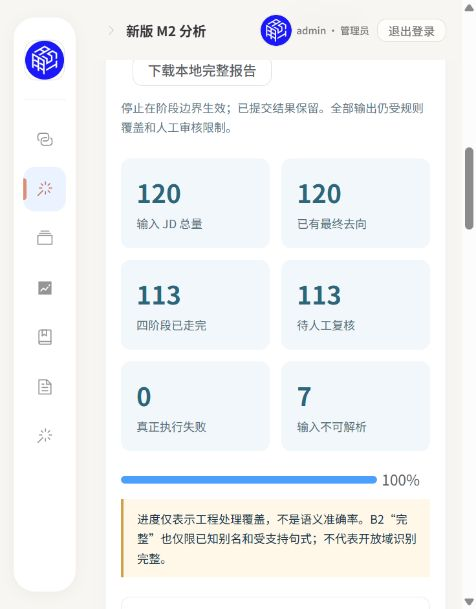
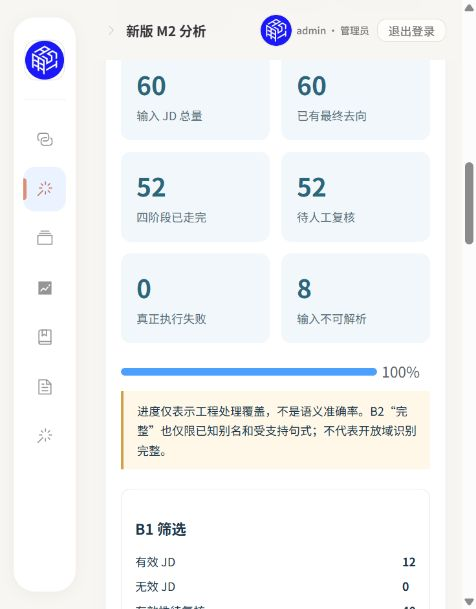

# 新版 M2 产品化与真实历史 JD 验收

日期：2026-10-21（Asia/Singapore）。增量基线 `2ac2856`，现有工作树 `m1-m2-quality-replay/TalentMind`、分支 `codex/product-integration-20261020`、Draft PR #44。未新建工作树/分支/PR，未合并 master。

## 结果与访问

统一入口 `pwsh -File scripts/start-local.ps1`；访问 **http://127.0.0.1:18080/#/m2**，导航“新版 M2 分析”。后端18000，前端18080。服务已实际启动并通过页面创建/启动任务、查看阶段原文、停止、恢复和版本重放；创建与启动分开，刷新不启动分析或采集。

| 真实运行 | run_id | 输入 | 最终去向齐全 | 四阶段已走完 | 待复核 | 输入异常 | 真正执行失败 |
|---|---|---:|---:|---:|---:|---:|---:|
| 页面初始小样本 | `5e5529918e544b5eb91c7bf93e3777ce` | 5 | 5 | 5 | 5 | 0 | 0 |
| 主集冻结输入新版重放 | `29af896353304a7e92346378e2057ddd` | 120 | 120 | 113 | 113 | 7 | 0 |
| 页面留出 | `39a61ec6f94e44e0814b9dd302dcc939` | 60 | 60 | 52 | 52 | 8 | 0 |
| 页面同版本重放，停止后恢复 | `968ce294e914476daa114fdbc44600bb` | 60 | 60 | 52 | 52 | 8 | 0 |
| 最终源码重启后的 API 同版本核验 | `8be84fa737d147148ca9a53245a840ad` | 60 | 60 | 52 | 52 | 8 | 0 |

“四阶段已走完”是工程执行口径。上述全部合法分析结果最终仍是 `needs_review`，没有正式语义完整样本或确认需求。输入异常不进 B2/B22/B3，保留原始行和明确 blocked 原因，不从分母中消失。B1 部分阶段已保存、后续停止的旧主集 `5365497cc17f4584a9864bb9d08bc862` 保留在历史；审查修复导致实现版本变化后，创建新任务重放其原始冻结输入，未改写原停止记录。

以上截图仅含汇总，无 JD 原文或密钥；完整来源/阶段截图仅在本地 `data/local/m2-product/browser/`，未上传。

## 契约、版本与处理边界

- 输入：MySQL `jd_pool`，实际当前2988行；参数化来源、ID上下界和数量（1～5000），只执行 `START TRANSACTION READ ONLY`、SELECT、finally ROLLBACK/close。120/60入口使用此前固定成员ID，保存旧input SHA与当前内容差异；两集合 changed_ids/missing_ids 均为空。它们是“历史成员的当前 MySQL 快照”；版本重放才使用任务原始冻结字节。
- 原始 SQL NULL、空正文、标题、source/source_detail、观察时间、全部字段保留。版本化阶段适配只省略 duties/experience/requirements 的可选 NULL，不补原文或URL。主集7条和留出8条异常均为真实空正文，原始字节仍在快照。来源异常不改成正常平台；网页详情完整性无法核验时始终提示未核验。
- 复用 `screening`、`semantics`、`governance`、`role_classification.proposals` 与 families.v3；四阶段原生 store 顺序打开同一个 `analysis.sqlite3`，不嵌套，不在进度请求中重开会触发恢复的原生 Store。控制任务/冻结输入在独立 workflow.sqlite3，API读控制库。
- namespace 绑定 JD ID 与适配输入摘要，避免原生 heads 混入旧成员；保存精确原生 report/decision/attempt/result ID。版本覆盖 M2 代码/JSON、共享 skills代码/词典和B1 cleaner；恢复校验输入字节和依赖，变更后要求新run_id。SQLite中先原子保存最终报告及publishing状态，文件原子发布后才完成；重启可恢复中断窗口。
- B1 needs_review 的可解析原文继续进入后续候选证据分析；所有产品输出 `confirmed_demand_eligible=false`、`formal_statistics_eligible=false`。B2五态和组合保持原生语义，未擅自把 uncertain 或仅提及升为必备。B3仅有限大类建议/未决，不加载19草案冒充发布目录。
- `/api/m2/*` 全部受显式本地原文开关、回环客户端、Host、Origin和Sec-Fetch-Site门禁，禁缓存；列表无正文，详情/完整报告有原文。统一入口绑定回环。演示登录仅前端展示，不是生产身份授权；未将真实JD打进前端构建或公开静态目录。

## 分阶段分母

以下均为原始 JD 行/陈述/片段计数，不是独立职位或 precision/recall。指标间有重叠，不能相加当样本量。

| 指标 | 主集120 | 留出60 |
|---|---:|---:|
| B1有效 / 有效性待复核 / 输入未评估 | 42 / 71 / 7 | 12 / 40 / 8 |
| B1范围内 / 范围外 / 范围待复核 / 不适用 | 14 / 0 / 99 / 7 | 1 / 0 / 51 / 8 |
| B1无法解析（audit.failed 包含输入失败）/ 执行异常 | 7 / 0 | 8 / 0 |
| B2受支持语法完整 / 部分 / 执行失败 / 输入阻断 | 0 / 113 / 0 / 7 | 0 / 52 / 0 / 8 |
| B2无已识别技能 JD（仍可能存在规则未识别技能） | 18 | 3 |
| B2 required / preferred / mentioned / not_required / uncertain 陈述 | 0 / 0 / 3 / 0 / 1224 | 0 / 0 / 3 / 0 / 920 |
| B22已处理 / 有候选 JD / 候选记录 | 113 / 4 / 14 | 52 / 4 / 14 |
| B22已检查的语义冲突 JD / 目录治理冲突 | 0 / 未评估 | 0 / 未评估 |
| B22有未解决内容 JD / 未解决片段 | 113 / 1763 | 52 / 1046 |
| B3有大类候选 / 待审核 / 无法分类 / 输入阻断 | 0 / 113 / 113 / 7 | 0 / 52 / 52 / 8 |
| 有原文引文的阶段输出 / 无引文阶段输出 | 452 / 7 | 208 / 8 |
| 已匹配原文位置 / 位置异常 / 不可解析JD | 5885 / 0 / 7 | 3658 / 0 / 8 |

候选记录按字段证据保存，同一词在 raw_text/duties 中可分别出现，不宣称14个不同新技能。B22 unresolved_fragments 是有限规则保留的片段，并非每个片段都存在语义冲突。B3本轮所有合法输入均未得到可提出的大类候选，保留真实 reason/context_clues，未伪造分类完成。

## 逐条结果、SQLite 与可重复性

本地私有根：`data/local/m2-product/`。

| 产物 | 作用 |
|---|---|
| `workflow.sqlite3` | 不可变冻结输入/版本、任务及逐条阶段指针、带摘要的最终报告 |
| `analysis.sqlite3` | 新版共同 snapshots 与 B1/B2/B22/B31 不可变历史，不是旧 StateDB |
| `runs/<run_id>/input.json` | 完整冻结原行；保留NULL、空值与异常分母 |
| `native-reports/<native_run_id>.json` | 每条JD各阶段原生报告，可由产品报告精确关联 |
| `reports/<run_id>.json` | 全分母、逐条input、来源、阶段结果/原因、证据位置/规则版本及汇总 |

页面“查看”展示冻结原文和B1/B2/B22/B3页签、引文、Python字符索引[start,end)、版本和审核原因；完整JSON折叠可核查全部组合和上下文。实际打开主集 JD248863 的有效/范围内判定、治理候选及B3 unsupported_duty_context未决；没有把候选准入。

只读核验两SQLite `PRAGMA integrity_check=ok`；产品JSON与SQLite报告/摘要一致、冻结字节SHA正确，所有保存阶段的原生报告SHA及唯一成员逐条核对，5885/3658处位置匹配且异常0。私有详细逐条核验见 `data/local/quality-execution/m2-artifact-verification.json`。

页面重放 `968ce...` 在32条最终完成时停止，28条显式stopped；已保存但未走完的阶段同样保留。恢复同一run_id后52条合法输入的B1 decision_id、B2 attempt_id、B22 result_id、B3 result_id均与原留出精确一致，停止前已保存的阶段run_id不变；输入SHA和最终汇总相同。最终重启后再用API重放60条成功，验证提交代码的入口和复用；不重新读取MySQL或覆盖旧报告。

## 测试、安全对账与审查

- 新后端25项：真实原生模块+合成临时库，覆盖全分母/NULL、输入合法→非法的旧成员污染、共享词典/cleaner版本变化、停止恢复、发布提交后模拟进程退出、摘要篡改、同版本复用、失败原因脱敏、只读SQL参数绑定、全部API本地门禁。新增页面5项：显式创建/开始、范围校验、详情/任务竞态、创建迟到、错误/重放。回归均先复现缺口再修复。
- 最终完整阻网非集成后端：**1448 passed / 2 failed / 2 skipped / 23 deselected**，93 Python进程，外部网络尝试0，验证脚本专属临时目录删除true。失败为 `test_repository_draft_covers_eight_families_and_empty_release` 与 `test_shipped_source_hash_matches_a_fresh_LF_checkout`，均为既有19草案引用整份产品文档的hash/quote失配；用`git show 2ac2856`原始资产在临时目录复现相同两项失败，校验代码与基线一致。未重签、放宽或跳过修绿。
- 前端 **144/144**，`pnpm run build`含vue-tsc通过；既有chunk>500kB提示保留。本轮没有引入依赖。
- 新增合成测试的SQLite/文件在finally/fixture teardown精确清理，核验目录不存在；没有向真实MySQL写测试夹具。真实业务运行产物按授权保留，未当成测试残留删除。
- MySQL八表采前/采后**行数及全字段按ID排序SHA逐项相同**：jd_pool2988、signal1540、skill_dict285、job_definition/job_skill/job_change_log=717/717/275、resume/talent_raw=0。没有DDL、INSERT/UPDATE/DELETE或迁移；未调用正式图谱写入、旧LLM或招聘采集。私有审计JSON保留在quality-execution，原文/密钥/个人配置不入Git。
- 独立只读审查给出成员污染、跨模块版本、发布窗口三项重要发现，已分别由回归复现并修复。审查进程随后因额度结束，没有完整最终独立通过结论；页面迟到响应另经自检补测试修复。负责人/ChatGPT对PR44的集中审查仍为最终门禁；不自动合并。

## 覆盖不足与下一轮

1. 当前历史列表卡、空正文及字段完整性不能靠M2补造；按输入状态分层，后续M1详情补齐另验收，不阻塞当前历史分析。
2. 保守句式对实际中文长句/职责/复杂条件/多岗位仍大量uncertain；下一轮先人类标注主集/留出，再按错误类型扩展可支持语法，分别报告precision/recall，保持未知未决。
3. B3真实候选召回不足，本轮0候选；针对已标注职责增加有限规则并独立评测，19岗位定义继续逐项审核，不自动发布。
4. B22候选需去重视图与逐项人工依据；当前覆盖只限已有词典/规则和有界显式术语，不声称完整未知技能发现或目录冲突评估。
5. 本地单worker、批次上限5000已实现，真实最大运行120；当前2988全库批处理、断电/磁盘损坏、多机/生产认证与远程共享SQLite未验收。异常执行可新版本重放，不自动重试收费服务。

回退：停止M2任务后回到旧页面；保留所有run_id/版本/输入/报告，不删除真实数据，不影响原M1单轮/批次或历史图。代码回退以本轮增量提交为边界，经集中审查再决定；不自动合并或清理分支。
