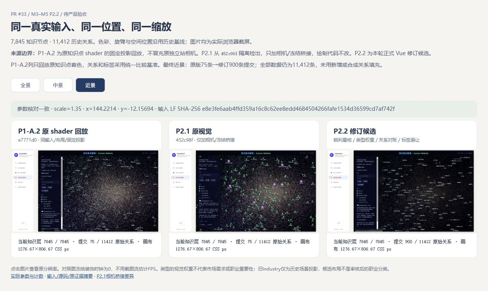

# M3/M5-P2.2 知识星体与关系可读性修订（待验收）

2026-10-19，继续PR33原分支，基线452c98f。未改原M3快照、布局产物、数据库、正式岗位目录或生产重建入口；不合并PR。本报告交付实现与实测材料，**视觉仍待产品验收**。

核心实现提交：`0873c34`。证据目录另行提交，原PR33保持Draft；本轮不是另建视觉实验项目。

## 真实三方对照

[同视角对照页](m3-m5-p2-2/comparison.html) 与 [参数清单](m3-m5-p2-2/comparison-observations.json)。九张1600×900真实浏览器截屏，三方每个层级的transform、画布矩形、输入LF摘要完全一致；背景时钟冻结为0。

| 来源 | 全景 | 中景 | 近景 |
|---|---|---|---|
| P1-A.2原shader受控回放 | [截图](m3-m5-p2-2/p1a2-overview.jpg) | [截图](m3-m5-p2-2/p1a2-middle.jpg) | [截图](m3-m5-p2-2/p1a2-near.jpg) |
| P2.1原视觉 | [截图](m3-m5-p2-2/p21-overview.jpg) | [截图](m3-m5-p2-2/p21-middle.jpg) | [截图](m3-m5-p2-2/p21-near.jpg) |
| P2.2最终候选 | [截图](m3-m5-p2-2/p22-overview-cached-final.jpg) | [截图](m3-m5-p2-2/p22-middle-cached-final.jpg) | [截图](m3-m5-p2-2/p22-near-cached-final.jpg) |

**不能混淆的来源边界：** P1-A.2从e7771d0复用原知识点vertex/fragment shader，两者逐字摘要匹配；受控回放统一采用P2.1历史输入、布局和固定投影，不是原独立站相机/布局的原样运行。原独立站证据保留于PR30。本次没有使用#31 adaptive代码或haze pass。P2.1从452c98f隔离检出，仅增加 [相机/冻结桥接](m3-m5-p2-2/p21-camera-only-bridge.patch)，不改绘制逻辑。原P2.1的26份证据逐文件SHA留档且未覆盖，见 [来源清单](m3-m5-p2-2/provenance.json)。

P1-A.2只回放原知识点着色，关系和标签采用统一比较基准；不能将该列称为完整原独立站。P2.2早期截图亦保留：`p22-near.jpg`为初稿75边，`p22-near-final.jpg`为900边修订，最终精灵缓存版本使用表中的`cached-final`文件，没有覆盖前述阶段图。

## 实现范围

- 知识点：核心与光晕预绘入同一Canvas精灵，按类型/半径/DPR缓存，上限96项，卸载时清理；屏幕尺寸有上限。岗位/技能/历史场景采用固定类型权重；不使用job_count、度数、市场需求或候选社区作为亮度/尺寸评分。
- 装饰层：保留214200粒子、seed、位置、配色、旋臂、曝光、Bloom及各层透明度/尺寸上限；较大非mist粒子采用屏幕足迹约束的锐利核心轮廓，mist保持柔和。没有按相机距离整层淡出，未复用#31负结果参数。
- 关系：每条原始关系按无有效端点→类型→LOD→坐标→视口→长度→预算顺序归入首个原因；各项互斥，和已提交数量等于当前范围。选中范围是全部真实直连，视口/长度/预算不删除直连。零直连仅表示本历史快照无直接记录。
- 修订版近景scale≥1.25时，长边参与长度排序和900条预算，不再先被480px阈值删除。受控近景原版75条→最终900条：9361视口外、1151预算截断、其余类型/LOD/坐标/长度排除为0，合计11412；不是新增数据关系。
- 高连接：每条原边独立扇形二次曲线，端点不变，无边聚合。列表保留原sourceIndex、原属性，支持逐条高亮；隐藏类型行明确提示，只有显式显示类型后才能跳转。
- 标签：随缩放控制密度，选择/悬停/原边关联端点优先；多个候选位置避让其他星核、标签与面板，不以装饰粒子参与标签布局。
- 语义：旧Industry只称“历史场景（旧投影）”。社区说明默认折叠，无默认社区分析叠层；候选相似层默认关闭。不映射B3八大类，不实现正式目录或职业路径。

## 数据与交互验证

前端完整 **62/62**，图谱后端定向 **53/53**；正式前端类型检查+构建、P1-A.2参考前端构建通过，保留大chunk提示。没有写库集成测试，无数据库夹具或生产查询；未重跑无关M1/M2/M4全量。P2.1报告中的两个M2来源摘要失败未由本轮修复，不能据本轮定向通过称全仓绿。[数据/身份核验汇总](m3-m5-p2-2/validation.json)确认原快照和布局Git blob不变，26份旧证据不变，三个案例原边索引逐项匹配。

实际浏览器 [记录](m3-m5-p2-2/browser-observations.json) 与从原文件计算的 [预期案例](m3-m5-p2-2/expected-cases.json)：

| 实体 | 原身份与来源 | 实测关系 | 证据 |
|---|---|---|---|
| Python技能 | skill:python，nodes[1] | 222条全部提交，222个不同原sourceIndex；逐边扇形曲线无聚合，全部关联适配223节点outside=0；逐条高亮不改变选中身份 | [全部关系](m3-m5-p2-2/python-all-relations.jpg)、[原edges[0]高亮](m3-m5-p2-2/python-original-edge-0.jpg) |
| 智能体数据工程师（仿真环境方向） | job:j-19a33f6480c854ba，nodes[0] | 13条真实技能/旧场景关系全部提交 | [岗位](m3-m5-p2-2/job-all-relations.jpg) |
| 沙盒化代码/GUI/浏览器自动化执行 | 旧Industry投影，nodes[10] | 1条APPLIES_TO，原edges[9] | [历史场景](m3-m5-p2-2/historical-scenario.jpg) |

类型隐藏案例：场景选中时关闭岗位，scope=1/typeHidden=1/submitted=0，行内提示“原关系仍在数据中”；显式恢复后才跳转岗位，相机逐项不变，见 [截图](m3-m5-p2-2/hidden-type-reason.jpg)。单元回归还验证全部7845/11412的raw对象与索引保持、过滤和高亮不改输入。派生相似默认关闭；候选布局说明默认折叠，没有社区区域/标签叠层。

最终缓存版真实Canvas中心点击选中skill:python，相机不变，见 [点击证据](m3-m5-p2-2/new-star-canvas-click.jpg)；随后拖拽、缩放保持同一身份及222条提交记录。全部关联与返回视角在原版和修订版均逐项相同，没有依赖自动飞行或隐式重定位。

独立子代理代码自检未发现阻断项，发现隐藏类型跳转和曲线抽样计数两项问题，均先复现失败再定向修复；见 [自检收口](m3-m5-p2-2/code-self-review.md) 与 [陷阱记录](../superpowers/traps/2026-10-19-graph-visibility-and-hidden-neighbor.md)。此自检不替代ChatGPT PR独立审核或产品验收。

## 修订前后性能

同一台Ryzen AI9 H365、系统列出Radeon880M/虚拟显示适配器，IAB视口1600×900；未据宿主显卡名推断实际GPU。rAF间隔与CPU提交/绘制均不等于GPU计时或端到端呈现延迟。连续截屏不参与稳态采样。

| 项目 | P2.1原提交 | P2.2最终候选 |
|---|---:|---:|
| 稳态全景600帧p50 / p95 | 16.7 / 17.1ms | 16.7 / 17.4ms |
| 同预设近景600帧p50 / p95 | 16.7 / 17.1ms | 16.7 / 17.5ms |
| 五次全景绘制中位数 | 31.3ms | 48.7ms |
| 五次近景绘制中位数 | 24.1ms（75边） | 31.1ms（900边） |

[完整帧/交互数据](m3-m5-p2-2/performance.json)、[原版与修订初稿五次绘制](m3-m5-p2-2/draw-samples.json)、[最终缓存五次绘制](m3-m5-p2-2/draw-samples-final.json)。最终缓存把修订初稿全景64.9ms、近景36.6ms的中位数降至48.7/31.1ms，但仍比原版绘制成本高；不能用稳态约60fps掩盖交互重绘成本。样本小，不是跨机或所有交互性能保证。

处理开始到下一rAF的单次交互采样：原版搜索/全部邻接/返回47.5/15.4/16.2ms，最终修订53.3/33.1/32.6ms。该数据同样显示重绘成本上升，不能称全面性能提升。

## 未解决与产品验收范围

单独维护的 [未解决问题与回退清单](m3-m5-p2-2/open-issues.md) 随PR交付，不将候选写成已通过产品验收。

1. 全景星体绘制成本仍高于P2.1，高频悬停/拖拽可能比稳态帧间隔慢；没有宣称所有交互达到60fps。
2. 高连接邻居位置集中时，222条曲线仍可能拥挤；需逐条高亮/列表核对，不能声称肉眼同时区分每一条。
3. 全景微小知识星体仍可能与装饰混淆；近景140标签密度预算、星体尺寸及背景较暗的观感需用户验收，标签未全部出现不等于节点/关系丢失。
4. P1-A.2列为明确标注的原shader同投影比较，未宣称完整原独立站与新界面相同。原始历史身份/旧语义问题、新版五态/正式目录/职业路径仍不在本轮实现范围。

## 明确回退

- 默认修订候选：`http://127.0.0.1:18131/#/graph`。
- P2.1视觉回退：`http://127.0.0.1:18131/?graphVisual=p21#/graph`，保留新计数/语义说明，使用原圆片及原背景轮廓。
- 旧Canvas：`http://127.0.0.1:18131/#/graph?graphRenderer=legacy`，不依赖候选布局文件，无数据库操作；见 [回退截图](m3-m5-p2-2/legacy-fallback.jpg)。
- 本机原P2.1隔离副本18132、对照材料页18134供审阅；正式产品代码仍在原Vue应用，未另起渲染框架。localhost/HTTPS摘要验证限制沿用P2.1。PR33保持Draft，不自动合并。
