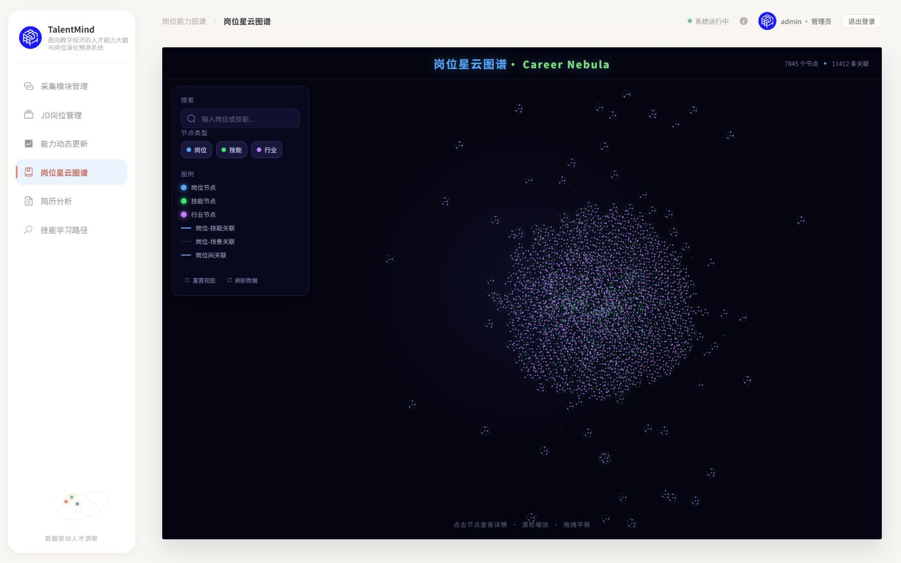
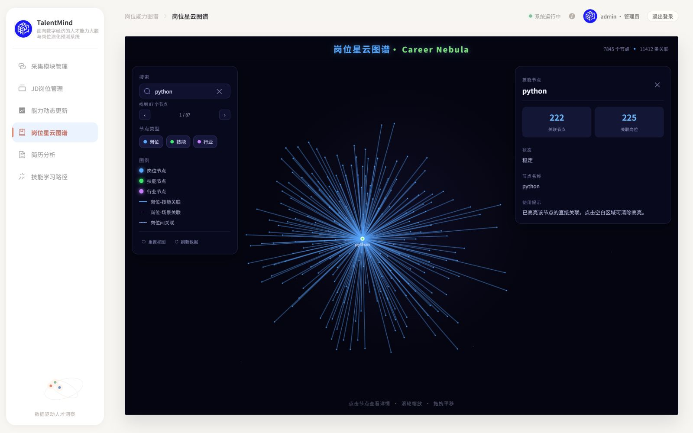
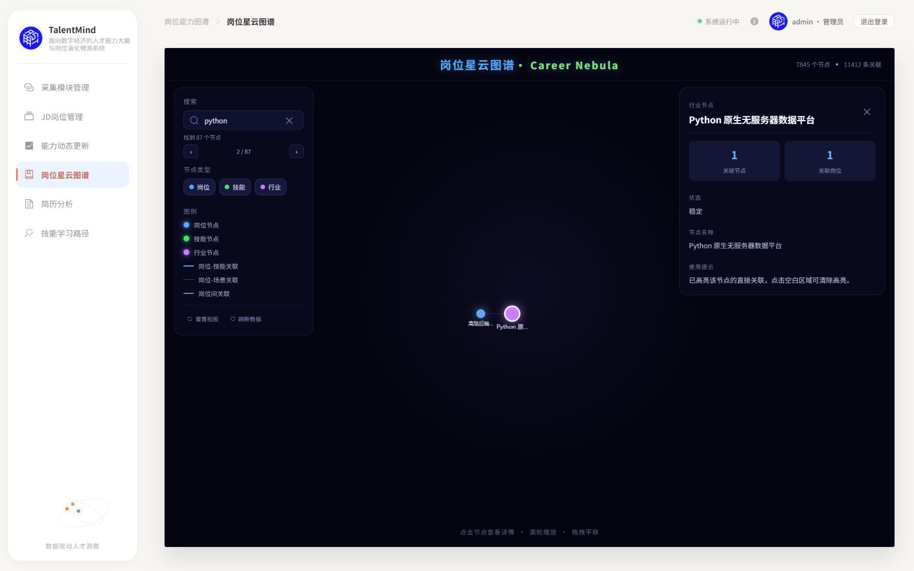
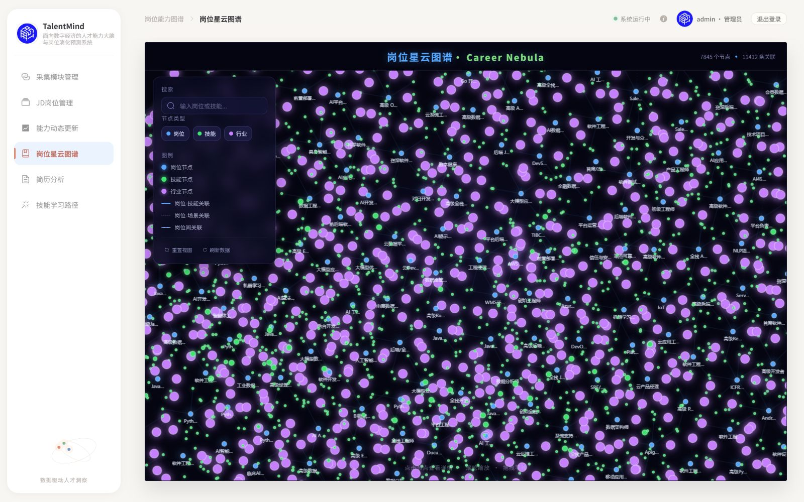
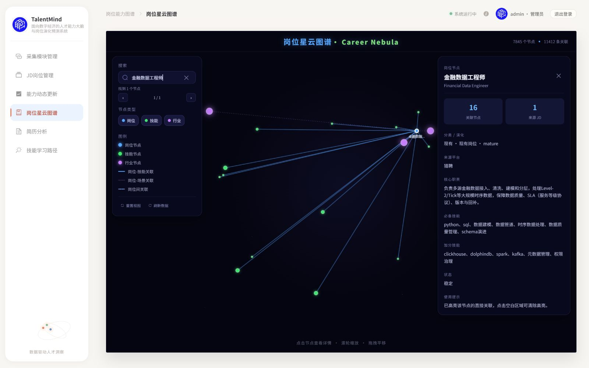

# PR #23 第二轮：全览、搜索和分级连线

日期：2026-10-17（Asia/Singapore）。[PR #23](https://github.com/Serena-Lyric/TalentMind/pull/23) 保持 OPEN；本轮不合并，不清理 worktree。需求来自 PR「视觉验收反馈：三项基础交互需在本 PR 补齐后再考虑合并」。技术验证已完成，等待 ChatGPT 定向复审及用户亲自视觉验收。

## 范围与提交

沿用独立分支 `codex/m3-m5-issue-22`，从首轮交付 `0615c7e` 继续，未切换原工作区脏分支。无新增依赖；未修改布局骨架、M2、后端、DDL、Neo4j、正式图/ID 或导入流程。

| 提交 | 内容 |
|---|---|
| `5986669` | 实验版首次/重置全图fit，按实际面板寻找可用矩形；远景节点LOD与命中。 |
| `602a7c7` | 前后按钮、序号、Enter/Shift+Enter、多结果稳定循环及游标重置。 |
| `747bef0` | 远/中/普通连线预算、短线优先、三类型样式和分开debug计数。 |
| `017304a` | 独立审查修复：聚焦fit后的滚轮下限与方向性回归。 |

## 1. 全览与重置

- 仅实验模式：初次装载与重置按照全部当前可见类型节点的真实坐标、画布尺寸、现有玻璃面板边界fit。不再把 scale=1 当作完整图谱。
- 面板只作相机障碍：在现有面板边界之间选最大空矩形，留20px内边距；不改侧栏/详情区域。全览resize重新fit；聚焦resize重新适配邻域。完全没有可用区域时保留有限回退，不能承诺被面板完全覆盖的屏幕仍能展示图。
- 远景节点随scale减小，岗位/技能/行业最小半径分别为0.9/0.35/0.6px，关闭普通阴影/轮廓，scale<0.65抑制普通标签。所选节点至少3.5px并保留标签；放大后恢复标签/阴影。命中使用实际屏幕半径加7px容差。
- 全览/搜索/筛选/缩放都不重新排列节点、不改节点或关系数据。

实际默认全览和经历拖拽/聚焦后的重置，相机逐字段完全一致：

```json
{"scale":0.0855858299753504,"x":1553.1799862045536,"y":-56.975756701247064}
```

1600×1000浏览器下Canvas为1277×817，空矩形 x=260..1277、y=0..817；两次均fit 7845点，outside=0。901px Canvas 的全览和37直连聚焦也均outside=0。

## 2. 多结果搜索

实验搜索框附近仅增加两个小按钮和 `当前序号 / 总数`。首次Enter选稳定排序的精确名称/ID；之后Enter下一项，Shift+Enter上一项，双向循环。未选择时显示0/N。

实际Python搜索：1/87精确 `skill:python` → 下一按钮2/87 `industry:python-原生无服务器数据平台`；Shift+Enter回1/87，再Shift+Enter到87/87，Enter回1/87。上下按钮都已验证。纯测试遍历全部87个不同结果，覆盖其余86项，反转输入顺序结果相同。

关键词、筛选和新数据提交均重置游标；筛选行业后为0/82，继续隐藏技能后为0/33并清除隐藏选择。空结果0/0、按钮禁用，Enter显示“没有匹配节点”；空词Enter显示“请输入岗位或技能”。刷新后游标0/87、仍有效的Python详情及222条直连保留；不存在选择的清除由既有纯回归覆盖，未为测试删除真实节点。

## 3. 连线策略

| 无选择缩放层级 | 最多绘制 | 最大普通边屏幕长度 |
|---|---:|---:|
| scale<0.18 | 120 | 72px |
| 0.18≤scale<0.5 | 300 | 180px |
| 0.5≤scale<1.8 | 900 | 480px |
| scale≥1.8 | 当前视口全部有效关系 | 放大补线，无长度截断 |

在预算内优先屏幕距离较近的真实边，然后视口端点、中心距离、稳定键；保留类型轮转与新端点覆盖。普通长线进一步降低不透明度。岗位技能实线蓝、岗位场景点线紫、岗位间related_to虚线灰紫，均来自原色板；仅实验图例补场景线说明。

选中节点绕过长度/预算限制，完整保留全部可见类型的真实直连；提高到0.7不透明度、1.15px线宽，过滤隐藏端点。没有新增、修改或补造关系。

| 浏览器实际状态 | 数据总边 | 可绘制候选 | 最终stroke / 画布相交 | 所选可见直连 |
|---|---:|---:|---:|---:|
| 默认全览 | 11412 | 11412 | 120 / 120 | 0 |
| 重置全览 | 11412 | 11412 | 120 / 120 | 0 |
| Python首项 | 11412 | 222 | 222 / 222 | 222 |
| Python第二项场景 | 11412 | 1 | 1 / 1 | 1 |
| 普通视图scale≈0.6815 | 11412 | 5624 | 900 / 900 | 0 |
| 同相机金融数据工程师聚焦 | 11412 | 16 | 16 / 16 | 16 |
| 窄视口pytorch聚焦 | 11412 | 37 | 37 / 37 | 37 |

debug的candidates是在隐藏/缺失端点与视口规则后的真实候选，进一步的长度/预算降级发生在其后。submitted为实际stroke次数，painted为线段与几何画布相交，不是扣除所有节点像素遮挡后的统计。顶部11412始终是数据总关系，未绘制不表示未建关系。

## 4. 实际页面截图

全部是本机现有只读服务的真实Vue页面，没有Mock替代、AI图片或录屏拼接。实验服务端口18081，URL必须将参数放在hash前：

```text
http://127.0.0.1:18081/?nebula=experimental&nebulaDebug=1#/graph
```

同一7845/11412图，固定1600×1000浏览器、1277×817 Canvas；默认/重置相机相同，普通/金融岗位聚焦相机相同，搜索两项则按各自邻域适配。

| 验收组 | 实测截图 |
|---|---|
| 默认全览 |  |
| 从拖动/聚焦重置后全览 |  |
| Python多结果切换 |   |
| 普通/聚焦连线 |   |

补充：[窄桌面聚焦](issue-22-round2/narrow-focus.jpg)（1224×1000、Canvas901×817）、[同分支默认legacy](issue-22-round2/legacy-default.jpg)。截图在状态稳定后捕获，并逐张回读核对，不用上一帧充数。

## 5. 自动与交互验证

- `pnpm test`：**28 passed**。本轮4项全览/LOD、2项搜索、3项连线和1项审查修复测试均先失败再通过；既有18项保留（命中断言随真实LOD屏幕半径更新）。
- `pnpm run build`：vue-tsc及Vite通过，既有>500kB chunk提示保留；没有新增重型依赖。
- 只读固定快照检查：反转输入逐点坐标一致、坐标有限、输入不变；完整7845点fit outside=0，11412远景候选选择120；pytorch37、python222、金融岗位16直连全部保留。输出：[snapshot-check.json](issue-22-round2/snapshot-check.json)。
- 浏览器记录含快捷键/按钮/循环边界、过滤/空词/空结果/刷新、滚轮方向、拖动/重置、宽窄视口和legacy：[browser-observations.json](issue-22-round2/browser-observations.json)。聚焦fit约0.68147，向下滚轮到0.61333，向上到0.67466；fit比例随相机维护，没有反向放大。
- 当前服务与首轮冻结响应规范化内容一致：[source-check.json](issue-22-round2/source-check.json)。原API响应SHA256为 `6e396721ea55b26451d0d58f8f8356027361c2707e87c1e4a96d77ec4331517a`；正式graph.json为 `6565d56dbc5a267eb90144f078c54f3d0c761c9a98ca29a18b4dc9c6cdde38e2`。

本机样本初算约1.3–1.4s；全览draw约42ms、普通约34ms、Python聚焦约11ms，完整明细以JSON为准。不是连续帧率基准或所有设备性能承诺；布局初算仍在主线程。

## 6. 独立审查

独立只读审查 `0615c7e..747bef0`，现场27项测试通过，无Critical；一项Important：聚焦fit小于全览下限时，向下滚轮被旧下限反向钳大。900×700、左右面板、两点±1e12可复现。

已在 `017304a` 增加失败回归后修复：每次全览/聚焦fit均维护比例，缩放下限包含当前fit并允许继续缩小，过期下限也不得逆向放大；最终28项测试/build重新通过，浏览器确认fit比例与相机一致及实际滚轮方向。没有派重复复审；这份作者修复证据仍交ChatGPT定向复审。审查未裁定最终截图主观观感和各设备连续交互，留待用户验收。

## 7. 保留边界

- legacy仍默认：`http://127.0.0.1:18081/?nebulaDebug=1#/graph`。已验证scale=1，实验搜索按钮不存在；实验版仍opt-in。18080旧工作区不是本分支的新页面，错误地把nebula写成路径也不会启用实验模式。
- 全景小节点/边有意降级；全部数据并未消失。特别高连接节点仍可能形成星状线束，邻居标签需继续放大查看，最终美感/密度未宣称用户已通过。
- python既有jobs元数据225与真实直连222的差异不在本轮修改，右侧详情原文案不改。
- 原侧栏/导航/浅色壳层/深色主题、Canvas和技术路线保留，只新增搜索附近小控件、实验场景线图例与绘制样式。无三模式重构、3D、GraphRAG或新增业务关系。
- 无写库集成、导入、迁移、真实采集或清理。测试仅内存合成图、明确只读快照和现有只读页面；没有数据库夹具需要删除。原工作区未提交修改、独立分支及worktree均保留。
