# PR #23 第三轮：原位选择、标签与只读诊断

日期：2026-10-17。基线 `e867dae`，原独立分支 `codex/m3-m5-issue-22`；按用户要求继续落实第三轮复审。**技术验证完成，等待 ChatGPT 定向复审和用户实机验收；不授权合并。** 星系/知识群落视觉研究留在 Issue #24，README 竞赛创新章节未修改。

## 改动与提交

| 提交 | 内容 |
|---|---|
| `582c79d` | 单击/空白/详情关闭保持相机；显式完整关联 fit/返回；搜索仅平移目标；真实 SFC 交互回归与计划/陷阱。 |
| `3a13f42` | 三类型分级标签、远景匹配描边、网格避让；关系诊断；修正独立审查发现的悬停扫描开销和面板 DOM 时序。 |

两项绘制变更共享 SFC，B/C 合成一个独立验证提交，未扩展后端或布局。新增测试工具只使用已安装的 Vue/compiler-sfc 和 TypeScript 执行真实 setup，替代网络、挂载及 Canvas 端口，无新依赖。

## 1. 相机与选择

- 单击只更新选择、全部真实直连高亮和右侧详情。空白/关闭详情清除选择，不恢复全览；resize 不因已选中而自动 fit。
- 详情中的“查看全部关联”才 fit 当前可见类型完整邻域；首次触发保存 `transform/fittedScale/overview`，重复触发不覆盖原快照。左侧“返回原视角”精确恢复相机，保留当前选择；重置清除返回状态，刷新清除旧布局的返回快照。
- 搜索序号/按键逻辑沿用第二轮。目标在两块面板以外的有效区域内时相机不动；否则仅平移，保持当前比例，避免高连接技能默认缩到极小比例。

浏览器固定 **1600×1000、Canvas1277×817**，与第二轮相同；原位点击实际选中 `skill:vmware`（真实度数2），与点击前相机逐字段一致；空白取消后也一致。重置回到初始7845点 outside=0，相机仍为：

```json
{"scale":0.0855858299753504,"x":1553.1799862045536,"y":-56.975756701247064}
```

从全览逐级滚轮放大到1.3576559779603716，搜索 Python 保持该比例，仅平移；下一结果行业仍保持该比例。主动完整关联才变为0.18098882013558656，223点 outside=0、222条直连全部提交；返回与主动查看前相机完全一致。

## 2. 标签与远景匹配

- scale<0.65：普通标签关闭，保留选中/悬停标签；匹配节点最小半径1.8px和白描边，不强制开启87个匹配标签或远景阴影。
- scale≥0.65：岗位及匹配标签候选；scale≥1.25：岗位、技能、行业均有普通标签候选。缩小反向关闭，选中/悬停优先。
- 按选中、悬停、匹配、岗位、其他优先级与稳定ID排序，64px屏幕网格检查文字矩形；排除离屏或与控制/详情面板重叠的文字。只处理视口候选，不全图两两比较。标签沿用既有截短，详情保留全名。
- 实测中景0.843：100候选→88标签；近景1.3577：620→273。反向缩到0.64936只保留一个悬停行业标签。实际截图确认技能/行业名称出现；密集节点/点光仍保留原基调，不把标签可用等同星系视觉已验收。

## 3. 只读关系诊断

开发属性 `.nebula-page[data-nebula]` 中新增 `direct`，仅 experimental 且选中节点时有值：

| 字段 | 含义 |
|---|---|
| dataDegree | 数据中该ID的原始直连边数（包含无法绘制的端点） |
| typeFiltered | 双端存在且通过类型过滤的直连边数 |
| drawable | 再排除无坐标端点的直连数；沿用 visibleDirect |
| submitted | 实际提交 stroke 的直连数，包括画布外线段 |
| intersecting | 线段与画布几何相交数，未扣除面板/节点像素遮挡 |

Python实际为 **222/222/222/222/222**；隐藏岗位类型后为 **222/0/0/0/0**，数据关系并未消失。纯回归另覆盖缺失端点、无坐标、离屏直连和超过900预算。全览仍11412候选→120描线；顶部总边数不作为绘制数。未新增或修改任何关系。

## 4. 同视口真实截图

以下来自实际 Vue 页面及现有只读后端，未用 AI 概念图、Mock 或拼接；截图逐项回读。参数须在 hash 前：

- 实验：[18081 experimental](http://127.0.0.1:18081/?nebula=experimental&nebulaDebug=1#/graph)
- 回退：[18081 legacy](http://127.0.0.1:18081/?nebulaDebug=1#/graph)

| 场景 | 截图 |
|---|---|
| 正常全览/原位单击 |  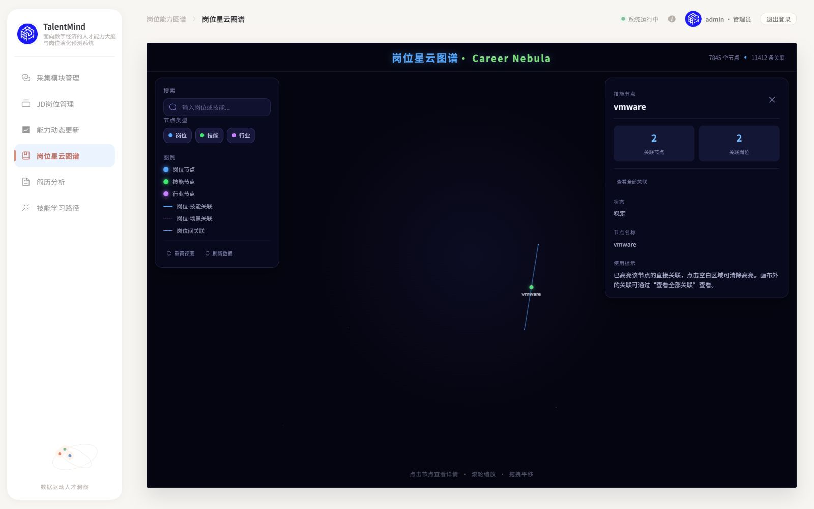 |
| 全览仅输入Python，尚未Enter | 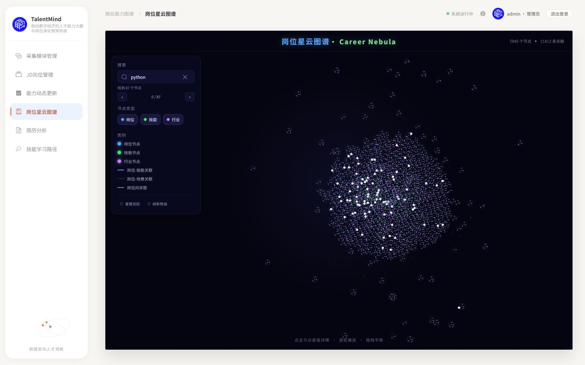 |
| 搜索首项/切换到行业 | 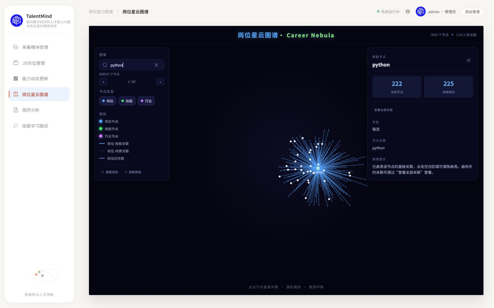 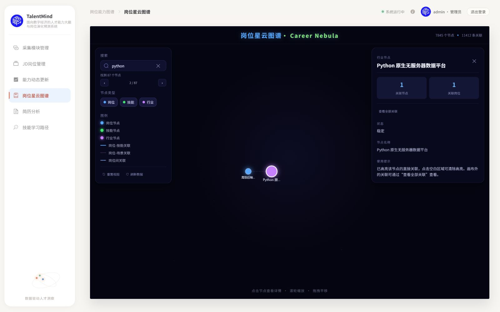 |
| 主动全部关联/返回原近景 | 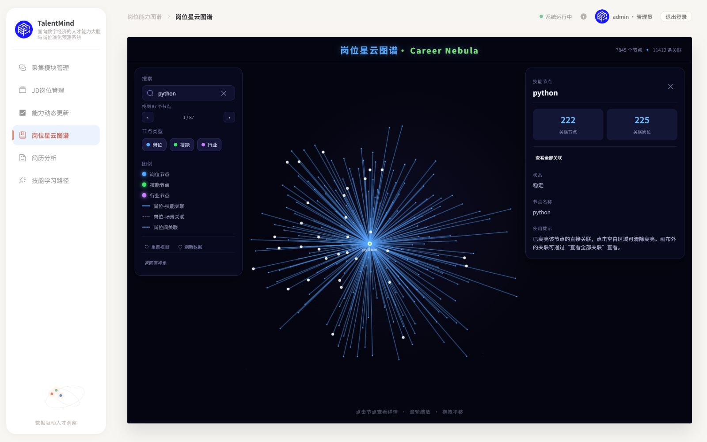 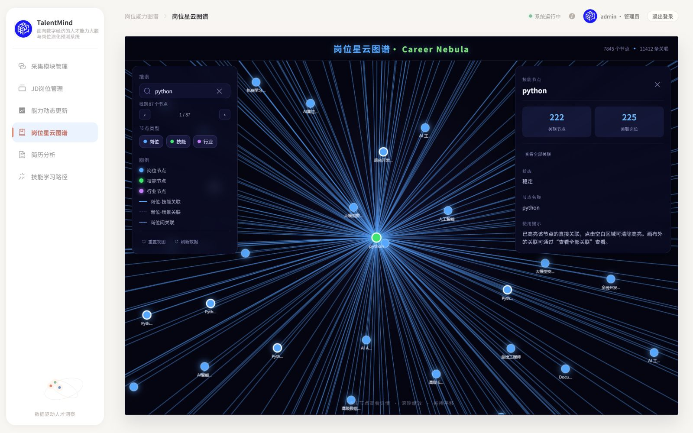 |
| 中景/近景/缩小保留悬停 | 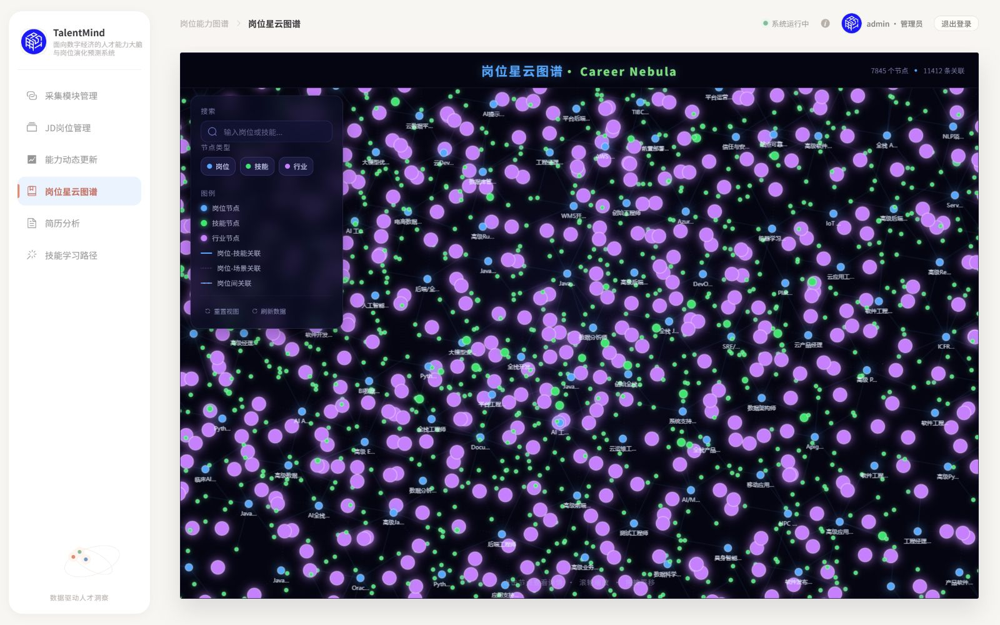 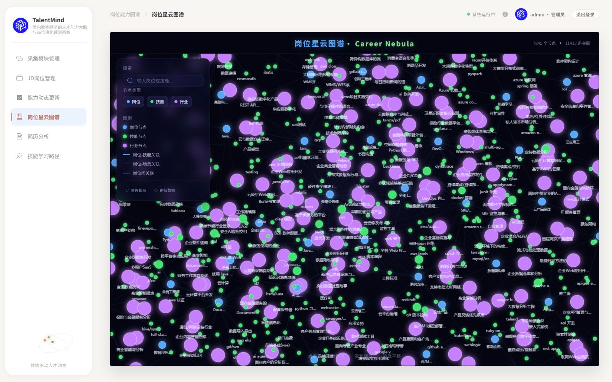 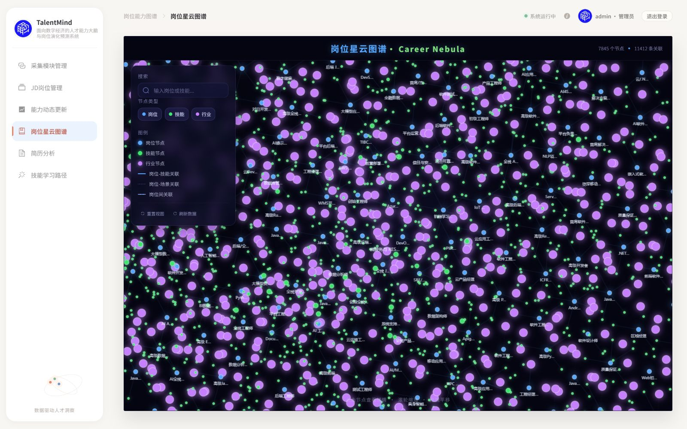 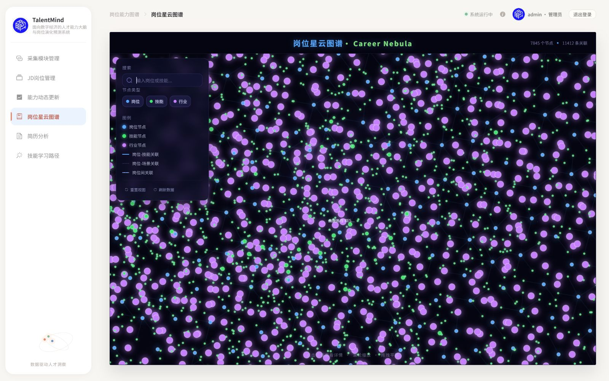 |
| 同分支默认legacy | 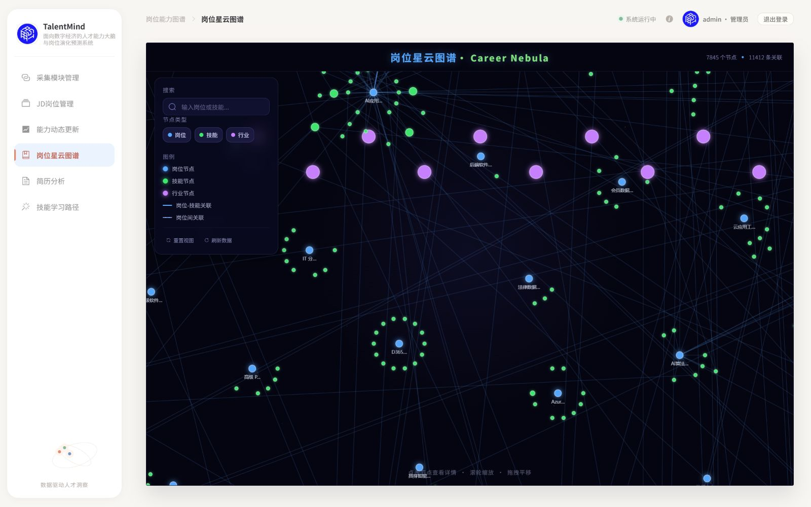 |

全览另见[initial-overview](issue-22-round3/initial-overview.jpg)，近景搜索另见[near-python-search](issue-22-round3/near-python-search.jpg)。浏览器完整观察：[browser-observations.json](issue-22-round3/browser-observations.json)，覆盖相机、绘制、标签、87→1循环、筛选、刷新和重置。首轮批量滚轮两次因工具超时中断，未把未观察到的动作当通过；重新读取实际状态，最终反向阈值和截图均确认。测试结束恢复浏览器原尺寸，独立服务18081保留供用户验收，原18080未改。

## 5. 验证与独立审查

- `frontend/`：`pnpm test` **39 passed**；`pnpm run build` 类型检查/Vite成功，保留既有>500kB chunk提示。三项相机、三项标签、两项诊断以及两项审查补修均观察到预期失败再修正；其余既有回归保留。
- 独立只读审查：复跑当时37项，无Critical，1 Important（宽泛搜索悬停O(N×M)）及1 Minor（详情DOM更新前避让）。前者500节点失败回归观察252000次身份读取，改computed Set后通过线性读取上限；后者真实SFC + post-flush面板回归先失败，再改nextTick后绘制。最终39项及build重过；作者修复仍交ChatGPT定向复审，没有声称第二次独立审查通过。
- [完整快照检查](issue-22-round3/snapshot-check.json)：7845/11412、有限坐标、乱序稳定、输入不变、全览outside=0；pytorch37、python222、金融岗位16条真实直连全部保留。检查器只读显式快照，不连接服务或写业务文件。
- [来源核对](issue-22-round3/source-check.json)：本轮只读GET响应与既有快照完全一致，响应SHA-256 `6e396721ea55b26451d0d58f8f8356027361c2707e87c1e4a96d77ec4331517a`；正式graph.json仍 `6565d56dbc5a267eb90144f078c54f3d0c761c9a98ca29a18b4dc9c6cdde38e2`。
- 未运行数据库写入/集成、采集、迁移、导入或清理，无数据库夹具；原工作区未提交修改保留。无M2/M3后端、DDL、正式图/ID或新依赖变更。

限制：初算仍约1.5s主线程；近景273标签采样draw约68ms，不是持续帧率承诺。极密节点与星状直连的主观构图、美感和群落解释仍待用户验收/Issue #24，不属于本轮已完成结论。PR保持OPEN、legacy默认、实验opt-in，不合并、不清理旧实现/分支/worktree。
