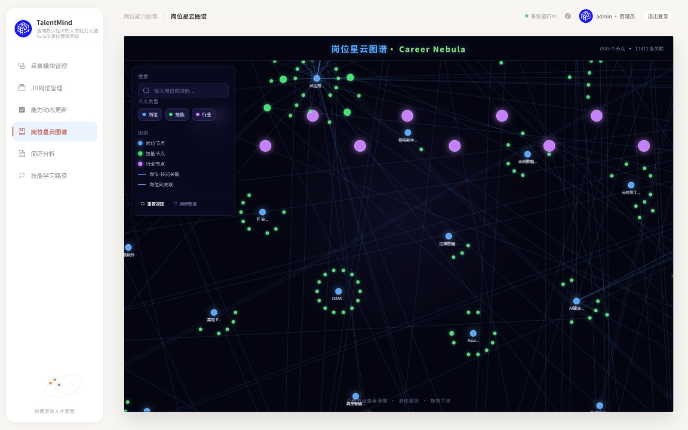
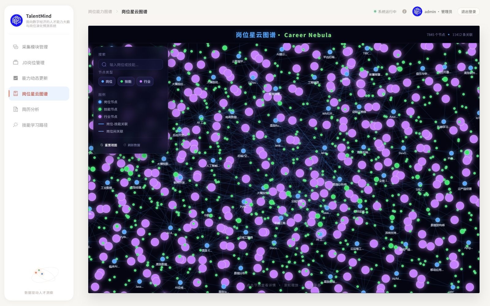
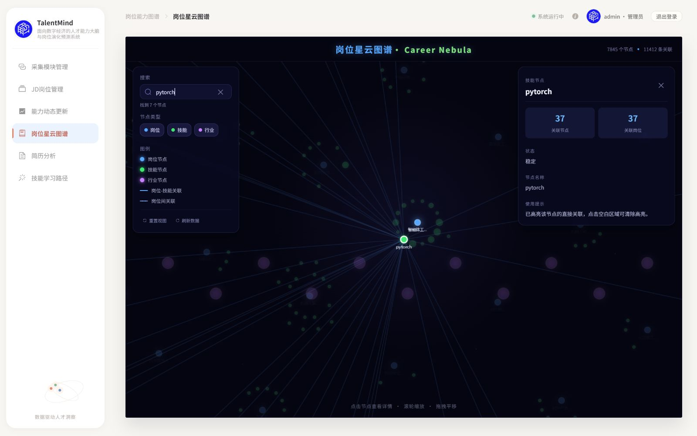
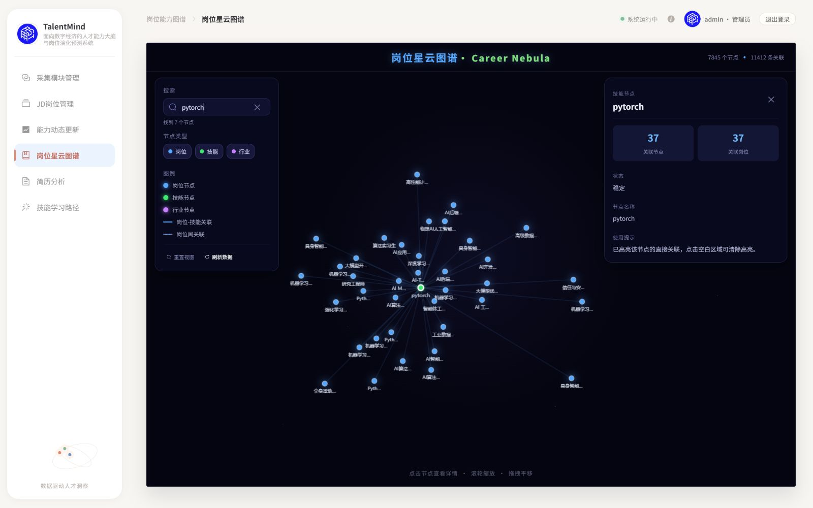
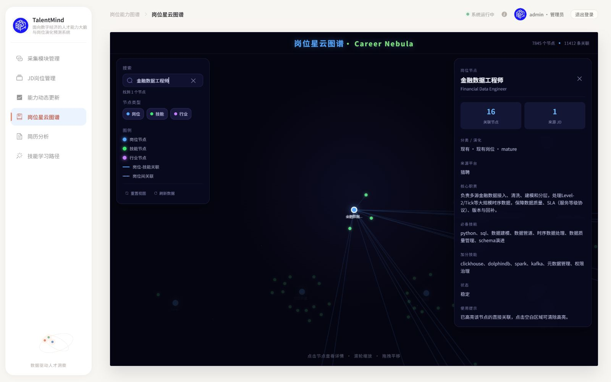
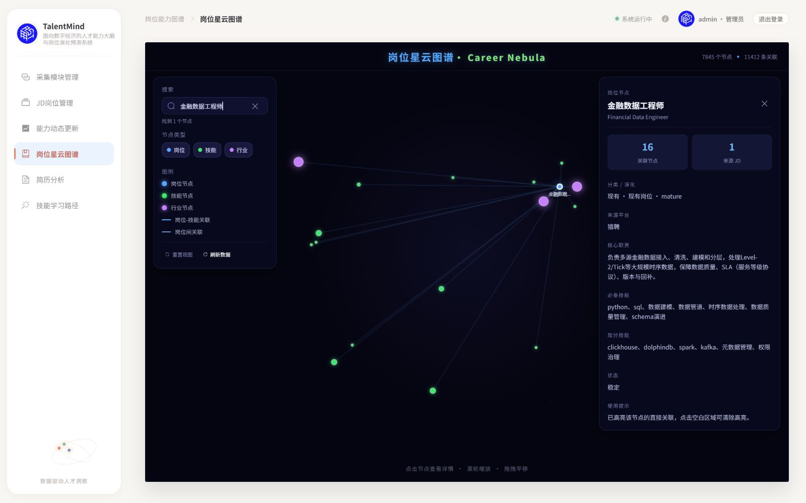
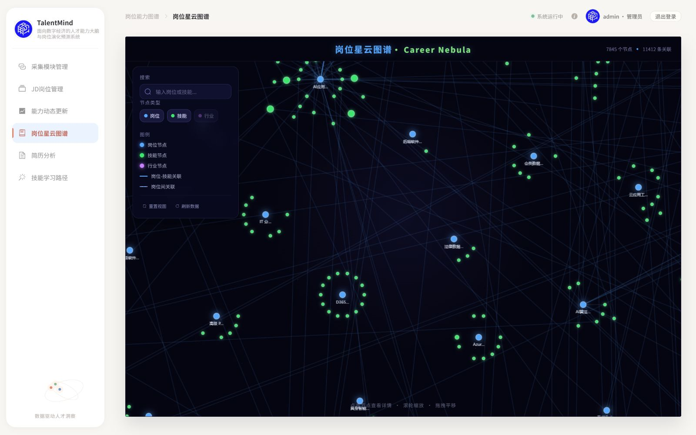
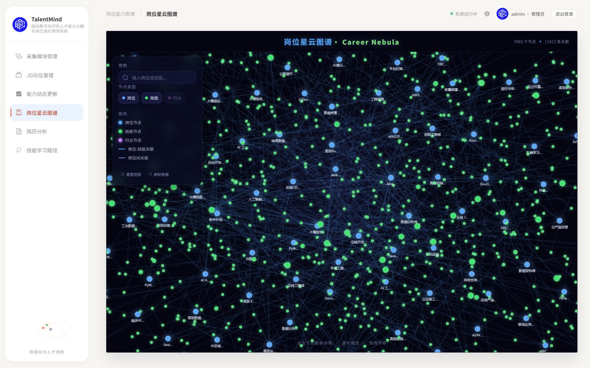

# Issue #22：Career Nebula 布局与关系可见性第一轮

交付：[PR #23](https://github.com/Serena-Lyric/TalentMind/pull/23)，base=master，head=codex/m3-m5-issue-22；创建后实查 OPEN / CLEAN，autoMergeRequest=null，远端检查列表为空（不宣称远端 CI 通过）。

日期：2026-10-17（Asia/Singapore）。状态：实现、自检与独立代码审查修复完成，等待 ChatGPT 集中复审和用户视觉验收。不是生产数据迁移，也没有默认启用新布局。

## 1. 基线与边界

- 来源：[Issue #22](https://github.com/Serena-Lyric/TalentMind/issues/22)，合并后 master `425aef537ec6b503969df3ed1cee573d4f803de2`（PR #21）。
- 独立分支 `codex/m3-m5-issue-22`，独立 worktree。原 `D:\Application\ClaudeCode\repository\TalentMind` 的 MySQL 端口等未提交修改没有搬入本分支。
- 默认 legacy。实验入口：`http://127.0.0.1:18081/?nebula=experimental&nebulaDebug=1#/graph`；回退入口：`http://127.0.0.1:18081/?nebulaDebug=1#/graph`。参数位于 hash 前；修改 URL 后完整刷新。
- 不新增永久工具栏。模板及 CSS 内容逐行对比基线相同；浅色壳层、深色主题、导航、字体/配色、玻璃面板和详情文案保留。仍使用 Canvas。
- 未改 M2、后端、DDL、Neo4j、正式交接数据/ID 或导入代码，没有运行 rebuild/导入/迁移/采集/清理/写库集成测试。

## 2. 最终实现与分开提交

| 提交 | 内容 |
|---|---|
| `4b0ddd0` | 原算法抽为 nebulaLegacy；增加 opt-in 关系布局及五项布局测试。 |
| `35a0397` | 稳定可见关系选择、完整直连、相机/搜索/命中；改为复用 d3-force 固定迭代；只读快照检查器。 |
| `7d14018` | 按新图恢复选择/邻域、拒绝过期异步结果；按实际面板矩形聚焦，resize 重新适配；新增三项回归。准确提交见本文件的 Git 历史及 PR。 |

布局先按节点 ID 和真实关系稳定排序，以岗位及共享实体形成骨架；复用成熟力布局安排岗位。共享技能/行业的中心使用全部不同关联岗位的等权质心，同邻域实体使用稳定局部槽位；只有一个岗位的节点在该岗位附近展开。孤立节点有限二维回退，不伪造关系。选择、搜索、过滤及缩放只改相机/绘制集合，不重新计算布局。

成熟库对照：先尝试 G6 导出的 D3ForceLayout；后台页实际等待异步计时器约 30.5s，实验延迟 chunk 约 1.236MB。最终直接复用其已有底层 d3-force 3.0.0，固定随机源、120 tick、立即 stop；将原传递依赖及类型显式列为直接依赖，没有新增包或版本，延迟 chunk 约 15.63kB。原 G6 依赖保留，没有自写通用物理引擎。

实验模式普通选边先排除隐藏/不存在端点及不与画布相交的边，按两端在视口内优先、距视口中心距离、稳定类型/端点键排序，再用类型轮转与新端点覆盖执行最多 900 条预算。选中节点返回全部可见类型的真实直连；聚焦时只绘制该邻域，避免无关节点叠加遮线。scale >= 1.8 时不应用 900 预算，补全当前视口内真实边。related_to 只有岗位两端才用原图例虚线；requires/applies_to 仍为原实线和原色。

## 3. 数据与证据来源

全部页面截图来自本机实际 Vue 页面和现有只读 `/api/graph/data` 服务。前图为原工作区 18080，后图为本分支 18081；没有使用 AI 图片、Mock 业务关系、离线图冒充线上运行。

- 同一图：7845 节点（Job 717 / Skill 4671 / Industry 2457）；11412 边（requires 8866 / applies_to 2539 / related_to 7）。
- 只读 API 响应冻结到 Git 忽略的 `data/local/issue-22/graph-api.json`，SHA256：`6e396721ea55b26451d0d58f8f8356027361c2707e87c1e4a96d77ec4331517a`。
- 排序并完整规范化节点/边后的 Python JSON 内容指纹：`fa63b8997338d4ac476dabafebf55cc37c486df08a31ea3239c9d34609bad514`；收尾重读现有服务与冻结输入一致。
- 正式 `exchange/m3/graph.json` SHA256 始终为 `6565D56DBC5A267EB90144F078C54F3D0C761C9A98CA29A18B4DC9C6CDDE38E2`。
- 浏览器视口固定 1600×1000，实测 Canvas 1277×817 CSS px。全景及过滤对照均从 scale=1、x=y=0 开始；聚焦对照使用同一搜索词从相同初始相机开始，新版会主动适配全部直连，因此最终相机与原版有意不同。

## 4. 四组实际页面对照

| 场景 | 修改前（原版） | 修改后（实验版） |
|---|---|---|
| 全景，无选择 |  |  |
| 共享技能 pytorch，37 条直连 |  |  |
| 金融数据工程师，16 条直连 |  |  |
| 隐藏行业，无选择 |  |  |

附加：[Python 222 条直连](issue-22/after-python.jpg)、[1224×1000 浏览器、901px Canvas 的窄视口聚焦](issue-22/narrow-focus.jpg)、[回退到本分支 legacy](issue-22/rollback-overview.jpg)。

截图在交互完成后另行捕获，并回读图片核对当前搜索词/详情/过滤状态，排除浏览器合成的前一帧。原版的技能位置与跨屏关系问题仍完整保留在 legacy；没有为改善对照而改动原图。

## 5. 验证结果与开发期计数

- `cd frontend; pnpm test`：最终 **18 passed**；布局、边选择、低倍命中、聚焦、搜索、刷新新增直连/移除所选节点、900px 画布和 DOM 矩形均有定向断言。主要新增行为先观察失败再通过。
- `pnpm run build`：vue-tsc 和 Vite 成功；既有主包/ECharts 等 >500kB 提示保留，本轮不改无关打包。
- `node --experimental-strip-types scripts/check-nebula.ts ../data/local/issue-22/graph-api.json`：7845 个坐标全部有限；反转输入后逐节点坐标完全一致；输入内容不变；所有挑选边来自原边。机器输出：[snapshot-check.json](issue-22/snapshot-check.json)。
- 原版整体横向跨度约 273775；实验版约 8683，纵向约 9101 世界单位。该数字只描述坐标范围，不表示新增节点/关系或视觉验收已通过。

| 开发期检查 | 数据总关系 | 提交绘制 / 与画布相交 |
|---|---:|---:|
| 实验普通全景 | 11412 | 900 / 900 |
| pytorch | 11412 | 37 / 37 |
| python | 11412 | 222 / 222 |
| 金融数据工程师 | 11412 | 16 / 16 |
| 无选择，实际 scale=1.9487 | 11412 | 1685 / 1685 |

`nebulaDebug=1` 只在根节点 data-nebula 属性写开发期计数、相机与耗时，无新增可见统计 UI。submitted 是实际 stroke 次数，painted 是线段与几何画布相交次数，不代表扣除了玻璃面板/节点像素遮挡后的像素可见数量。页面顶部总关系仍是数据值 11412。固定世界矩形的高倍纯函数探针返回 4047 条；不能把它当成实际浏览器任意缩放视角的绘制数。

浏览器交互记录：[browser-observations.json](issue-22/browser-observations.json)。实际验证搜索/精确 Python、低倍 Canvas 点击、拖拽平移、滚轮缩放、类型过滤、隐藏选中类型、连续刷新保留 37 条邻域、窄视口及 legacy 回退。局部实测首次布局约 1.3s，普通全景单次 draw 约 25–41ms，聚焦/拖动/缩放约 5–12ms；不是持续帧率基准。首次布局仍在主线程计算，完整图全景仍密集，用户视觉验收尚未完成。

## 6. 独立审查及修复

独立只读审查覆盖 `425aef5..35a0397`，现场 15 项测试通过；无 Critical、无独立 Minor，提出两项 Important：

1. 刷新旧选择/邻域掩盖新边或产生空白聚焦：新增失败回归后修复。新图与布局统一提交；按 ID 重建详情与有效邻域；移除所选节点清除选择；请求代次拒绝过期结果。
2. 900px 桌面画布按百分比预留面板不足：两项失败回归后修复。nextTick 后读取现有面板真实矩形交给纯相机函数，ResizeObserver 中重新适配。

最终 18 项测试与 build 已重新通过，实际连续刷新和 901px Canvas 另行验证。没有派发重复复审；这些结果是作者对两项发现的定向修复证据，不能代替 ChatGPT 后续集中复审。

审查明确未裁定：主观布局美感、完整手机 UI 重设计、持续拖拽性能轨迹、后端/身份迁移。处置：样式保持；手机面板仍有原设计覆盖范围限制，窄桌面已修；性能只报告实测样本；后端/身份迁移继续排除。

## 7. 保留限制与交付

- 全景仍需用户判断密度和行业圆点的视觉比例。Python 222 直连在小视口会密集，不能承诺标签完全不重叠；可继续放大/平移查看。没有默认替换用户布局。
- 现有节点 jobs 元数据可能与实际边数不同，例如 python 原属性 225、真实直连 222；本轮按实际边绘制且不修改右侧详情或生产数据。元数据差异留给后续数据审计。
- 900px 桌面有明确避让；完整手机媒体布局、语义缩放、社区算法/3D/WebGPU、成熟渲染器替换均未开展。
- 不进行写库集成测试，故没有生成数据库夹具或运行任何清库动作。单测只在内存中构造合成小图；读取真实服务未产生测试行。
- 原工作区未提交修改保留；本分支普通推送并面向 master 创建 PR。无自动合并、无 master 写入、无分支删除或 worktree 清理。
