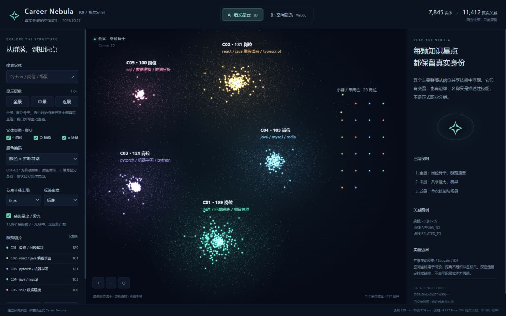
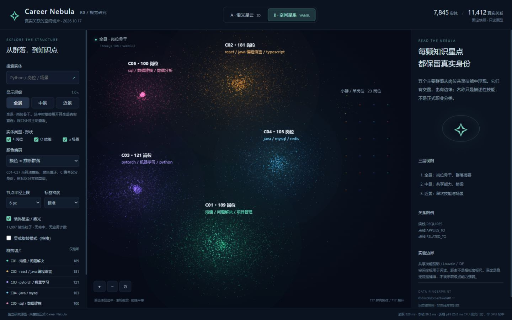
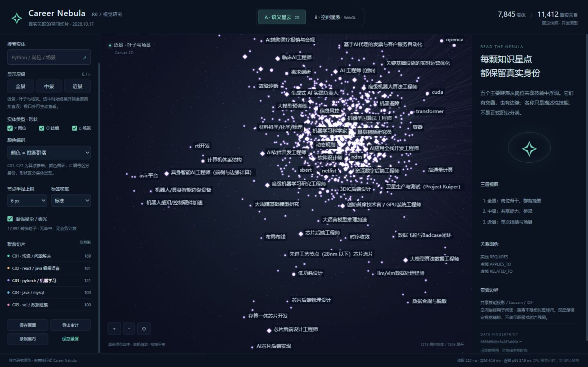
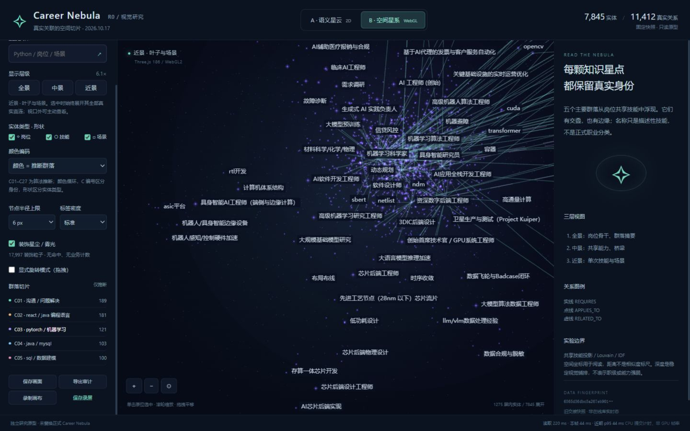
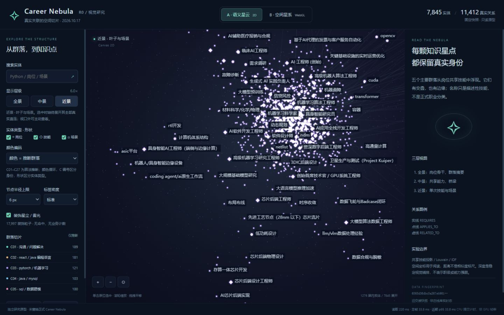
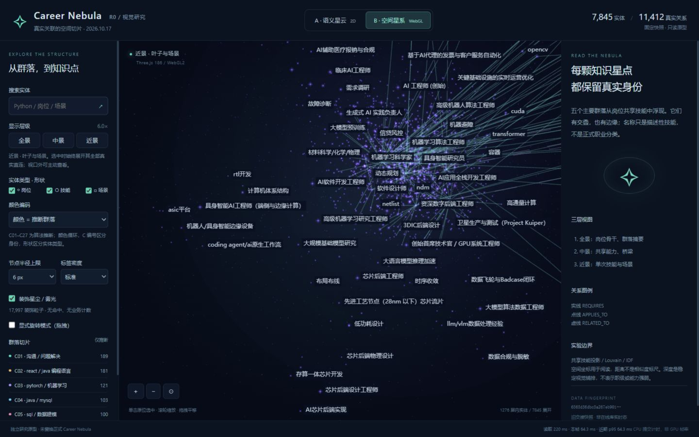
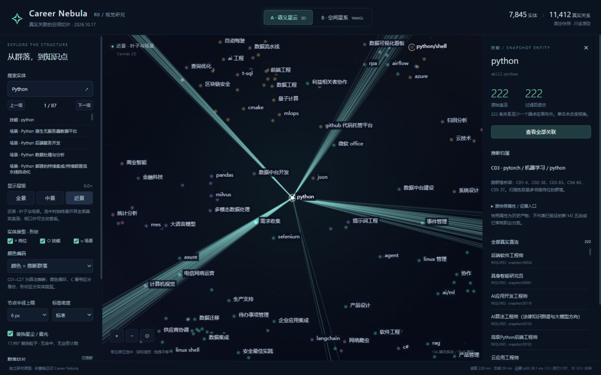
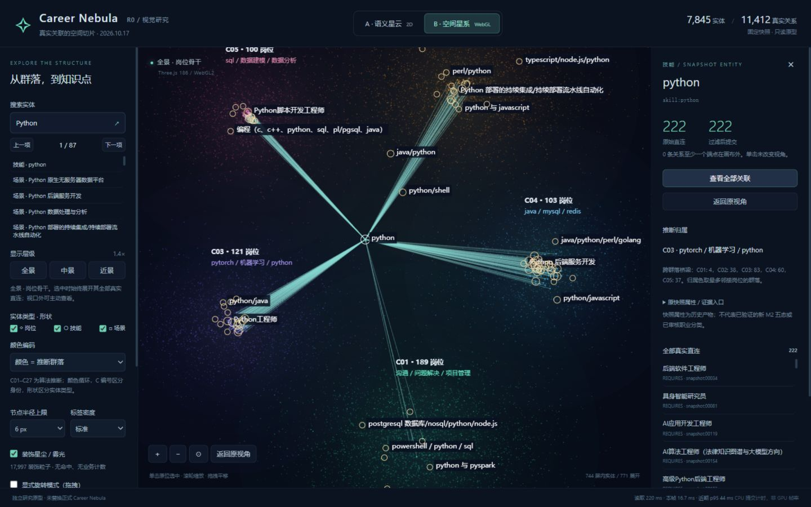

# Issue #24 · R0 真实群落分析与 A/B 视觉原型

2026-10-17，Asia/Singapore。状态：**研究原型待用户选路，非正式图谱集成**。原型从 PR #23 `abb73eb9c2b35819ba0ac870ed4cbd8dd5d91e7f` 建立独立 worktree/分支 `codex/issue-24-r0`；保留该 PR 的默认 legacy 与用户原工作区。没有修改正式图谱组件、后端接口、M2/M3 ID、DDL、Neo4j 或交接数据，没有启动采集/模型/导入/迁移/真实清理。

用户补充的两张本地参考图已实际查看：第一张多色团块、亮核和疏密层次；第二张青绿色雾光与局部深度。它们是用户提供的审美参考，**不是已实现截图**。未将原图复制入仓库。下面所有截图/视频来自本轮真实页面；美术效果仍待用户验收，当前也没有声称自然生成了参考图的螺旋臂。

## 1. 先看可运行对照

| A · 语义星云 | B · 空间星系 |
|---|---|
| [打开 A](http://127.0.0.1:18082/?route=a) | [打开 B](http://127.0.0.1:18082/?route=b) |
|  |  |
|  |  |
|  |  |
|  |  |
| [真实交互短录屏 WebM](issue-24-r0/a-interaction.webm) | [真实交互短录屏 WebM](issue-24-r0/b-interaction.webm) |

A/B 均为 Vue 3，同一页面壳、搜索、详情、类型过滤、像素规则、标签碰撞和中立空间数据；只切换 renderer。截图统一 1440×900，五群全览、C03 群落局部、6× 近景的相机参数分别完全一致，详见 [实测记录](issue-24-r0/observations.json)。视频录制实际画布交互（不含侧栏控件），未拼接概念图或伪造性能。

复现入口与命令见 [原型 README](../../frontend/prototypes/nebula-r0/README.md)。原型服务仅 127.0.0.1:18082，正式 18080 和 PR #23 的 18081 未替换。**本轮不决定 A/B 胜负，用户选择后再安排正式集成。**

## 2. 数据来源与真实性

- 唯一输入：`exchange/m3/graph.json`，原 metadata.version=`m2-full-2026-09-02`、exported_at=`2026-09-04T17:03:44.633296+00:00`。这是固定历史交接快照，不是线上库实时态，也不是 PR #21 新 ID 离线投影。
- 原文件 SHA-256：`6565d56dbc5a267eb90144f078c54f3d0c761c9a98ca29a18b4dc9c6cdde38e2`。协议内容/布局 SHA-256：`01b87cf3437ad200676f4e4d232170e321e2b7e3f28d223a81c0e9b70924d787`。
- Python 3.14.5 / NetworkX 3.7 / NumPy 2.5.4，固定 seed=24，resolution=1，所有身份、候选与输出确定排序。完整统计及参数见 [机器报告](issue-24-r0-analysis.json)。重复完整运行应得到相同 layoutSha256；耗时不是内容指纹的一部分。
- A/B 保留全部 **7845 原节点 + 11412 原关系**，原 properties 深度相等已与输入逐项比较。`edgeId=snapshot:排序序号` 是带快照指纹的原型定位键，反查 source/target/type，不冒称 Neo4j 内部关系 ID。详情可看原属性，[A 审计](issue-24-r0/a-audit.json)、[B 审计](issue-24-r0/b-audit.json)包含选中原节点、全部直连和视角。
- 计数重算自真实边，不使用可能过时的 job_count。例如 Python 属性保留历史 job_count=225，实际边度数为 **222**。原快照的技能碎片/旧 ID 碰撞属于已知数据限制，本轮不擅自规范化或修复事实。

## 3. R0-1：真实结构与群落比较

| 指标 | 结果 |
|---|---:|
| Job / Skill / Industry（场景） | 717 / 4671 / 2457 |
| REQUIRES / APPLIES_TO / RELATED_TO | 8866 / 2539 / 7 |
| 无向连通分量 / 最大分量 | 22 / 7614（97.1%） |
| 零度节点 | 0 |
| 按存储方向的强连通分量 | 7845，均单节点；方向图不适合用 SCC 表达职业群落 |
| 只连一个岗位的技能 | 3750 / 4671（80.3%） |
| 只连一个岗位的场景 | 2404 / 2457（97.8%） |
| 共享技能 / 技能投影无连接岗位 | 921 / 21 |
| 最大岗位度 / 最大技能度 / 最大场景度 | 96 / 222 / 8 |

技能度数详细分布：1→3750、2→425、3→170、4→79、5→50、其余197项度≥6。场景：1→2404、2→34、3→14、4→3、5→1、8→1。完整岗位直方图保留在机器报告。所有度均为无向去重邻接，原关系另完整保留。

最高频技能 python/sql/java/mysql/react 的岗位度为 222/104/74/70/56；五项贡献 **36543 / 65146 = 56.1%** 的“技能引起的岗位对共现次数”（允许同岗位对被多项技能重复贡献，**不是唯一投影边占比**）。约 78.4% 全图节点是单次技能/场景叶子，全量同权力布局容易把大量叶子变成均匀点云；“旧 RELATED_TO 只有7条”不能推断总知识关联只有7条。

比较图仅由 REQUIRES 二部关联导出，保留全部717岗位。投影包含共享至少一项技能的所有岗位对，共46807边，无阈值/TopK，不将推导的岗位相似边当作正式 RELATED_TO。普通 Jaccard 为交集数/并集数；IDF 版本对每技能用 `1+ln((718)/(df+1))`，用交/并集权重之比。分母包含单次技能；它们不创造投影边但影响相似度归一化。场景边和旧7条RELATED_TO仅在视觉/审计保留，不参与分群。

| 固定 resolution=1 | 普通 Jaccard | 稀有度 IDF 加权 |
|---|---:|---:|
| 社区总数 / 多岗位群数 | 26 / 5 | 27 / 6 |
| 多岗位群大小 | 182,176,158,102,78 | 189,181,121,103,100,2 |
| 单岗位群 | 21 | 21 |
| 各自加权图 modularity | 0.275421 | 0.314526 |
| 群内权重比例 | 53.60% | 53.18% |
| seed25 / seed26 对 seed24 的 ARI | 0.803 / 0.831 | 0.824 / 0.917 |
| 去最高频五项技能后重新划分 ARI | 0.436 | 0.580 |
| 跨社区技能数 | 592 | 551 |

ARI=1 表示分区相同，不是业务准确率。两种权重图的 modularity **不能直接当同一标尺比较优劣**；IDF 群内权重比例也未胜出。两方案分区间 ARI=0.749，有实质差异。resolution=.7 时 IDF 大群为362/226/106，1.3时变成173/99/86/85/82/77/62/30；社区数量不是唯一真值。R0 暂用 IDF 为 A/B 的共同输入，以便控制视觉变量，并未批准最终算法。IDF 缓解而未消除高频技能影响。

描述性摘要：C01 189岗位（沟通/问题解决/项目管理），C02 181（react/java 编程语言/typescript），C03 121（pytorch/机器学习/python），C04 103（java/mysql/redis），C05 100（sql/数据建模/数据分析），C06 2（z/os/CICS 等），另21单岗位群。词为群内出现比例×逆频率排序的原技能，**不是人工验证职业命名**。C01 主要由软技能连接，C02/C04 与 java 名称碎片有关；C03 也包含跨领域岗位，不能宣传为可靠职业分类。

## 4. R0-2 / R0-4：空间协议与呈现规则

`nodeId, type, communityId?(推断), communityMembership, xyz, importance, visibleLevel` 与原 properties 分层。岗位是群内 NetworkX spring；主要群落中心基于真实跨群投影权重的 `1+ln(1+sum(weight))` 用 spring 展开，避免原始强弱跨度把主群压成一核。≤2岗位的小群放右侧独立排版区，**即使存在跨群弱联系也不删边**。排版区不能解释为无真实关联。共享技能/场景取全部真实相连岗位的质心；所有原边仍能反查。

局部叶子槽位和稳定哈希深度只解决排版；z 不表示岗位级别、能力强弱或新的知识距离。没有螺旋臂拟合。若今后引入旋臂也只能是明确标注的视觉变换。

- 远景：岗位骨干、五主要群的真实岗位数与技能摘要，小群共23岗位单列；中景（相对1.6×）展开共享能力/场景；近景（3.5×）全部7845节点可绘制。隐藏是 LOD，不删除实体。
- 选中与搜索命中突破 LOD，完整直连不受900条普通边预算限制。普通边中景180、近景900；全景不铺普通关系。详情始终列原始全直连，类型过滤后提交数和离屏提示分开。
- 核心半径按 CSS 像素有上限5/6/8，默认6；场景点基础半径低于岗位，放大不继续膨胀。选中/悬停/搜索优先，标签先避让再绘制；完整名在详情，不承诺所有名字同时可见。
- 默认群落色、类型形状；另一编码为类型蓝/绿/紫。超过8群复用色但保留 C 编号，不能只靠颜色识别全27群。跨群共享节点保留所有 membership，主色按邻接岗位最多群落决定。
- **17997 装饰粒子**与雾光独立图层，确定性生成、无 ID/命中、不计7845节点，不衍生业务边。可以关掉；背景雾光颜色明确表示推断群落。

## 5. R0-3：实机交互与开销

本轮浏览器为 Codex IAB 的 Chromium，1440×900；非跨设备 GPU 基准。CPU 提交耗时来自真实7845/11412数据路径，未用小示例代替。

| 场景（已存相同相机） | A CPU ms | B CPU ms |
|---|---:|---:|
| 全景717实体 | 40.4 | 44.9 |
| C03 局部，全图7845展开，1275屏内 | 54.0 | 67.1 |
| 6×近景，1276屏内 | 56.5 | 112.8（切入B时明显顿挫） |

这是单次场景观察，热态与首次/切换成本不同，不能据此断言 B 更快。后续 B 全直连fit/返回观察约25.5/38.1ms；录屏期间 B 旋转最后提交约37.9ms。重拍页面初读样本220ms是开发服务/本机缓存情况，不是网络首次下载保证。离线完整分析/布局最终一次约6.24秒，浏览器直接加载预计算协议，没有把离线计算藏为“零布局成本”。按事件重绘、静止不持续刷新，尚无连续 FPS/GC/GPU 完成时间结论；CPU 逐帧投影与 BufferAttribute 重建保留为后续风险。

交互证据：

1. A/B 真实画布点选 Python，前后 `{k,x,y,yaw,pitch}` 完全相同；详情打开/关闭不改画布宽度。详见 observations 的 `*-real-canvas-click`。
2. Python近景原始/提交均222，222条至少一端在画布外；主动全部关联后提交222、离屏0。A/B均返回原参数；重复fit不覆盖第一次保存视角。
3. Python搜索87项，B实测按钮下一项与Shift+Enter反向恢复；普通测试验证精确项第一、全部身份保留。隐藏岗位类型：原始222/提交0，未伪造或删除关系。
4. B默认不旋转；显式勾选后真实拖拽得到yaw=.5、pitch=.25，依旧提交222条直连。旋转只是展示视角，切回A恢复正面。
5. A/B短视频由真实画布MediaRecorder录制并实际下载；导出审计实际下载并包含源指纹/原属性/关系。没有音频或桌面/麦克风采集。

## 6. 引擎与依赖选择

| 候选 | 本轮取舍 |
|---|---|
| Vue + Canvas + NetworkX离线布局（A） | 复用 Vue 和浏览器 Canvas，布局用成熟 NetworkX；不重写通用物理引擎。已有 G6 不适合只为一层固定坐标粒子追加一次图生命周期；本轮未再引入G6运行时。A知识核心更亮、更明确；首次近景仍顿挫。 |
| Vue + Three.js（B，已运行） | 同页面动态导入 Three 0.186.1，Points/BufferGeometry/ShaderMaterial，独立雾光/星尘、正交相机、显式旋转。没有引入React、WebGPU或Bloom后处理。柔和、细点多，但默认正面与A结构一致，旋转才显深度。 |
| 3d-force-graph（已研究，未做运行基准） | 集成Three与力布局/相机交互方便，但会引入第二套布局/命中/聚焦管理；R0已有确定空间协议和相机基线，收益有限。保留后续候选，不伪报对比性能。 |
| TresJS（已研究，未做运行基准） | 与Vue声明式场景契合；本轮只有固定Points/边三层，增加组件运行层及重写成本未必划算。未安装，不将文档研究当运行验收。 |

原型依赖隔离、精确锁定；Vue 3.5.13、Three 0.186.1、Vite 4.5.14 为 MIT；研究用 NetworkX 3.7 为 BSD-3-Clause、NumPy 2.5.4 为 BSD-3-Clause（发行包包含的第三方许可见各包LICENSE）。Three 动态chunk约746.94kB / gzip191.81kB，主JS约190.49kB / gzip73.14kB，CSS约7.70kB / gzip2.48kB，独立数据JSON约6.42MB另计；不是把全部前端强制换成3D。实际依赖入口与锁文件是复现依据。

技术来源：[NetworkX Louvain](https://networkx.org/documentation/stable/reference/algorithms/generated/networkx.algorithms.community.louvain.louvain_communities.html)、[Three WebGLRenderer](https://threejs.org/docs/pages/WebGLRenderer)、[Three Points](https://threejs.org/docs/pages/Points)、[3d-force-graph 官方仓库](https://github.com/vasturiano/3d-force-graph)、[TresJS 官方文档](https://docs.tresjs.org/)。Three当前WebGLRenderer要求WebGL2；缺失时原型提示并允许手动切A。未做 WebGL context loss 注入、Safari/Firefox/移动端矩阵测试，不承诺GPU驱动恢复。

## 7. 验证、异常与待用户决策

- Python研究检查5项通过（含两个不同PYTHONHASHSEED子进程的完整图确定性回归）；原型Node检查7项通过，覆盖原节点/边逐项保全、Python222直连/过滤、LOD7845、像素上限、装饰隔离/确定性、搜索、多端点fit与标签碰撞。正式前端PR #23基线39项通过，原型及正式前端构建均通过；chunk体积警告保留。
- 未运行数据库集成测试、未连正式数据库，无测试写库或生产夹具清理动作；不冒称已查询生产行数。内存夹具无文件残留。布局源快照SHA核查不变；用户原树未提交改动保留。
- 浏览器发现并修复原型详情初始响应依赖及侧栏撑高画布；完整重复运行另复现子图集合枚举导致坐标不稳定，新增跨进程失败回归后显式排序重建，5项检查通过；记录于[陷阱](../superpowers/traps/2026-10-17-r0-prototype-viewport-and-selection.md)。这些修复限本独立原型，不修改正式组件。
- 当前核心仍是五个团块，尚未达到参考图的连续银河盘/大尺度雾带；完整222直连呈扇形线束；近景普通标签会被碰撞省略，部分群语义混杂。无边束化、美术定稿、正式分类确认或性能达标宣称。
- 待用户选择：A的清晰二维骨干，或B的柔光/可旋转纵深；颜色=群落或类型、5/6/8px上限及标签密度均可现场比较。选择后再决定具体美术迭代与生产集成；PR #23与本原型均不自动合并、清理或替换正式图谱。
