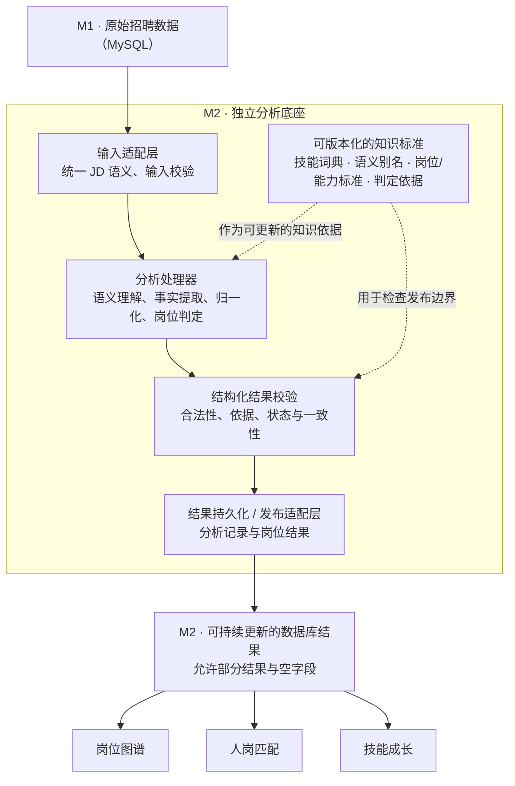

# M2 核心分析底座：需求、架构约束与待论证方向

> 日期：2026-10-27  
> 文档性质：产品需求与架构设计输入，供后续 Agent brainstorming。**不是实施方案、任务计划或开发授权。**  
> 当前状态：**核心架构原则已确认；知识组织方式偏向方案 B，但 B/C 尚未定案；技术路线与细部契约待设计。**

> 2026-10-28 后续确认：持续工作组合候选、受控自动化、中文适配、有限推断及三项最小职责组织，见 [产品决策 §3.11](../../PRODUCT_DECISIONS.md#311-新底座最小职责组织与候选管理2026-10-28)；技术组织与剩余取舍见 [最小架构设计草案](2026-10-28-m2-analysis-candidate-design.md)。本文保留原设计输入，上述事项按后续确认收窄，B/C 仍未选定。

## 1. 背景与目标

TalentMind 要解决的现实问题很直接：持续获取招聘岗位信息，将非标准化 JD 转换成可用的岗位与能力信息，帮助学生/求职者了解目标岗位需要什么技能、相关要求如何变化，也为人岗适配提供依据。

M2 是其中的核心分析底座：接收 M1 已采集并保存的招聘信息，理解其中的工作内容、能力要求与岗位归属，输出可供后续模块使用的结构化结果。系统规模以当前竞赛项目的实用性为准，**不以建设完整劳动力市场研究平台、职业本体或大型商业产品为目标**。

本轮重新设计不默认沿用原版“模型优先”管道，也不以新版持续补充硬编码规则作为长期唯一途径。现有系统的有效成果可以保留或复用，但**既有实现不构成新底座的技术路线前提**。

本设计聚焦 M2 需要具备的能力、边界与演进性；不指定模型、依赖、框架、算法、存储细节、开发步骤或验收执行方法。

## 2. 已确定的架构约束

以下是已确认的设计方向，后续方案必须遵守，而不是可选建议：

1. **结构化**：M2 不止输出一段自然语言总结；结果应能明确表达岗位、工作内容、能力要求及要求关系，并与原始依据关联。
2. **模块化**：语义分析、知识归一化、岗位构建、质量控制与结果发布具备清晰职责边界，内部组织可调整，不把某项算法或规则渗入所有环节。
3. **可拆卸与可替换**：内部模型、规则、检索方式和具体分析实现可替换；模块之间通过明确约定交换数据，不能以替换处理器为由强制改造所有下游模块。
4. **独立运行**：M2 可以在给定合法 JD 输入和必要知识标准时独立分析，不以 M3 图谱、前端页面或其他模块的运行作为分析前提。
5. **固定对外输入输出契约**：明确且版本化的外部输入和输出语义应保持稳定；内部处理流程可以改变。确需不兼容演进时应显式升级契约，不默默改变字段含义。
6. **与现有主线保持松耦合**：M1 负责采集和保存原始 JD，M2 读取原始数据并产生分析结果；M2 结果应能够持久化供后续模块消费。未能确定的字段允许为空/待决，但不得将“未识别”“未提及”“分析失败”混为同一结果。M2 不直接依赖其他模块的内部实现。
7. **证据与事实边界**：原始 JD 事实不能被岗位归类或聚合结果回写改造；候选判断、不确定判断、确认结果应可区分。单条 JD 的要求不自动等于整个岗位的统一要求。

此处“固定契约”确定的是接口边界与兼容性原则，**并非已批准任何具体 API、表结构、字段列表或 JSON Schema**。旧管道使用的工作流、SQLite 中间层和硬编码规则只是历史/现有实现，不自动成为新架构强制组件。

## 3. 架构概念（参考呈现图）

基本构想：**契约驱动、知识标准可更新的岗位分析引擎**。

概念上分为三个相互配合但不混同的部分：

- **分析引擎**：理解 JD，识别工作内容、技能/能力要求及其关系，并给出相应判断。
- **知识标准**：维护可演进的技能词典、语义别名、岗位能力表示、岗位定义及相关判定依据。
- **岗位构建与结果发布**：组织单条事实与岗位关联，生成面向其他模块的稳定结构化结果，同时保留不确定和来源边界。

下图只表达依赖关系与职责分离；**不规定必须按框的顺序串行执行，也不代表微服务划分或已选定处理算法**。

图示中的“分析处理器”只是逻辑容器，内部可按实际需要划分职责。知识标准不应被固化为分析器源码中的一长串规则，也不能因采用可更新目录就要求一定引入独立知识图谱或其他重型平台。

## 4. M2 必须具备的四项基本能力

| 能力 | 需要回答的问题 | 预期的能力边界 |
| --- | --- | --- |
| **语义分析** | 这条 JD 描述了哪些工作内容？有哪些技能/能力与任职要求？条件、任选、优先、否定等关系是什么？ | 可输出部分事实、未知表达与不确定关系，不必先知道完整标准岗位名称。 |
| **知识归一化** | 不同表达是否指向同一能力？已知技能如何对应标准概念？未知表达如何保留？ | 知识版本与处理器解耦；不能仅凭字符串或向量相似就把不同技能强行合并。 |
| **岗位判定与构建** | JD 与已有岗位怎样关联？多条 JD 所反映的工作内容和能力要求如何构成岗位画像？何时需要提出新岗位候选？ | 标题、职责、能力共同提供依据；不能强制每条 JD 归入现有岗位，聚合不能改写单条事实。 |
| **质量控制与发布** | 哪些结论有足够依据？哪些只是候选或未决？哪些结果能够稳定提供给下游？ | 明确区分机器判断、证据有效性与正式知识状态；结构通过不等于语义正确。 |

以上是**四项基本能力**，不代表四个独立服务、四个强制执行阶段或四类必须选用的模型。某一能力无法给出结论时，不应使其他可独立成立的事实丢失。

### 4.1 必须保留的语义区别

- 技能或能力的“明确要求、加分优先、仅提及、明确不要求、待判断”不能压成简单的有/无；**未提及不等于明确不要求**。
- “Python 或 Java 至少一种”是组合要求，不意味着两者分别必备；对条件、否定、程度和复杂组合的表达不能因结构化而改变原意。
- 工作任务、技能/能力、学历年限等任职条件、行业场景不是同一种对象；不要求当前就建完整分类本体，但不能全部混为“技能列表”。
- 候选技能、候选岗位、不确定事实和正式确认的知识必须能够区分。必要的来源与原文证据应被保留。
- **单条 JD 分析事实与跨 JD 岗位画像应可区分**；岗位画像发生变化不自动证明某家公司的原始要求发生变化。

这些是语义正确性边界，不预先决定应由规则、模型还是其他方法来实现。

## 5. 核心目标：能力可更新，而不只是算法可替换

“可更新”至少包含三个不同层次，不可简单等同于替换 LLM 或重写处理器。

| 层次 | 更新对象 | 应体现出的能力 |
| --- | --- | --- |
| **知识更新** | 技能词典、概念定义、别名、未知技能候选等 | 新技能出现时，可以被发现、保留和纳入管理；目录更新不要求反复修改硬编码识别规则。 |
| **标准更新** | 岗位能力表示、岗位定义、能力归属与相关判定标准 | 旧标准可以迭代为新版本；相关判断能基于新的标准重新解释或重新构建。 |
| **分析能力更新** | 文本理解、实体发现、关系判断、匹配与归类方式 | 当现有能力不足时，可替换或改进处理方式，同时保持外部契约稳定。 |

### 5.1 新知识发现与正式收录分离

一个典型场景：当前词典认识 Python，却不认识新出现的工具/技术名称。M2 不应因词典没有该项就直接丢弃原文，也不应把所有陌生术语自动宣布为正式技能。

期待的产品行为是：**发现未知表达 → 保留语义和证据 → 形成可管理的候选 → 经明确的确认机制纳入知识标准**。确认方式、自动准入条件与审核责任尚未决定，不在本文规定。

新增技能、调整别名或更新岗位标准时，理想上能够复用仍然有效的分析事实，而不是强制从零重复所有文本理解；当旧事实不充分时，也允许重新分析。如何判断影响范围与复用资格，由后续技术方案设计。

### 5.2 版本与历史事实不混淆

至少应能区分：**原始输入发生变化、知识标准发生变化、分析器能力发生变化、岗位画像重新构建**。这些变化可能产生不同结果，但不应把一次算法/知识更新误报为“招聘市场在那一天新增了技能需求”。

这里确定的是可追溯与可管理的原则，不指定版本号格式、具体存储模式、失效算法、权限系统或管理界面。

### 5.3 避免两个极端

- **不是长期靠人工不断补规则**：人工参与应主要用于知识与边界的确认、纠偏和评价，而非每遇到新表达就必须开发一条新硬编码条件。
- **也不是让生成模型拥有最终裁决权**：模型输出须服从结构、证据、标准状态等约束；未知、冲突、无法判定都应有合法表达。

因此，未来可研究适合的模型、检索、规则与学习方法，但本文**不预选“规则优先”“模型优先”或固定混合比例**。

## 6. 岗位知识如何组织：方案 B 更贴合需求，但尚未定案

### 6.1 方案 B：以工作内容与能力要求为中心，再构建岗位（当前优先探索）

不把“先给每条 JD 一个标准岗位名”作为提取事实的必要前提：

1. 先理解 JD 中实际需要做的工作以及能力/任职要求；
2. 保留这些内容及其关系，使其不依赖即时成功的岗位命名；
3. 再依据标题、职责与能力组合，研究该 JD 与已有岗位的关系；
4. 当出现既有岗位定义难以解释的**工作内容与能力要求的组合聚集**时，允许提出待确认的新岗位候选；之后再研究其归属和命名。

这里有一个**待检验的设计假设**：新岗位往往是因为市场先形成新的工作内容和能力要求组合，原有岗位定义难以充分解释，随后才逐渐形成被认可的岗位称谓。它用于指导候选发现设计，**不是已验证的普遍职业演化定律**。

例如：一些 JD 都包含“设计智能体工作流、连接外部工具、管理多步骤任务”等职责及相近能力要求，但职位名称分别写为 AI 应用工程师、后端工程师、智能体开发工程师。M2 不宜单靠标题切分，也不能只因为看到一个陌生技能就宣称出现了新岗位。

“组合聚集”需有可检查的实际证据与一定重复性；**聚集依据、相似度边界、与已有岗位的区别、新岗位准入条件、正式命名方式均待研究**。在没有确定标准时，保留“未归类/候选”的合法状态，不能强行命名或发布。

### 6.2 方案 B 的严格体量边界（必须重点研究）

B 的价值在于**事实先于岗位命名**，不等于必须建立庞大任务本体。为了适应 TalentMind 的实际规模，方案设计应尽量只维护必要的数据：

- **原始 JD 及可定位依据**；
- **工作内容的简洁表达**：允许保存具备证据的任务/职责片段，不预设所有片段都要人工赋予全球唯一任务概念 ID；
- **规范化的技能与能力要求**：已有标准概念、未知候选及关键要求关系；
- **岗位关联或未归类状态**：在必要时建立与岗位画像的关联，并允许将无法解释的组合保留为待研究候选。

不要求一开始就建设完整职业—任务—技能本体、所有任务的分层目录、全球任务唯一编号、大规模相似任务图谱或专业劳动力市场分析体系。是否还可以**进一步压缩 B 的对象种类、持久化粒度与维护成本**，交由 brainstorming 给出有依据的最小设计。

### 6.3 方案 C：内部保留轻量事实，对外保持岗位中心（仍是合理备选）

C 的取舍是：内部保留 JD 事实、关键职责片段和能力要求，允许岗位归类后置；对外主要提供规范岗位及岗位能力画像。不建立完整任务本体，以保持当前产品接口简单。

C 与轻量化 B 看起来接近，但仍有一项需要澄清的本质差别：**工作任务/能力组合在系统内究竟是可独立演进、可聚集发现的知识主体，还是仅作为构建岗位画像的一组中间证据？**

若任务/能力组合只是岗位画像的附属输入，系统可能仍难以独立发现没有合适名称的新型工作组合；若完全将其提升为独立本体，又会带来过重的治理和实现成本。这一取舍**尚未由负责人决定**。

### 6.4 当前结论与禁止提前决定事项

- **明确倾向：B 的知识组织思路更符合目标**，尤其是“新能力要求组合先出现、岗位定义后形成”的研究方向。
- **明确保留：C 是有价值的轻量化备选**，不是被否定的方案。
- **未决：B 的最小形态、B 与 C 的边界、聚集对象与粒度、岗位候选形成条件、正式岗位的定义/命名原则**。
- 不因文档中称某方案“优先探索”就视为其已获实施批准；不要以该假设自行创建大量目录、表或独立服务。

## 7. 对外结果的概念约束（不是具体契约设计）

无论最终选择 B 或 C，外部至少需要稳定表达：

- **输入身份与依据**：来源 JD、实际提供的文本及其输入身份；
- **分析得到的内容**：岗位/职责信息、技能与能力要求、关键约束关系，允许未识别、未归类和部分结果；
- **判断状态**：明确事实、候选、未决及失败状态分开；
- **知识与分析版本关联**：能理解结果是基于什么标准和分析能力产生；
- **岗位输出**：面向下游可用的岗位能力画像，与单条 JD 事实有清楚区分。

具体输入输出字段、数据类型、数据库结构、历史表、是否独立保存任务实体与发布规则，均留待下一轮架构设计；不得将本章当作已经批准的 API/DDL。

## 8. 留给后续 Agent brainstorming 的设计问题

请以**实现现实痛点、控制体量、维持长期可更新能力**为判断标准提出方案，而不是直接生成代码或施工计划：

1. **轻量化 B 能缩到什么程度？** 在不建立完整任务本体的情况下，最少需要哪些概念，才能让“没有定义的工作与能力要求组合”被发现、比较、保留与构建为岗位候选？
2. **B 与 C 的关键取舍是什么？** 两者是否能统一成一种更简单的数据组织方式？分别会损失哪些必要能力？不要为了命名上的区别强行增加模块。
3. **“能力要求的聚集”如何定义才有产品意义？** 怎样避免把同一岗位的技术栈差异、暂时热词、单条特殊 JD 当成新岗位？尚无证据时如何表达？
4. **知识和标准如何更新而不退回手写规则？** 哪些判断应属于可管理的标准，哪些属于分析器能力；概念更新后如何保持历史解释合理？
5. **如何让独立模块与稳定对外结果保持轻量？** 哪些契约是必须稳定的；哪些内部组件可以合并；哪些能力可以推迟而不影响核心问题的解决？

期待交付的是**比较清晰的候选架构、权衡和待负责人裁决的问题**，而不是未授权的执行步骤、技术栈定案、表结构迁移、正式数据操作或实现承诺。

## 9. 与当前仓库及历史设计的关系

- 本文是**新一轮 M2 底座设计输入**，并非声明现有 B1/B2/B2.2/B3 流程已被实现替换。
- 已确认的事实保全、技能要求语义、证据追溯、候选/正式区分、跨 JD 聚合不改写原始事实等保护原则继续有效。
- 旧版“模型优先”或现版“离线确定性规则优先”的**阶段实现选择，不自动约束新底座的技术路线**。尤其不能仅引用旧阶段的技术限定，就将本次重新设计排除在外。
- 正式写库、生产契约变更、数据库迁移、旧数据处理等**均未在本轮获得执行授权**；本文件只用于讨论和设计，不改变当前仓库已有安全边界。
